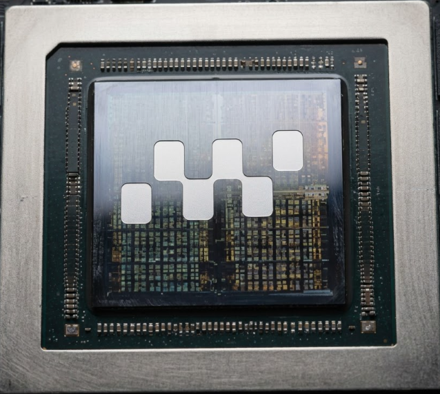

<div align="center">

<a href="https://www.horoslab.org/">
  
</a>

# HOROS Lab

### Frontier AI Research & Physical Intelligence Infrastructure

[](https://www.horoslab.org/)
[](https://www.horoslab.org/sign-up)
[](https://cal.com/vegito)
[](LICENSE)
[](https://github.com/Sunilkumarchavhan9/horoslab)

<p align="center">
  <b>High-throughput model endpoints, autonomous post-training loops, and physical AI compute.</b><br>
  Deploy verified inference kernels, run autonomous research missions, and simulate contact-rich humanoid robotics.
</p>

<p align="center">
  <a href="https://www.horoslab.org/"><b>Explore Website</b></a> •
  <a href="https://www.horoslab.org/pricing"><b>Pricing & Cohorts</b></a> •
  <a href="https://www.horoslab.org/sign-up"><b>Sign Up</b></a> •
  <a href="https://cal.com/vegito"><b>Book Demo</b></a> •
  <a href="./research/PROBE-1"><b>Research Dossier</b></a>
</p>

---

</div>

<p align="center">
  
</p>

## 🌐 The HOROS Platform

HOROS is an end-to-end foundation research and physical AI infrastructure platform bridging frontier model inference, autonomous post-training loops, and real-world contact-rich physical dynamics.

```
┌─────────────────────────────────────────────────────────────────────────────────────────┐
│                                   HOROS INFRASTRUCTURE                                  │
├───────────────────────────┬─────────────────────────────┬───────────────────────────────┤
│ ⚡ Track 1: Model APIs    │ 🔬 Track 2: Autonomous Lab  │ 🤖 Track 3: Physical AI       │
├───────────────────────────┼─────────────────────────────┼───────────────────────────────┤
│ • Pay-per-token inference │ • SFT / DPO / GRPO / RFT    │ • PROBE-1: Humanoid Robotics  │
│ • vLLM, SGLang, TRT-LLM   │ • 15-point benchmark harness│ • AEROPROBE-1: CFD Surrogate  │
│ • State & prefix caching  │ • Causal experiment engine  │ • Certified p-CBF runtime safe│
│ • Up to 90% cache discount│ • Trajectory episode stores │ • Dedicated bare-metal H100s  │
└───────────────────────────┴─────────────────────────────┴───────────────────────────────┘
```

---

## 🔬 Track 2: Autonomous Lab Cohorts & Compute Pricing

Predictable monthly plans with dedicated compute credits, autonomous post-training runners, and priority GPU cluster allocation.

| Plan | Pricing | Included Compute | Capabilities & Features | Action |
| :--- | :--- | :--- | :--- | :--- |
| **Lab Explorer**<br>`[RESEARCH]` | **$190** / mo | **$100** compute credits | • 5 concurrent research missions<br>• LoRA & SFT task adaptation engine<br>• 15-point benchmark harness<br>• Trajectory store for 1,000 episodes | [**Apply for Explorer Cohort >**](https://cal.com/vegito?tier=explorer) |
| **Frontier Lab Pro**<br>`[RECOMMENDED FOR LABS]` | **$690** / mo | **$450** compute credits | • Unlimited autonomous research missions<br>• Full Post-Training: SFT, DPO, GRPO & RFT<br>• Causal Experiment Engine & failure mining<br>• RL Environment Factory with rollouts<br>• Priority allocation on H100 SXM5 nodes | [**Apply for Pro Lab Cohort >**](https://cal.com/vegito?tier=pro) |
| **Cluster Team**<br>`[SCALE]` | **$1,950** / mo | **$1,500** compute credits | • Distributed rollout & trainer worker pools<br>• Teaching-Data Admission Gate & contamination check<br>• Multi-node benchmarking & cold-start profiling<br>• Full team RBAC & workspace isolation | [**Apply for Cluster Team >**](https://cal.com/vegito?tier=cluster) |

> 💡 **Developer Onboarding:** Direct signup and API token generation are available at [**horoslab.org/sign-up**](https://www.horoslab.org/sign-up). Founder architecture sessions can be booked directly via [**cal.com/vegito**](https://cal.com/vegito).

---

## 🤖 Track 3: Physical Intelligence & Dedicated GPU Infrastructure

```
┌─────────────────────────────────────────────────────────────────────────────────────────┐
│ ■ FIRST-PARTY MODEL PROGRAMS & INDUSTRIAL COHORTS                                       │
│                                                                                         │
│ Physical Intelligence & Dedicated GPU Infrastructure                                    │
│ Deploy dedicated bare-metal H100/H200 clusters with certified p-CBF safety and private   │
│ weights for robotics, aerospace, and defense facilities.                                │
│                                                      [ Apply for Dedicated Cohort -> ]  │
├────────────────────────────────────────────┬────────────────────────────────────────────┤
│ PROGRAM 01           [ HUMANOID ROBOTICS ] │ PROGRAM 02         [ AEROSPACE ENGINEERING ] │
│                                            │                                            │
│ HOROS PROBE-1 Tactile & Contact Policy     │ HOROS AEROPROBE-1 Fluid & CFD Surrogate    │
│ Multifingered hand manipulation,           │ Aerodynamic pressure and velocity field    │
│ nonstationary contact states, and          │ surrogate models with inverse parameter    │
│ predictive Control Barrier Functions       │ estimation calibrated against wind tunnel   │
│ (0.0% drops/crushes).                      │ and OpenFOAM data.                         │
│                                            │                                            │
│ • Hardware-in-the-Loop                     │ • Mach/Reynolds Inputs                     │
│ • MuJoCo & Isaac Sim                       │ • Mesh Conditioning                        │
│ • ROS2 Telemetry                           │ • Inverse Solvers                          │
└────────────────────────────────────────────┴────────────────────────────────────────────┘
```

<p align="center">
  
</p>

### 1. HOROS PROBE-1 — Research-001: Uncertainty-Aware Safe Adaptation
- **Paper:** *Uncertainty-Aware Safe Adaptation for Multifingered Grasping* ([PDF Download](./research/PROBE-1/HOROS_PROBE-1_Research_Paper.pdf))
- **Key Breakthrough:** First multifingered grasp controller integrating deep generative flow policies with certified Predictive Control Barrier Functions (p-CBF), achieving **0.0% crush and drop violations** under dynamic friction shifts.

### 2. HOROS PROBE-1 — Research-002: Trustworthy Contact World Models
- **Focus:** *Contact-Mode-Stratified, Planner-Selection-Aware Conformal Dynamics (CMS-PSACD)*
- **Problem Statement:** Standard world models appear accurate on passive datasets, but optimizing planners (CEM/MPPI) systematically exploit model blindspots at contact-mode transitions (*the optimizer's curse*).
- **Core Components:**
  - **7-Mode Hybrid Contact Manifold:** $\Sigma \in \{\text{Free}, \text{FirstContact}, \text{Sticking}, \text{Sliding}, \text{Impact}, \text{Jamming}, \text{Release}\}$
  - **Multi-Horizon Conformal Quantile Engine:** $\mathbf{Q} \in \mathbb{R}^{7 \times 5}$ across $H \in \{1, 3, 5, 10, 20\}$
  - **Planner-Selection-Aware Calibration:** CAP selection correction
  - **Active Contact-Mode Mining (ACMM):** Targeted at Coulomb cone boundaries
  - **Independent p-CBF Runtime Safety Filter:** Zero observed safety violations

---

## ⚡ Track 1: Compute & Frontier Model APIs

Pay only for generated model tokens with zero idle capacity fees. All endpoints offer native OpenAI and Anthropic API compatibility, prefix caching, and session-aware routing.

<p align="center">
  
</p>

### Supported Model Endpoints

| Model | Developer | Input / 1M Tokens | Cached Input / 1M | Output / 1M Tokens | Capabilities |
| :--- | :--- | :--- | :--- | :--- | :--- |
| **HOROS PROBE-1** | HOROS Lab | **$0.30** | **$0.03** *(98.2% hit)* | **$1.20** | Multifingered contact policy, p-CBF safety |
| **HOROS AEROPROBE-1** | HOROS Lab | **$0.40** | **$0.04** *(96.5% hit)* | **$1.60** | Navier-Stokes latent CFD surrogate (>200 FPS) |
| **DeepSeek V4.1 Flash 1017** | DeepSeek | **$0.15** | **$0.01** *(99.5% hit)* | **$0.60** | Reasoning, tool-use, code synthesis |
| **GLM 5.3** | Z.ai | **$1.30** | **$0.13** *(99.1% hit)* | **$4.20** | High-parameter frontier reasoning |
| **GLM 5.3 Flash** | Z.ai | **$0.11** | **$0.03** *(99.3% hit)* | **$0.45** | Sub-100ms low-latency chat completion |
| **Nemotron 3.5 Lightning 30B**| NVIDIA | **$0.05** | **$0.01** | **$0.15** | High-efficiency instruction alignment |
| **Qwen3.8 27B** | Alibaba | **$0.10** | **$0.01** *(95.7% hit)* | **$0.40** | Multimodal comprehension & agentic tool use |
| **Ornith 1.5 35B** | Ornith | **$0.10** | **$0.01** *(94.3% hit)* | **$0.40** | Agentic workflows & code planning |
| **DeepSeek V4.1 Flash** | DeepSeek | **$0.14** | **$0.03** *(98.8% hit)* | **$0.58** | Fast production agent loops |

### Quickstart: Calling the API

```python
from openai import OpenAI

client = OpenAI(
    base_url="https://api.horoslab.org/v1",
    api_key="horos_live_xxxxxxxxxxxxxxxx"
)

# Call first-party HOROS physical policy or frontier reasoning models
response = client.chat.completions.create(
    model="probe-1-robotics",
    messages=[
        {"role": "system", "content": "You are HOROS PROBE-1 executing contact impedance control."},
        {"role": "user", "content": "Plan a compliant peg insertion trajectory under 0.2mm clearance."}
    ],
    temperature=0.2
)

print(response.choices[0].message.content)
```

---

## 🛠️ Repository Structure

```
horoslab/
├── assets/                     # Platform logos, visual banners & architecture figures
├── memoryos-frontend/          # Production Next.js 16 Web Application (www.horoslab.org)
│   ├── app/                    # App Router pages (pricing, sign-up, console, docs)
│   ├── components/             # HOROS design system, brand primitives & UI blocks
│   └── public/                 # Static assets, PDFs, and documentation media
├── research/
│   ├── PROBE-1/                # Humanoid Robotics Foundation Research
│   │   ├── 00-20 dossiers/    # Research-001 scientific dossiers & submission files
│   │   ├── Research-002/       # CMS-PSACD World Model Research Suite
│   │   │   ├── src/            # Hybrid models, conformal engines, p-CBF safety
│   │   │   ├── tests/          # Passing unit & integration test suites
│   │   │   └── experiments/    # Stress test runners & calibration reports
│   │   └── HOROS_PROBE-1_Research_Paper.pdf
│   └── AEROPROBE-1/            # Aerospace CFD Latent Neural Operator Research
└── src/                        # Core backend service APIs and agents
```

---

## 🚀 Running the Web Application Locally

```bash
# Clone the repository
git clone https://github.com/Sunilkumarchavhan9/horoslab.git
cd horoslab/memoryos-frontend

# Install dependencies via Bun or npm
bun install

# Start development server
bun dev
```

Visit [`http://localhost:3000`](http://localhost:3000) to inspect the HOROS landing page, pricing matrix, and interactive developer console.

---

## 🧪 Running the Research-002 Test Suite

```bash
# Run unit & integration tests for Seven-Mode Model and Conformal Engine
python -m unittest discover -s research/PROBE-1/Research-002/tests -p "test_*.py"

# Run Multi-Horizon Conformal Calibration Benchmark
python research/PROBE-1/Research-002/experiments/calibration/run_calibration_experiment.py
```

---

## 🤝 Enterprise Cohorts & Dedicated Infrastructure

HOROS partners with frontier robotics laboratories, aerospace facilities, and enterprise AI teams requiring dedicated compute:

- **Private Bare-Metal H100 / H200 Clusters:** Isolated InfiniBand fabrics with sub-millisecond telemetry.
- **Air-Gapped & Private VPC Deployments:** Zero data retention and custom SLA guarantees (up to 99.99%).
- **Founding Lab Cohort:** Direct access to research weights and automated continuous post-training harnesses.

👉 [**Book an Architecture Call with our Founders**](https://cal.com/vegito) or email [**contact@horoslab.org**](mailto:chavhansunilkumar753@gmail.com).

---

<div align="center">

**HOROS Lab** — *Advancing Frontier Physical AI & Autonomous Research Infrastructure*

© 2026 HOROS Lab. All rights reserved.

</div>
