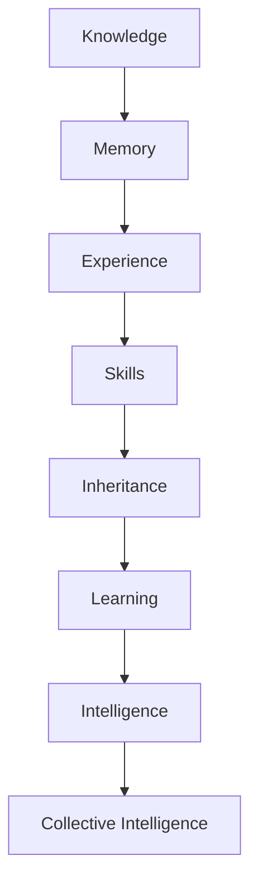

# MemoryOS — Product Phase Vision & What We Built

**Phases 1–6** (including **3.5** and **4.5**): engineering continuity through Company Brain, Experience-to-Skills, inheritance, agent harness, and organizational learning (build-mapped below). **Phase 7+:** generational extended vision for humans, agents, robots, and machines (narrative + honest status; not in repo yet).

**Last mapped:** 2026-06-09  
**Sources:** Founder phase narrative (Jun 2026), founder execution plan (Jun 9 2026), `docs/COMPANY_BRAIN_CORE_PRODUCT.md`, `docs/EXECUTION_PLAN_LOCK.md`, `docs/COMPANY_BRAIN_P0_P1_P2_BACKLOG.md`, `docs/startup-execution-status.md`, and repo inspection of `lib/`, `server/`, `memoryos-frontend/`, `packages/mcp-server/`.

**Status legend:** **Built** · **Partial** · **Planned** · **Not started**

---

## Product vision (founder narrative)

### Phase 1 (Now): Engineering Continuity

**Goal:** Never explain your codebase twice.

This is where MemoryOS is today.

**Customer**

- Startups
- AI-native companies
- Engineering teams

**Problem**

- AI agents forget
- Engineers lose context
- Onboarding is slow
- Knowledge scattered across tools

**Build**

**MemoryOS:**

- GitHub ingestion
- Slack ingestion
- Jira ingestion
- Memory contracts
- Resume API
- Handoff API
- MCP server

**Continuity Lab:**

- Resume work
- Continue tasks
- Agent memory
- Human-agent collaboration

**Outcome**

> Never explain your codebase twice.

**Success metric:** 10 engineering teams using MemoryOS weekly.

This gets adoption. Do not broaden beyond engineering until this loop is repeatable.

---

### Phase 2: Company Brain

**Goal:** Turn scattered company knowledge into structured memory.

Once teams trust MemoryOS, deepen the memory graph instead of adding more control surfaces.

**Add**

**Decision Memory** — store:

- Decision
- Why decisions were made
- Who made them
- Alternatives considered

**Incident Memory** — store:

- Root cause
- Fix
- Lessons learned

**Architecture Memory** — store:

- ADRs
- Tradeoffs
- Constraints

**Process Memory** — store:

- Deploy workflows
- Escalation workflows
- Onboarding workflows
- Support workflows

Now you become: **Company Brain**.

This is the first real moat: structured company memory, not another chat surface.

---

### Phase 3: Experience to Skills

This is where most competitors stop.

Current simple roadmap:

```
Memory
  ↓
Skills
```

Sharper roadmap:

```
Memory
  ↓
Experience
  ↓
Skills
```

Build a **Skill Compiler**.

**Example:**

```
Agent solves bug
        ↓
Capture problem, context, actions, outcome
        ↓
Generate debugging skill
        ↓
Future agents inherit the skill
```

Repeat for:

- PR review
- Incident response
- Refactoring
- Support
-engeers chats
-team plans 
-plan teams etc 

Company experience becomes reusable execution knowledge. This is where MemoryOS becomes special.

---

### Phase 3.5: Inheritance Layer

**Goal:** Turn company experience into inherited capabilities.

**Flow:**

```
Company Knowledge
  ↓
Company Brain
  ↓
Experience
  ↓
Skill Compiler
  ↓
Inheritance
```

Future agents inherit skills.

Future humans inherit skills.

New employees, agents, and teams start from accumulated experience instead of starting from zero.

**Example:**

```
100 auth incidents
        ↓
Auth Debugging Skill
        ↓
Future agents automatically use it
        ↓
Future engineers learn from it
```

This is one of the most unique parts of the roadmap. It turns MemoryOS from a memory product into an organizational intelligence and inheritance system.

---

### Phase 4: Agent Operating System

Now every agent connects to MemoryOS.

Not just coding agents.

**Start with Engineering and ai companies and robotos only .** Expand later to support and operations when the engineering loop has design-partner proof.

**Future agents:** Engineering · Support · Operations

Every agent shares:

- Memory
- Skills
- Experience
- Context

The product becomes an operating system for reliable agents, but only after engineering continuity is working weekly.

---

### Phase 4.5: Agent Infrastructure & Harness Layer

This is the infrastructure that allows thousands of agents to reliably operate inside companies. It fits naturally into MemoryOS because we're already building MCP, Resume APIs, Handoff APIs, and Continuity Lab.

**Build areas**

1. **Agent Identity** — unique agent ID, memory ownership, permissions, audit trail, skill profile, experience history, trust score, evaluation metrics
2. **Agent Runtime** — lifecycle, state, context windows, memory injection, session continuity
3. **Agent Evaluation** — task success rate, handoff success rate, context retrieval quality, cost per task, reliability
4. **Agent Orchestration** — planner, research, coding, review, support agents
5. **Tool Infrastructure** — safe execution for GitHub, Slack, Jira, databases, internal APIs, Kubernetes, CI/CD
6. **Governance Layer** — Agent → Propose → Review → Approve → Execute → Learn

Agent Identity is not a separate company and not a separate phase. Identity is generated from:

```
Experience
  +
Skills
  +
Outcomes
  +
Permissions
```

**Outcome**

> MemoryOS becomes the infrastructure layer that powers reliable AI agents inside companies — not just memory/retrieval/MCP, but the complete harness for agents to safely operate on company systems.

---

### Phase 5: Organizational Learning

Now every action teaches the company.

**Flywheel:**

```
Human
  ↓
Agent
  ↓
Action
  ↓
Outcome
  ↓
Memory
  ↓
Experience
  ↓
Skill
  ↓
Future human and agent
```

This is where the company literally gets smarter.

This is where the flywheel begins.

---

### Phase 6: Organizational Intelligence Network

Very carefully.

Only after real customers.

Companies contribute **patterns, not data**.

**Example:**

```
1000 incidents
        ↓
Anonymized pattern
        ↓
Recommendation
```

No raw customer data. No private code. No customer-specific memory.

Companies benefit from collective learning without exposing their data.

---

### What humans need

Humans don't need another chatbot. Humans need:

| Need | Meaning |
|------|---------|
| **Memory** | Remember what happened |
| **Context** | Know why it happened |
| **Continuity** | Resume work instantly |
| **Learning** | Get smarter from experience |
| **Trust** | Know where knowledge came from |

MemoryOS should provide all five.

---

### What AI agents need

| Need | Role |
|------|------|
| **Identity** | Who am I? |
| **Memory** | What do I know? |
| **Skills** | What can I do? |
| **Context** | What's happening now? |
| **Learning** | What should I remember? |

MemoryOS becomes that layer.

---

### What companies need

Companies don't buy AI. Companies buy outcomes:

- Faster onboarding
- Fewer repeated mistakes
- Faster engineering
- Better support
- Knowledge retention
- More effective AI

MemoryOS should always tie back to those outcomes.

---

## Extended vision: Phases 7–15 and beyond

Phases 1–6 (including **3.5** and **4.5**) win the **company** wedge: engineering continuity → Company Brain → Experience → Skills → Inheritance → agent OS → **agent harness** → organizational learning → careful pattern-only intelligence network. Phases 7–15 describe where MemoryOS goes if it becomes a **generational** company — not only humans and companies, but **every intelligent system** that generates experience.

### Compounding stack (50+ year thesis)



**Final thesis:** Most companies build better models, agents, and copilots. MemoryOS’s ultimate thesis is different:

- **Experience should not be lost.**
- Knowledge should become **memory**.
- Memory should become **experience**.
- Experience should become **skills**.
- Skills should become **inheritance**.
- Inheritance should become **learning**.
- Learning should **compound forever**.

Every intelligent system — human, company, agent, robot, machine — has the same failure mode: it generates experience, but that experience is not **preserved**, **transferable**, or **compounding**. MemoryOS is the layer that fixes that at civilization scale.

### Founder discipline (today vs. 50 years)

| Horizon | Focus |
|---------|--------|
| **Today** | Finish **Phase 1**. Earn **Phase 2**. Unlock 3–6 only with design partners. |
| **Customer wedge** | *Never explain your codebase twice.* — first brick of the civilization-scale vision. |
| **Giant vision** | Tells you **where** you’re going; the next customer only cares about the wedge. |

Do not sell Phases 7–15 as shipped. Use them for strategy, recruiting, and long-range architecture — not demo scripts.

---

### Phase 7 — Universal Intelligence OS

This is the 20-year vision.

**Not** “Personal Intelligence OS” only. **Universal Intelligence OS:** memory and continuity for every intelligent actor, not just people at companies.

| Actor class | Examples |
|-------------|----------|
| **Humans** | Developer, doctor, lawyer, founder, student, nurse, operator |
| **AI agents** | Coding, research, support, planning agents |
| **Robots** | Warehouse, factory, medical, delivery robots |
| **Machines** | 3D printer, CNC, industrial systems, medical equipment |
| **IoT / sensors** | Cameras, lines, drones, environmental sensors |

All connect to the same primitives: **memory**, **context**, **skills**, **learning**, **trust**.

**Universal loop:**

```
Experience
  ↓
Memory
  ↓
Skills
  ↓
Learning
  ↓
Intelligence
```

**Example — 3D printer:** Print fails → MemoryOS captures material, temperature, settings, failure reason, fix, outcome → every future print inherits that knowledge (today: operator learns once; knowledge is lost).

**Example — Factory:** Workers + robots + agents + machines → **shared memory**, **shared skills**, **shared learning** → the whole factory compounds (today: all separate).

**Example — Hospital:** Doctors, nurses, medical AI, robots, equipment → experience compounds across shifts and systems.

**Example — Construction:** Engineers, drones, robots, 3D printers, sensors, AI planners → every project teaches the next.

**Build status:** **Not started** (no personal/universal identity graph, device/robot connectors, or machine telemetry ingest).

---

### Phase 8 — Universal Skill Network

Today: knowledge is **stored**. Future: knowledge becomes **portable, reusable skills**.

```
Knowledge → Skill → Reusable (across humans, orgs, and systems)
```

| Signal volume | Emergent skill (examples) |
|---------------|---------------------------|
| 1000 lawyers | Contract negotiation skill |
| 1000 doctors | Diagnosis pattern skill |
| 1000 engineers | Incident response skill |

Skills become **portable** — not locked in one model session or one company silo.

**Build status:** **Not started** at network scale; **Planned** dependency on Phase 3 Experience-to-Skills + Phase 6 privacy-safe pattern sharing.

*Condensed roadmap alias (see below): folded into **Phase 8 — Human + AI + Robot Learning Network**.*

---

### Phase 9 — Human + AI Symbiosis Layer

Today: humans work; AI works — **separately**. Future: **shared intelligence**.

```
Human memory + AI memory → Shared intelligence (one continuous system)
```

The human and agent are one continuity surface, not two chat threads.

**Build status:** **Partial** at company scope only (Continuity Lab + MCP before/after model, handoff); **Not started** for personal life graph or cross-device symbiosis.

---

### Phase 10 — Global Learning Network

Today: learning happens **locally** per team. Future: millions of organizations contribute **anonymized patterns** → **global learning**.

Not raw data sharing. **Learning** sharing — generalized patterns (incidents, workflows, skills) with strict privacy.

**Build status:** **Not started** (extends Phase 6; no federated learning layer).

---

### Phase 11 — Autonomous Organizations

Today: company = people. Future: company = people + **memory** + **skills** + **agents** — a **self-improving** organization.

**Build status:** **Planned** / early **Partial** (operational loops, drift, action memory — not autonomous org-wide improvement).

---

### Phase 12 — Economic Intelligence Layer

Every company, startup, enterprise, and (vision) government runs on MemoryOS:

```
Knowledge → Skills → Execution → Learning
```

The **economy itself** learns — not just one team’s repo.

**Build status:** **Not started** (no multi-tenant economic graph or public-sector SKUs).

---

### Phase 13 — Robot Intelligence Layer

Robots enter explicitly:

```
Robot → Memory → Experience → Skills
```

Warehouse robot learns → all warehouse robots improve. Medical robot learns → future medical robots inherit.

**Build status:** **Not started** (no robot telemetry, skill inheritance, or fleet memory APIs).

---

### Phase 14 — Planetary Intelligence Network

Humans, organizations, AI agents, and robots — **all connected**:

```
Memory → Skills → Learning → Intelligence
```

A **global intelligence graph** (governed, privacy-preserving, not a single model weights dump).

**Build status:** **Not started**.

---

### Phase 15 — Civilization Continuity Layer

Deepest version — **generational knowledge** does not die with the generation.

| Today | Future |
|-------|--------|
| Generation → knowledge lost → relearn | Generation → knowledge **preserved** → **inherited** → **expanded** |

**Civilization compounds.**

**Build status:** **Not started** (research / ethics / governance only; no product surface).

---

### Who the stack serves (Phase 7+ scope)

Humans · companies · startups · enterprises · MNCs · AI agents · robots · 3D printers · IoT systems · factories · autonomous vehicles · **future systems not invented yet**.

---

### Optional condensed roadmap (Phases 7–10 rename)

For executive storytelling when 15 phases is too granular:

| Condensed phase | Maps from full list |
|-----------------|---------------------|
| **Phase 7** Universal Intelligence OS | Phase 7 (Universal OS) |
| **Phase 8** Human + AI + Robot Learning Network | Phases 8–10 + 13 (skills, symbiosis, global learning, robots) |
| **Phase 9** Autonomous Organizations | Phases 11–12 (self-improving org + economic layer) |
| **Phase 10** Civilization Memory Layer | Phases 14–15 (planetary + civilization continuity) |

Phases 1–6 names stay unchanged (**Phase 4.5** inserted between 4 and 5). Use the **full 7–15 list** for depth; use the **condensed 7–10** for board-level slides.

---

### Extended vision — build status summary

| Phase | Name | Status |
|-------|------|--------|
| 7 | Universal Intelligence OS | **Not started** |
| 8 | Universal Skill Network | **Not started** (depends on Phase 3) |
| 9 | Human + AI Symbiosis Layer | **Partial** (company/agent only) |
| 10 | Global Learning Network | **Not started** |
| 11 | Autonomous Organizations | **Planned** / **Partial** foundations |
| 12 | Economic Intelligence Layer | **Not started** |
| 13 | Robot Intelligence Layer | **Not started** |
| 14 | Planetary Intelligence Network | **Not started** |
| 15 | Civilization Continuity Layer | **Not started** |

---

## What we built today (mapped to phases)

### Phase 1 — Engineering wedge (~60–70% of vision)

| Item | Status | Evidence & notes |
|------|--------|------------------|
| GitHub ingestion | **Built** | `lib/integrations/github.ts`, `connectorManager.ts`; PR/issue sync, contract counts, repo index status (`repoIndexStatus.ts`) |
| Slack ingestion | **Partial** | `lib/integrations/slack.ts`, `slackMemoryMapper.ts`; extraction quality below GitHub per P1.1 backlog |
| Jira ingestion | **Partial** | `lib/integrations/jira.ts`, `jiraMemoryMapper.ts`; no first-class **Linear** connector in `ConnectorType` |
| Linear ingestion | **Not started** | Listed in vision; not in connector registry |
| Memory contracts (`memoryos.contract.v1`) | **Partial** | Categories in `lib/memory/types.ts`; extraction in `extractMemory.ts`, ingest graph `ingestShared.ts`; strict boundary validation still P0.1 |
| Resume API | **Built** | `POST /api/memory/resume`, `/resume/brief`, `/resume/prompt`; `resumePlanner.ts`, `resumeGraphLangGraph.ts` |
| Handoff API | **Built** | `POST /api/memory/handoff`; `handoffGraphLangGraph.ts`, MCP `memory.handoff` |
| MCP server | **Built** | `packages/mcp-server/`, `lib/memory/MCP/memoryTools.ts`, `docs/mcp-api.md`; tools include before/after model, handoff, preflight, product agents, project-state, next-actions, continuity-score |
| Continuity Lab — resume work | **Built** | Inject resume brief, continuity score (`resume-brief.ts`, session native); `CONTINUITY_LAB_CAPABILITIES` tier `live` |
| Continuity Lab — continue tasks | **Partial** | Continue brief + operational APIs; full “continue task” automation execution not hosted |
| Continuity Lab — agent memory | **Partial** | `beforeModel`/`afterModel`, action memory, session lineage; not full persistent agent identity store |
| Continuity Lab — human–agent collaboration | **Partial** | Native OpenHands session (`continuity-lab-session-native.tsx`), governance propose/approve, execution modals |
| Company Brain onboarding funnel | **Partial** | `GET/PATCH /api/memory/company-brain/funnel`, `funnelStore.ts`, console funnel panel |
| Governed GitHub write-back | **Partial** | `executionEngine.ts`, `githubExecution.ts` — propose/approve issue comments; PR/commits expanding |
| Automations UI | **Partial** | Rich local UI (`continuity-lab-automation-create.tsx`); **`automation-storage.ts` is local-only**; no hosted cron runner yet |
| Mission Control wedge | **Partial** | Playground trace proof, connectors section; some sections still shed static fallbacks per `startup-execution-status.md` |
| Production reliability / multi-instance limits | **Planned** | P0.6 Redis rate limits; intermittent `/api/memory/requests` issues noted in status doc |

**Phase 1 headline:** Core continuity APIs and GitHub-first ingest are real; Slack/Jira parity, strict contracts, hosted automations, and production hardening remain.

---

### Phase 2 — Company Brain memory types (~25–35% of vision)

| Memory type | Vision fields | Status | Evidence & notes |
|-------------|---------------|--------|------------------|
| **Decision** | Why, who, alternatives | **Partial** | Contract category `decision`; `GET /api/memory/decision-history`; text/heuristic extraction — no structured alternatives/owner schema |
| **Incident** | What broke, fix, lessons | **Partial** | Category `incident`; Jira/Slack mappers emit incident-shaped text; no dedicated incident lifecycle UI |
| **Process** | Refund/deploy/escalation workflows | **Partial** | Category `runbook` + operational tags; not multi-step workflow objects (refund vs deploy templates) |
| **Architecture** | Design history, tradeoffs | **Partial** | Category `architecture_note`; wiki + `wikiDiagramService.ts` (diagram cache); not full ADR graph |
| Company Brain graph | Relationships | **Partial** | `lib/companyBrain/platform.ts` graph nodes/edges; console Memory Graph tier `partial` |
| Operational map | Cross-memory structure | **Partial** | `operationalMapCompiler.ts`, `GET` operational-map sections via continuity handlers |
| Role-specific lenses (CTO/Support) | Same graph, different UI | **Planned** | P1.2 backlog; engineer path strongest |
| Trust / explainability | Why retrieved, lineage | **Partial** | `explainMemory.ts`, `/why`, trace proof on `/resume/prompt`; “why not retrieved” still roadmap in `EXECUTION_PLAN_LOCK.md` |
| Contradiction / staleness engine | active/stale/contradicted | **Partial** | `contradictionResolver.ts`, status types in `types.ts`; not fully wired as Phase C in execution lock |

**Phase 2 headline:** Contract taxonomy and APIs exist; rich **semantic** Company Brain (who decided, workflow templates, ADR lineage) is mostly roadmap.

---

### Phase 3 — Experience-to-Skills (~5–10% of vision)

| Item | Status | Evidence & notes |
|------|--------|------------------|
| Experience record → skill pipeline | **Not started** | No GitHub bug-fix flow that captures problem, context, actions, outcome, then emits an approved skill |
| Executable skills from experience | **Partial** | `compileSkillsV2()` in `lib/companyBrain/platform.ts` derives skills from **graph** nodes (risk, approvals, constraints) — demo/control-plane level, not ingest-driven |
| Agent invocation of compiled skills | **Planned** | Marketing copy + platform simulation; not primary runtime path for Continuity Lab |
| Skill versioning / provenance | **Planned** | Execution lineage exists for **actions**, not generated skills |

**Phase 3 headline:** Positioning and a graph-based skill compiler stub exist; **automatic Experience-to-Skills generation from real workflows is largely absent.**

---

### Phase 3.5 — Inheritance Layer (~0–5% of vision)

| Item | Status | Evidence & notes |
|------|--------|------------------|
| Experience → inherited capability | **Planned** | No first-class inheritance object yet; action memory and lineage are prerequisites |
| Future agent skill reuse | **Planned** | Requires approved skills from Phase 3 plus runtime injection before sessions |
| Future human onboarding from accumulated experience | **Planned** | Company Brain can retrieve memory, but no “inherit this skill” onboarding flow |
| Skill provenance and outcome tracking | **Partial** | Execution lineage exists for actions; skills do not yet carry outcome history |

**Phase 3.5 headline:** Inheritance is the differentiating thesis — future humans and agents should start from accumulated company experience — but the concrete product layer is not built yet.

---

### Phase 4 — Multi-agent OS (~20–30% of vision)

| Item | Status | Evidence & notes |
|------|--------|------------------|
| Engineering agent runtime | **Built** | OpenHands fork + native lab session; Company Model via OpenRouter |
| MemoryOS product agents (formalized) | **Partial** | `lib/agents/productAgents.ts` — Memory Engineer, Engineering Continuity, IDE Context; sessions + lineage P2.3 |
| Multi-model / handoff in Lab | **Partial** | Capability marked `live` in `company-brain.ts`; model selector + handoff inject |
| Support / Sales / Marketing / Ops / Recruiting agents | **Not started** | Vision lists six domains; repo is engineering-centric |
| Shared skills across agents | **Planned** | Depends on Phase 3 and Phase 3.5 inheritance |
| Unified agent identity layer | **Partial** | Product-agent sessions; not enterprise agent directory; identity should derive from experience, skills, outcomes, and permissions |
| Execution adapters beyond GitHub | **Partial** | `jiraExecutionAdapter.ts`, `slackExecutionAdapter.ts` in `executionEngine.ts`; Slack execution from Ask still needs wiring |

**Phase 4 headline:** Strong **engineering** agent OS; not yet “every agent in the company.”

---

### Phase 4.5 — Agent infrastructure & harness layer (~25–35% of vision)

| Item | Status | Evidence & notes |
|------|--------|------------------|
| **Agent Identity** — unique agent ID, memory ownership, permissions, audit trail, skill profile, experience history, trust score, evaluation metrics | **Partial** | `lib/agents/productAgents.ts`, `productAgentSessionStore.ts`, `agentLineage.ts`; product-agent sessions — no enterprise agent directory, permission model, skill-profile registry, experience-history score, or trust score |
| **Agent Runtime** — lifecycle, state, context windows, memory injection, session continuity | **Partial** | OpenHands native session (`continuity-lab-session-native.tsx`); MCP `beforeModel`/`afterModel`, resume/handoff inject; not hosted multi-tenant agent lifecycle manager |
| **Agent Evaluation** — task success, handoff success, retrieval quality, cost per task, reliability | **Partial** | `lib/companyBrain/kpis.ts`, `trustBenchmarkMetrics.ts`, `trustGateStatus.ts`; `eval:benchmark:gate:dev` per status doc — no per-agent scorecards or cost telemetry in product UI |
| **Agent Orchestration** — planner, research, coding, review, support agents | **Partial** | Product agents (Memory Engineer, Engineering Continuity, IDE Context); engineering-centric — no planner/research/review/support orchestration graph |
| **Tool Infrastructure** — safe execution for GitHub, Slack, Jira, DBs, internal APIs, K8s, CI/CD | **Partial** | `executionEngine.ts`, `jiraExecutionAdapter.ts`, `slackExecutionAdapter.ts`, `githubExecution.ts`; MCP tool surface — no database, internal API, Kubernetes, or CI/CD connectors |
| **Governance Layer** — Propose → Review → Approve → Execute → Learn | **Partial** | `executionProposalStore.ts`, governance modals, trust gates; GitHub write-back path maturing; Slack from Ask still needs execution wiring — “Learn” loop depends on Phase 5 action memory |

**Phase 4.5 headline:** Core **harness primitives** (MCP, resume/handoff, governed execution, product-agent sessions) are real; **enterprise-scale agent fabric** — identity, orchestration, evaluation consoles, and full tool coverage — is early. Agent Identity stays inside this layer and is generated from experience, skills, outcomes, and permissions.

---

### Phase 5 — Organizational learning flywheel (~15–25% of vision)

| Item | Status | Evidence & notes |
|------|--------|------------------|
| Action → outcome capture | **Partial** | `actionMemoryStore.ts`, `recordExecutionLineage.ts`, execution history APIs |
| Goal → action → outcome loop | **Partial** | `operationalLoopService.ts`, P2.1 store/types, loop APIs |
| Drift (planned vs actual) | **Partial** | `driftDetection.ts`, brief integration, UI badges |
| Automatic inheritance for future agents | **Planned** | Outcomes recorded; no autonomous “teach the org” loop |
| KPI flywheel (`resume_success_rate`, etc.) | **Partial** | Defined in `EXECUTION_PLAN_LOCK.md`; `lib/companyBrain/kpis.ts`, trust benchmarks — product surfacing incomplete |
| Benchmark / eval gate | **Partial** | `eval:benchmark:gate:dev` passes locally per status doc |

**Phase 5 headline:** Foundations for learning from execution exist; **closed-loop org intelligence is early.**

---

### Phase 6 — Organizational Intelligence Network

| Item | Status | Evidence & notes |
|------|--------|------------------|
| Anonymized cross-tenant pattern learning | **Not started** | No code paths for federated/anonymized incident patterns; must share patterns, not raw data |
| Collective intelligence product surface | **Not started** | Vision-only |
| Privacy-safe sharing controls | **Not started** | Enterprise privacy positioning in core product doc; no network layer |

**Phase 6 headline:** **Not started** — intentionally deferred until single-tenant wedge is proven.

--- 

### Phases 7–15 — Extended vision (not in repo)

See **[Extended vision: Phases 7–15 and beyond](#extended-vision-phases-715-and-beyond)** for full narrative. Honest summary: **all Not started** except **Partial** on Phase 9 (company human–agent continuity) and **Planned/Partial** foundations for Phase 11 (loops, drift, action memory). Do not conflate with Phase 1–6 (including 4.5) ship status.

---

### Cross-cutting: Humans & agents (five needs)

| Need | Status | Notes |
|------|--------|-------|
| Memory | **Built** | Ingest, store, list, retrieve |
| Context | **Partial** | Brief + preflight; depth varies by connector |
| Continuity | **Built** | Resume/handoff/brief/prompt — core moat |
| Learning | **Partial** | Action/loop/drift; not org-wide automatic learning |
| Trust | **Partial** | Trace proof, explain, governance proposals; full audit export maturing |

| Agent need | Status | Notes |
|------------|--------|-------|
| Identity | **Partial** | Product-agent sessions; Phase 4.5 enterprise directory not started; should derive from experience, skills, outcomes, and permissions |
| Memory | **Built** | Core layer |
| Skills | **Planned** | Phase 3; inherited capability layer is Phase 3.5 |
| Context | **Built** | before_model, project_state |
| Learning | **Partial** | after_model ingest |

---

## Recommended product plan (next 6–12 months)

Pragmatic sequencing: **finish Phase 1 wedge**, **earn Phase 2 trust**, **ship one narrow Experience-to-Skill-to-Inheritance loop**, and **defer Phase 6+** until design partners repeat one flow.

### What to build next month

Do **not** build robots, the organizational intelligence network, or more dashboards.

Build:

1. **Better Company Brain**
   - Decision Memory: decision, why, who, alternatives
   - Incident Memory: root cause, fix, lessons
   - Architecture Memory: ADRs, tradeoffs, constraints
   - Process Memory: deploy, escalation, onboarding, support
2. **Experience-to-Skills v1**
   - One workflow only: GitHub bug fix
   - Capture: problem, context, actions, outcome
   - Generate: debugging skill
   - Inherit: future agents and engineers apply the skill before starting from scratch
3. **Design partners**
   - Get 10 engineering teams using MemoryOS weekly
   - Measure repeat usage, time-to-resume, and whether teams stop re-explaining codebase context

The product story:

```
Scattered company knowledge
  ↓
Company Brain
  ↓
Experience
  ↓
Skills
  ↓
Inheritance
  ↓
Humans + Agents
  ↓
Organizational learning
```

### Months 0–3: Close Phase 1 (sellable engineering continuity)

1. **P0 exit criteria** from backlog: connect GitHub → continue project → generate prompt → inspect trace (10 design-partner sessions).
2. **Contract hardening** (P0.1): validate `memoryos.contract.v1` at API boundary; contract counts on every connector sync UI.
3. **Connector parity**: Slack + Jira quality pass (P1.1) to approach GitHub extraction; add **Linear** or document Jira-only.
4. **Reliability**: P0.6 Redis limits; fix `/api/memory/requests` instability; remove static console fallbacks when API healthy.
5. **Continuity Lab runtime truth**: either **hosted automation runner** (cron/webhooks) or clearly label automations as “configure locally, execute via session” — avoid demo confusion.
6. **Governed write-back**: finish GitHub PR/commit path; wire Slack execution from Ask.

**Defer:** organizational intelligence network, cross-company learning, non-engineering agent personas, full skill-generation marketing.

### Months 3–6: Phase 2 depth (Company Brain, not more UI)

1. **Structured decision records**: owner, decided_at, alternatives[], links to PR/issue — extend schema beyond free-text `decision` category.
2. **Incident object**: severity, root_cause, resolution, recurrence — surface in Review + Wiki, not only retrieval.
3. **Process templates**: runbook types (deploy, escalation, refund) as first-class templates synced from Notion/docs.
4. **Architecture / ADR**: link `architecture_note` to repo paths and wiki diagrams; operational map as default “company brain” view.
5. **Trust layer** (Execution lock Phase D): why-not-retrieved, revision diffs, confidence history.
6. **Role lenses** (P1.2): CTO/Support views on same graph — minimal backend forks.

### Months 6–12: Phase 3–5 and 4.5 selectively

1. **Experience-to-Skills v1** (narrow): compile **one** skill type from a real GitHub bug-fix flow with human approval — reuse `compileSkillsV2` patterns with real ingest provenance.
2. **Inheritance v1** (Phase 3.5): inject approved bug-fix skills into future matching sessions and expose them as onboarding knowledge for engineers.
3. **Agent harness v1** (Phase 4.5): enterprise agent identity + permission model; per-agent evaluation console (handoff success, retrieval quality, cost); finish Slack/Jira execution paths; orchestration graph for engineering workflow only.
4. **Flywheel metrics**: ship KPI control plane tied to `resume_success_rate`, handoff failure, trace coverage — weekly founder review.
5. **Product agents v2**: autonomous loops only where governance + drift gates pass; expand to **Support** agent only if design partner demands it.
6. **Phase 6**: research only — privacy review, zero cross-tenant data until Phase 1–2 repeatable.

### Anti-scope (next year)

- No federated network product until single-team NPS on resume/handoff.
- No “six department agents” before engineering wedge KPIs move.
- No hosted cron/automation scale before connector + brief reliability.

---

## Founder talking points

### The big vision (30 seconds)

MemoryOS is **continuity infrastructure**: it connects GitHub, Slack, Jira, and your agent tools, turns scattered work into **structured memory**, and lets humans and agents **resume without re-explaining**. Near term: **Company Brain** → **Experience** → **Skills** → **Inheritance** → **Humans + Agents** → **Organizational Learning** (Phases 1–6, including 3.5 and 4.5). Long term (Phases 7–15+): **Universal Intelligence OS** for humans, agents, robots, and machines — skills and learning that compound without resetting. We're not a chatbot; we're the layer that gives **memory, context, continuity, learning, inheritance, and trust**. **Today:** finish Phase 1; wedge = *never explain your codebase twice.*

### What’s real today (honest)

- **~60–70% of Phase 1** is in the repo: resume/handoff/MCP, GitHub-first ingest, Continuity Lab native sessions, continuity APIs (`project-state`, `continuity-score`, `decision-history`), governed GitHub execution proposals, automation-style lab UI (much of automations **local-only**).
- **Phase 2** is **taxonomy + partial retrieval**, not full Company Brain semantics (who decided, workflow libraries, ADR system).
- **Phase 3 Experience-to-Skills** is **mostly roadmap** — do not demo automatic skill creation as shipped until the GitHub bug-fix workflow captures problem, context, actions, outcome, and approved skill reuse.
- **Phase 3.5 Inheritance Layer** is **planned** — the thesis is strong, but the product needs inherited skill injection and human onboarding flows before it is real.
- **Phase 4** is **engineering agent OS**, not company-wide agent fabric.
- **Phase 4.5** has **harness foundations** (MCP, resume/handoff, governed execution, product-agent sessions) — not yet enterprise agent identity, orchestration, or full tool coverage (K8s, CI/CD, DBs).
- **Phase 5** has **action memory, loops, drift** — flywheel narrative is directionally right, not automatic yet.
- **Phase 6** is **not started**.
- **Phases 7–15** are **vision + honest Not started** — Universal Intelligence OS, skill network, robots, civilization continuity; see extended section; optional condensed 7–10 for board slides.

### Demo script (5 bullets, live-data only)

1. Connect **GitHub** in Mission Control → show contract category counts after sync.
2. **Continue Project** in Playground or Lab → show brief fields (goal, blockers, risky files).
3. **Generate IDE prompt** (`/resume/prompt`) → Cursor/Codex variants + trace proof panel.
4. **Handoff** to teammate/agent → structured package, not chat paste.
5. Open **Continuity Lab session** with memory injection → optional governed GitHub comment propose/approve.

### Investor / partner lines

| Say | Avoid |
|-----|--------|
| “We win on **resume where you left off** with explainable memory.” | “We already generate skills from all your tickets.” |
| “Contracts normalize GitHub/Slack/Jira into one brain.” | “We’re GitHub for org intelligence today.” |
| “Continuity Lab is the **runtime**; APIs/MCP are the **platform**.” | “Continuity Lab is the whole product.” |
| “Governed execution: propose → approve → act.” | “Agents auto-fix production everywhere.” |

### Internal planning alignment

- **Codex doc phases** (75% ingest / 45% lab / 15% write-back) measure **console surfaces** — Phases **1–6** (including **3.5** and **4.5**) here measure **founder GTM + build reality**; Phases **7–15** measure **generational north star** (not sprint scope). Both are true; use this doc for roadmap storytelling, `COMPANY_BRAIN_P0_P1_P2_BACKLOG.md` for sprint tickets.

---

## Key repo paths (evidence index)

| Area | Paths |
|------|--------|
| Vision / pillars | `docs/COMPANY_BRAIN_CORE_PRODUCT.md`, `memoryos-frontend/lib/company-brain.ts` |
| Execution lock & KPIs | `docs/EXECUTION_PLAN_LOCK.md` |
| Sprint backlog | `docs/COMPANY_BRAIN_P0_P1_P2_BACKLOG.md` |
| Build status | `docs/startup-execution-status.md` |
| Contracts | `lib/memory/types.ts`, `lib/memory/extractMemory.ts`, `lib/workflows/ingestShared.ts` |
| Connectors | `lib/integrations/connectorManager.ts`, `github.ts`, `slack.ts`, `jira.ts`, `*MemoryMapper.ts` |
| Resume / handoff | `lib/memory/resumePlanner.ts`, `lib/workflows/resumeGraphLangGraph.ts`, `handoffGraphLangGraph.ts`, `server/routes/memory.routes.ts` |
| Continuity APIs v1 | `lib/memory/continuityApiService.ts`, `server/routes/continuityMemory.handlers.ts` |
| MCP | `packages/mcp-server/`, `lib/memory/MCP/memoryTools.ts`, `docs/mcp-api.md` |
| Execution / governance | `lib/companyBrain/executionEngine.ts`, `executionProposalStore.ts` |
| Loops / drift / actions | `operationalLoopService.ts`, `driftDetection.ts`, `actionMemoryStore.ts` |
| Product agents | `lib/agents/productAgents.ts`, `productAgentSessionStore.ts`, `agentLineage.ts` |
| Agent harness / trust | `lib/companyBrain/trustBenchmarkMetrics.ts`, `trustGateStatus.ts`, `lib/agents/agentLineage.ts` |
| Continuity Lab | `memoryos-frontend/app/continuity-lab/`, `components/continuity-lab/`, `lib/continuity-lab/automation-storage.ts` |
| Onboarding | `lib/continuity-lab/ask-onboarding.ts`, `lib/companyBrain/funnelStore.ts` |
| Skills (early) | `lib/companyBrain/platform.ts` (`compileSkillsV2`) |

---

*This document is the single map between founder product-phase vision (1–15+) and repository reality. Update when P0 exits, major slices ship, or extended-phase narrative changes.*
