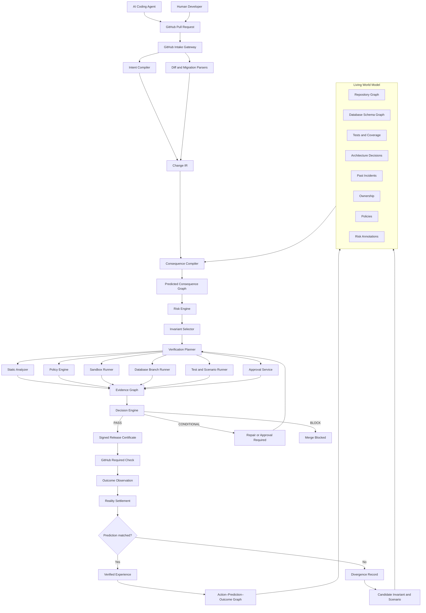
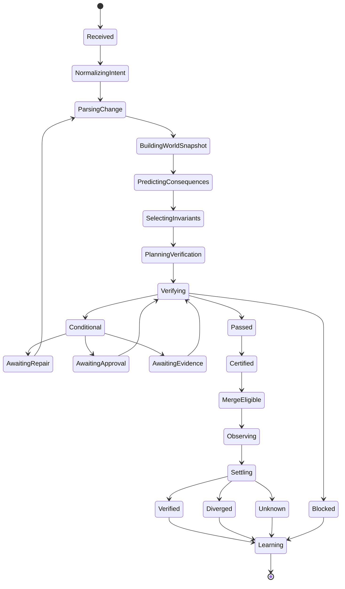
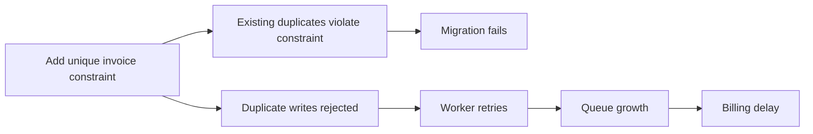
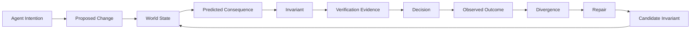
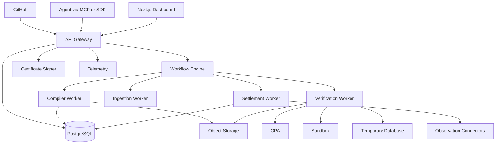
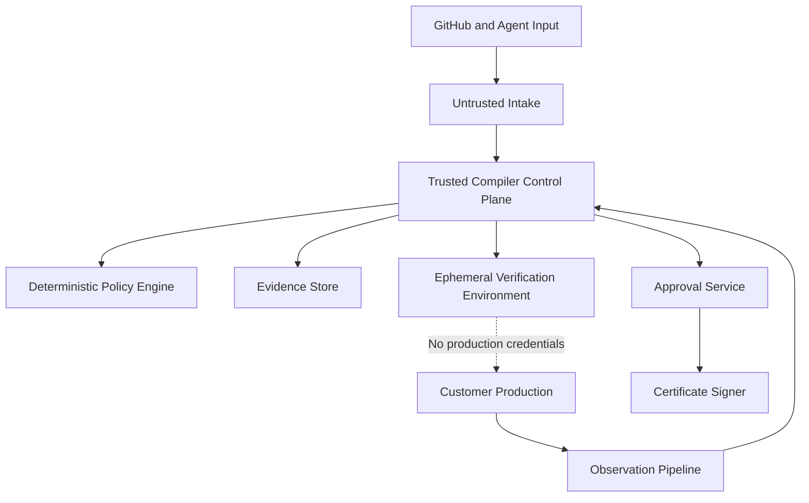

# memoryosTM — The Reality Compiler for Autonomous AI

## Final Master Product and Engineering Plan

**Status:** Authoritative plan
**Replaces:** AI Agent Inheritance Infrastructure plan
**Initial product:** Agent Release Compiler
**Long-term product:** Reality Compiler for consequential autonomous software actions
**Excluded:** Physical AI

---

# 1. Final Product Definition

## Company vision

memoryosTM is the infrastructure between an AI agent’s intention and the real-world software consequences of that intention.

It transforms a probabilistic proposal into:

* A structured change.
* A model of affected systems.
* Predicted consequences.
* Required invariants.
* A verification plan.
* Evidence.
* A release decision.
* A signed certificate.
* Outcome learning.

## Final one-liner

> **memoryosTM compiles machine-generated software changes into their consequences, required proofs, and release decisions before they reach production.**

## Initial customer-facing product

> **memoryosTM Agent Release Compiler**

## Initial promise

> **No machine-generated change reaches production uncompiled.**

## Long-term promise

> Before an autonomous software agent creates a consequential state change, memoryosTM understands it, predicts its consequences, verifies the required invariants, controls its execution, and settles the predicted result against reality.

## Simple explanation

Traditional compiler:

```text
Source code
→ Intermediate representation
→ Validation
→ Executable program
```

memoryosTM:

```text
Agent intention
→ Change IR
→ Consequence graph
→ Invariant verification
→ Evidence
→ Release Certificate
```

## Strongest category statement

> **Models decide what might be done. memoryosTM determines what has earned the right to become real.**

---

# 2. The Core Problem

AI coding agents can produce changes that look correct while missing:

* Hidden dependencies.
* Previous incidents.
* Database-state assumptions.
* Business invariants.
* Required tests.
* Mixed-version compatibility.
* Rollout risks.
* Ownership requirements.
* Approval rules.
* Irreversible consequences.
* Production behavior that is not represented in tests.

Normal CI evaluates tests that already exist.

It does not necessarily ask:

```text
What test is missing?
What second-order consequence exists?
What historical failure is relevant?
What company rule is not encoded in the repository?
What will happen during rollout?
What happens if the assumption is wrong?
```

memoryosTM becomes a second system that independently evaluates machine-generated changes before merge.

---

# 3. Initial Customer

## Target company

Start with engineering teams that:

* Use AI coding agents heavily.
* Use GitHub.
* Use TypeScript and Node.js.
* Use PostgreSQL.
* Use Prisma or SQL migrations.
* Deploy frequently.
* Have 5–100 engineers.
* Have experienced migration, authentication, billing, retry, or missing-test incidents.
* Want more autonomous development but do not trust autonomous merging.

## Primary users

### Platform engineer

Needs a consistent control point for machine-generated changes.

### Staff backend engineer

Needs risks, dependencies, and missing tests identified before review.

### Database owner

Needs migration compatibility and data-safety proof.

### Security engineer

Needs deterministic enforcement around authentication and authorization.

### Engineering leader

Needs evidence that AI-generated work is reducing—not increasing—operational risk.

## Initial buyer

* CTO.
* VP Engineering.
* Head of Engineering.
* Platform Engineering lead.
* AI Infrastructure lead.

---

# 4. Product Boundary

## What memoryosTM is

```text
Change understanding
Consequence prediction
Company-specific invariant enforcement
Verification planning
Isolated execution
Evidence collection
Release certification
Outcome settlement
```

## What memoryosTM is not

```text
Not an AI coding agent
Not a generic RAG product
Not an agent workforce manager
Not a skill marketplace
Not a prompt manager
Not a browser automation platform
Not a generic observability company
Not a model router
Not a deployment platform in the MVP
Not physical AI
```

## The product’s first control point

```text
GitHub pull request
```

This is agent-independent:

```text
Cursor
Claude Code
Codex
Devin
Windsurf
Internal agent
Human developer
        ↓
GitHub pull request
        ↓
memoryosTM compilation
```

GitHub Apps can create and update check runs, attach findings to lines, and publish a detailed result. Required checks can then be used as merge controls.

---

# 5. What Survives from the Original memoryosTM

The old inheritance plan discovered valuable information systems. They should become internal parts of the Reality Compiler.

## Keep and convert

| Old system             | New Reality Compiler role          |
| ---------------------- | ---------------------------------- |
| Source Ingestion       | World-model ingestion              |
| Memory Extraction      | Compiler-context extraction        |
| Knowledge Integrity    | Evidence and fact integrity        |
| Company Memory Graph   | Living World Model                 |
| Agent Experience Graph | Action–Prediction–Outcome Graph    |
| MemoryIgnition         | Compilation Context Builder        |
| Risky Files            | Risk annotations                   |
| Required Tests         | Verification requirements          |
| Policies               | Deterministic release policies     |
| Approvals              | Release authorization              |
| Agent Black Box        | Compilation Evidence Timeline      |
| Outcome Capture        | Observation pipeline               |
| Human Corrections      | Candidate invariants and scenarios |
| Mistake Immunity       | Invariant Learning Engine          |
| Future Instructions    | Invariant and Scenario Compiler    |
| MCP/API/SDK            | Agent integration adapters         |

## Keep for later

```text
Compliance evidence exports
Private verification workers
VPC deployment
Bring-your-own model
Controlled execution
Terraform and Kubernetes adapters
Enterprise identity and audit
```

## Freeze or remove

```text
Inheritance packages as the primary product
Agent Workforce OS
Agent queues and teams
Agent Operations Center
Skill Library
Skill Installation Layer
Skill Quality Engine
Skill Marketplace
Generic Workflow Blueprints
Browser automation
OpenClaw runtime
Model Router product
Cost Governor product
Robot inheritance
Dozens of initial integrations
```

---

# 6. Five Product Pillars

## Pillar 1 — Understand

Convert the proposed task and code changes into a structured representation.

Includes:

```text
Intent Contract
Git diff
AST analysis
Schema analysis
Change IR
Unknown-state detection
```

## Pillar 2 — Predict

Understand what the change may affect.

Includes:

```text
Living World Model
Repository dependencies
Database dependencies
Historical incidents
Consequence Graph
Blast-radius analysis
```

## Pillar 3 — Verify

Determine and run the evidence necessary to trust the change.

Includes:

```text
Invariants
Policies
Verification Plan
Static checks
Sandbox
Database branch
Existing tests
Generated scenarios
Approvals
```

## Pillar 4 — Certify

Produce a deterministic decision.

Includes:

```text
PASS
CONDITIONAL
BLOCK
Evidence Graph
Release Certificate
GitHub required check
```

## Pillar 5 — Settle

Compare predictions with outcomes.

Includes:

```text
Post-merge observations
Production signals
Prediction matching
Divergence
New scenarios
New invariants
Action–Prediction–Outcome Graph
```

---

# 7. Complete Product Architecture



---

# 8. Complete Compilation State Machine

Use a durable workflow because compilation may involve remote APIs, database provisioning, test execution, retries, and human approval. Temporal is designed around durable workflows and retryable activities, making it suitable for this lifecycle.



Every state transition must be:

* Idempotent.
* Persisted.
* Timestamped.
* Tenant-scoped.
* Linked to evidence.
* Recoverable after failure.

---

# 9. MVP Scope

## Supported

```text
GitHub pull requests
TypeScript
Node.js
PostgreSQL
Prisma
Raw SQL migration analysis
Jest or Vitest
GitHub Actions
CODEOWNERS
Manual incidents
Manual architecture decisions
```

## Initial risk domains

### Database migrations

* Destructive operations.
* Nullability.
* Defaults.
* Unique constraints.
* Backfills.
* Locks.
* Mixed-version compatibility.
* Rollback safety.

### Authentication and authorization

* Middleware.
* Session handling.
* Token verification.
* Route protection.
* Role checks.
* Tenant boundaries.
* Account recovery.

### Billing and idempotency

* Webhooks.
* Retry behavior.
* Duplicate delivery.
* Invoice creation.
* Refund consistency.
* Transaction boundaries.
* Provider/internal-state divergence.

## Excluded from MVP

```text
Autonomous production execution
Terraform
Kubernetes
Multiple languages
GitLab and Bitbucket
Generic browser agents
Customer support automation
Financial transfers
Agent workforce management
Skill marketplace
Physical AI
```

---

# 10. Component 1 — GitHub Intake Gateway

## Responsibilities

```text
Receive webhook
Verify signature
Deduplicate delivery
Resolve installation
Fetch PR state
Capture exact SHAs
Fetch diff
Create Compilation
Create check run
Start workflow
```

## Events

Support:

```text
pull_request.opened
pull_request.synchronize
pull_request.reopened
pull_request.ready_for_review
check_run.rerequested
installation.created
installation.deleted
installation_repositories.added
installation_repositories.removed
```

## Permissions

Start with:

```text
Metadata: Read
Contents: Read
Pull requests: Read
Checks: Read and write
Commit statuses: Read
Actions: Optional read
Issues: Optional read
```

GitHub requires Checks write permission to create or update a check run. A check can contain Markdown summaries and line annotations, with annotations batched when more than 50 are needed.

## Compilation identity

```text
installation_id
+ repository_id
+ pull_request_number
+ head_sha
+ compiler_profile_version
```

## Critical rules

* Never compile a mutable branch name alone.
* Bind every compilation to exact SHAs.
* Any diff update invalidates the prior certificate.
* Treat fork pull requests as a separate security mode.
* Do not expose customer secrets to forked code.

---

# 11. Component 2 — Intent Compiler

## Purpose

Convert the human or agent request into a structured contract.

## Intent sources, in priority order

```text
Explicit SDK or MCP input
Structured pull-request template
Linked issue
Pull-request title and body
Agent metadata
Model inference
```

## Schema

```typescript
interface IntentContract {
  goal: string;

  actor: {
    type: "human" | "ai_agent" | "unknown";
    provider?: string;
    sessionId?: string;
  };

  source:
    | "explicit"
    | "mcp"
    | "pull_request_template"
    | "linked_issue"
    | "pull_request_text"
    | "model_inferred";

  declaredEffects: string[];
  successConditions: string[];
  forbiddenOutcomes: string[];
  assumptions: string[];
  unresolvedQuestions: string[];

  confidence: number;
}
```

## Example

```json
{
  "goal": "Prevent duplicate subscription charges",
  "actor": {
    "type": "ai_agent",
    "provider": "cursor"
  },
  "declaredEffects": [
    "modify billing webhook",
    "add invoice uniqueness constraint"
  ],
  "successConditions": [
    "At most one charge per invoice",
    "Existing invoices remain readable",
    "Failed payments can still retry"
  ],
  "forbiddenOutcomes": [
    "Duplicate charge",
    "Migration failure",
    "Infinite retry"
  ],
  "assumptions": [
    "Webhooks may be delivered repeatedly"
  ],
  "unresolvedQuestions": [],
  "confidence": 0.94
}
```

## Missing-state behavior

If intent confidence is low:

```text
Do not guess silently.
Mark the unknown.
Increase verification.
Return CONDITIONAL if the uncertainty matters.
```

---

# 12. Component 3 — Change IR

Change IR is the central technical primitive.

## Purpose

Convert raw changes into a typed description of the proposed mutation.

```typescript
interface ChangeIR {
  id: string;
  organizationId: string;
  compilationId: string;

  source: SourceReference;
  intent: IntentContract;

  codeMutations: CodeMutation[];
  schemaMutations: SchemaMutation[];
  configurationMutations: ConfigurationMutation[];
  dependencyMutations: DependencyMutation[];

  affectedEntities: EntityReference[];
  externalInteractions: ExternalInteraction[];

  unknowns: UnknownProperty[];

  baseStateHash: string;
  diffHash: string;
  compilerVersion: string;
}
```

## Code mutation

```typescript
interface CodeMutation {
  filePath: string;
  symbolName?: string;

  operation:
    | "create"
    | "modify"
    | "delete"
    | "rename";

  semanticCategory:
    | "authentication"
    | "authorization"
    | "billing"
    | "database_read"
    | "database_write"
    | "background_job"
    | "public_api"
    | "configuration"
    | "test"
    | "unknown";

  changedBehaviors: string[];

  callers: string[];
  callees: string[];

  readsEntities: string[];
  writesEntities: string[];
  callsExternalSystems: string[];

  lineStart: number;
  lineEnd: number;

  confidence: number;
}
```

## Schema mutation

```typescript
interface SchemaMutation {
  framework: "prisma" | "sql";
  database: "postgresql";

  objectType:
    | "table"
    | "column"
    | "index"
    | "constraint"
    | "enum";

  operation:
    | "create"
    | "alter"
    | "rename"
    | "drop";

  objectName: string;
  parentObject?: string;

  nullableBefore?: boolean;
  nullableAfter?: boolean;

  typeBefore?: string;
  typeAfter?: string;

  defaultBefore?: string;
  defaultAfter?: string;

  destructive: boolean;

  reversibility:
    | "reversible"
    | "conditionally_reversible"
    | "compensatable"
    | "irreversible"
    | "unknown";

  riskReasons: string[];
}
```

## Build layers

```text
Raw diff
→ Changed files
→ AST mutations
→ Symbol mutations
→ Schema mutations
→ Semantic classification
→ Dependency enrichment
→ Organization-specific enrichment
```

## Initial technologies

```text
Git
ts-morph
TypeScript Compiler API
Prisma parser
PostgreSQL parser
Custom deterministic rules
Semgrep as a supplementary signal
```

## Acceptance criteria

The system must detect:

* Auth middleware removed.
* Authorization condition changed.
* Billing webhook changed.
* Idempotency logic removed.
* Retry behavior changed.
* Database write moved.
* Transaction boundary changed.
* Public API contract changed.
* Required test removed.
* Destructive migration introduced.

---

# 13. Component 4 — Living World Model

## Purpose

Represent only the software facts needed to evaluate change consequences.

## Initial entities

```text
Repository
File
Symbol
Function
Class
API route
Background job
Database
Table
Column
Index
Constraint
Test
External service
Incident
Architecture decision
Policy
Owner
Deployment unit
```

## Initial relationships

```text
FILE_CONTAINS_SYMBOL
SYMBOL_CALLS_SYMBOL
ROUTE_CALLS_SYMBOL
SYMBOL_READS_TABLE
SYMBOL_WRITES_TABLE
TEST_COVERS_SYMBOL
TEST_COVERS_ROUTE
INCIDENT_INVOLVED_ENTITY
DECISION_GOVERNS_ENTITY
OWNER_OWNS_ENTITY
SERVICE_DEPENDS_ON_SERVICE
POLICY_APPLIES_TO_ENTITY
```

## Storage

Use PostgreSQL relationship tables initially.

Do not add a graph database until real traversal or performance measurements justify it.

## Snapshot

```typescript
interface WorldModelSnapshot {
  id: string;
  organizationId: string;
  repositoryId: string;

  baseSha: string;
  repositoryGraphHash: string;
  schemaHash: string;
  policyBundleHash: string;
  incidentKnowledgeHash: string;
  ownershipHash: string;

  generatedAt: string;
}
```

Every certificate references the exact snapshot used to make the decision.

---

# 14. Component 5 — Evidence and Knowledge Integrity

This important layer was under-specified in earlier versions.

## Purpose

Prevent stale, contradicted, or low-quality context from influencing critical decisions.

## For every world-model fact, track

```text
Source
Created time
Last verified time
Content hash
Confidence
Approval status
Contradictions
Applicable scope
Superseded status
```

## States

```text
verified
approved
low-confidence
stale
contradicted
superseded
blocked
```

## Blocking rule

A knowledge item may block a release only when:

```text
It has valid provenance
It is within its applicability scope
It is not superseded
It is not materially contradicted
Its enforcement status is approved
```

Model-generated hypotheses never directly become blocking facts.

---

# 15. Component 6 — Consequence Compiler

## Four reasoning layers

### Layer 1: deterministic facts

```text
Column dropped
Unique constraint added
Authentication guard removed
Idempotency branch deleted
Retry count increased
API type changed
```

### Layer 2: dependency propagation

```text
Changed function
→ route
→ service
→ table
→ worker
→ external provider
→ customer-visible outcome
```

### Layer 3: historical analogies

```text
Same table involved in prior lock incident
Same file involved in previous auth bypass
Similar webhook change caused duplicate processing
```

### Layer 4: model hypotheses

```text
Mixed versions may write incompatible data
Retry behavior may create queue amplification
Session invalidation may stop working
```

## Predicted effect schema

```typescript
interface PredictedEffect {
  id: string;

  statement: string;

  category:
    | "data_integrity"
    | "availability"
    | "security"
    | "authorization"
    | "billing"
    | "compatibility"
    | "performance"
    | "operational";

  source:
    | "deterministic"
    | "dependency"
    | "historical"
    | "model_hypothesis";

  severity: "low" | "medium" | "high" | "critical";
  confidence: number;

  affectedEntityIds: string[];
  evidenceIds: string[];

  requiresVerification: boolean;

  status:
    | "candidate"
    | "verified"
    | "rejected"
    | "unknown";
}
```

## Consequence graph example



---

# 16. Component 7 — Risk Engine

## Risk dimensions

```text
Severity
Blast radius
Irreversibility
Uncertainty
Privilege
Data sensitivity
Historical relevance
```

## Risk levels

### Low

* Documentation.
* Tests.
* Safe local refactor.

### Medium

* Internal behavior.
* Background jobs.
* Non-destructive schema addition.

### High

* Authentication.
* Authorization.
* Billing.
* Migrations.
* Public API behavior.

### Critical

* Data destruction.
* Authorization bypass.
* Secret exposure.
* Duplicate financial operation.
* Unknown irreversible outcome.

## Important behavior

Keep each risk dimension visible.

Do not hide everything behind one arbitrary “AI safety score.”

---

# 17. Component 8 — Invariant Registry

## Purpose

Represent conditions that must remain true.

## Database invariants

```text
A populated column cannot be dropped without an approved plan.
A required column requires a safe default or backfill.
A unique constraint must be tested against existing duplicates.
A migration must support the old and new application during rollout.
Large blocking operations require a staged strategy.
```

## Authentication invariants

```text
Protected routes remain authenticated.
Authorization occurs before sensitive access.
Session revocation remains possible.
Required token claims remain validated.
Tenant boundaries remain enforced.
```

## Billing invariants

```text
One invoice produces at most one successful charge.
Webhook processing is idempotent.
Retries do not create duplicate financial actions.
Provider and internal state remain reconcilable.
Refund state remains consistent.
```

## Schema

```typescript
interface Invariant {
  id: string;
  organizationId: string;

  name: string;
  statement: string;
  domain: string;

  severity: "low" | "medium" | "high" | "critical";

  scope: EntityReference[];

  enforcement:
    | "static"
    | "policy"
    | "test"
    | "simulation"
    | "approval"
    | "observation";

  executableArtifact?: {
    type: "rego" | "sql" | "typescript_test" | "query";
    storageKey: string;
    contentHash: string;
  };

  provenance: EvidenceReference[];

  status:
    | "candidate"
    | "approved"
    | "deprecated"
    | "blocked";

  version: number;
}
```

## Lifecycle

```text
Candidate
→ human review
→ executable check
→ policy/test evaluation
→ approved
→ active
→ deprecated
```

---

# 18. Component 9 — Policy Engine

Use OPA/Rego for deterministic policy decisions over structured input. OPA separates policy decisions from enforcement and supports tests for policy behavior.

## Policy actions

```text
allow
warn
require_evidence
require_test
require_approval
force_simulation
block
```

## Example

```rego
package memoryos.database

violations contains result if {
  some mutation in input.change_ir.schemaMutations

  mutation.operation == "drop"
  mutation.objectType == "column"
  mutation.destructive == true
  mutation.estimatedRows > 0

  result := {
    "code": "POPULATED_COLUMN_DROP",
    "severity": "critical",
    "message": "The change drops a populated database column."
  }
}
```

## Required policy features

```text
Versioned bundles
Unit tests
Dry-run mode
Structured output
Tenant isolation
Bundle hashing
Rollback to prior version
Audit history
```

---

# 19. Component 10 — Verification Planner

## Input

```text
Change IR
Consequence graph
Risk
Invariants
Existing tests
Historical failures
Available verification providers
```

## Output

```text
Verification DAG
Required evidence
Required approvals
Timeout
Cost estimate
```

## Verification step types

```typescript
type VerificationStepType =
  | "static_analysis"
  | "policy_evaluation"
  | "existing_test"
  | "generated_test"
  | "database_migration"
  | "scenario_replay"
  | "compatibility_test"
  | "rollback_test"
  | "human_approval";
```

## Example billing plan

```text
1. Evaluate billing policies.
2. Create temporary PostgreSQL state.
3. Load duplicate-event fixtures.
4. Apply proposed schema migration.
5. Start old application version.
6. Start new application version.
7. Replay duplicate webhook.
8. Assert one invoice.
9. Assert one charge.
10. Verify retry state.
11. Verify rollback or compensation path.
```

## Risk mapping

| Risk     | Verification                                               |
| -------- | ---------------------------------------------------------- |
| Low      | Static checks and existing tests                           |
| Medium   | Policy plus targeted tests                                 |
| High     | Database branch, replay, compatibility and approval        |
| Critical | Block unless explicit exception policy permits progression |

---

# 20. Component 11 — Sandbox and Database Runtime

## Local and CI runtime

Use Testcontainers for disposable PostgreSQL environments and repeatable fixtures.

## Hosted migration runtime

Use ephemeral Neon branches for realistic isolated database verification. Neon branches are isolated copy-on-write environments and support short-lived development and testing workflows.

## Sandbox requirements

```text
Exact commit SHA
Temporary filesystem
No production secrets
Restricted network
Resource limits
Execution timeout
Short-lived credentials
Command audit
Structured logs
Artifact capture
Guaranteed cleanup
Tenant isolation
```

## Generated-test requirements

A generated test must:

* Link to a specific invariant.
* Explain why it was generated.
* Fail against a vulnerable fixture where possible.
* Pass against the repaired version.
* Be marked as model-generated.
* Not be the only evidence for a critical irreversible decision.

---

# 21. Component 12 — Evidence Graph

## Evidence types

```text
Git diff
AST result
Schema diff
Policy result
Existing test
Generated test
Migration output
Database query result
Incident
Architecture decision
Approval
Log
Trace
Sandbox metadata
Certificate
Observation
```

## Trust levels

```text
deterministic
system_observed
human_attested
model_generated
```

## Evidence artifact

```typescript
interface EvidenceArtifact {
  id: string;
  organizationId: string;
  compilationId: string;

  type: string;
  storageKey?: string;

  structuredPayload?: Record<string, unknown>;

  contentHash: string;
  producedBy: string;
  producedAt: string;

  supportsEffectIds: string[];
  supportsInvariantIds: string[];

  trustLevel:
    | "deterministic"
    | "system_observed"
    | "human_attested"
    | "model_generated";
}
```

## Required properties

* Immutable.
* Content-addressed.
* Tenant-scoped.
* Retention-controlled.
* Secret-redacted.
* Linked to exact compiler and policy versions.

---

# 22. Component 13 — Decision Engine

## Decisions

```text
PASS
CONDITIONAL
BLOCK
```

## Deterministic logic

```typescript
function decide(input: DecisionInput):
  "PASS" | "CONDITIONAL" | "BLOCK" {

  if (input.criticalViolations.length > 0) {
    return "BLOCK";
  }

  if (input.failedBlockingSteps.length > 0) {
    return "BLOCK";
  }

  if (input.requiredEvidenceMissing.length > 0) {
    return "CONDITIONAL";
  }

  if (input.requiredApprovalsPending.length > 0) {
    return "CONDITIONAL";
  }

  if (input.blockingUnknowns.length > 0) {
    return "CONDITIONAL";
  }

  return "PASS";
}
```

The model can summarize or explain the decision.

The model cannot change it.

---

# 23. Component 14 — Release Certificate

## Purpose

Bind the decision to exact immutable inputs.

```json
{
  "schema": "memoryos.release-certificate/v1",
  "certificateId": "cert_71982",
  "compilationId": "cmp_9812",

  "subject": {
    "repository": "acme/billing",
    "pullRequest": 482,
    "baseSha": "abc123",
    "headSha": "def456",
    "diffHash": "sha256:..."
  },

  "context": {
    "worldModelSnapshot": "wm_718",
    "schemaHash": "sha256:...",
    "policyBundleHash": "sha256:...",
    "compilerVersion": "0.1.0"
  },

  "decision": "CONDITIONAL",
  "riskLevel": "HIGH",

  "effects": {
    "predicted": 8,
    "verified": 5,
    "rejected": 1,
    "unknown": 2
  },

  "invariants": {
    "passed": 14,
    "failed": 1,
    "notEvaluated": 2
  },

  "requiredActions": [
    "Reconcile duplicate invoice rows",
    "Add duplicate-webhook replay test"
  ],

  "evidenceDigest": "sha256:...",
  "issuedAt": "2026-08-18T10:14:00Z",
  "expiresAt": "2026-08-18T16:14:00Z",
  "signature": "..."
}
```

Use established signing primitives instead of creating custom cryptography. Cosign supports signing blobs and producing verification material suitable for signed evidence bundles.

## Invalidation

Invalidate when:

```text
Head SHA changes
Diff changes
Relevant base changes
Policy bundle changes
World-model facts materially change
Approval expires
Evidence becomes invalid
Certificate expires
Compiler version is revoked
```

---

# 24. Component 15 — Approval Service

## Approval object

```typescript
interface ApprovalRequest {
  id: string;
  compilationId: string;

  reason: string;
  riskLevel: "medium" | "high" | "critical";

  requiredRole:
    | "code_owner"
    | "security"
    | "database_owner"
    | "billing_owner"
    | "organization_admin";

  evidenceIds: string[];

  status:
    | "pending"
    | "approved"
    | "rejected"
    | "expired";

  expiresAt: string;
}
```

## Rules

* The proposing agent cannot approve.
* Approval binds to the exact compilation hash.
* Any relevant diff change invalidates approval.
* Approvers see evidence, not only an AI summary.
* Critical exceptions require a reason.
* Every approval event is append-only.

---

# 25. Component 16 — GitHub Experience

## Check result

```text
memoryosTM Compilation: CONDITIONAL

Intent
Prevent duplicate subscription charges.

Risk
HIGH

Affected systems
• Billing webhook
• Invoice table
• Retry worker
• Reconciliation process

Evidence
✓ Existing tests passed
✓ Temporary PostgreSQL created
✓ Migration applied to clean fixtures
✕ Migration failed with duplicate fixtures
✕ Mixed-version compatibility not proven

Required repairs
1. Reconcile duplicate records.
2. Add duplicate-delivery test.
3. Prove old and new workers can run together.
```

## Inline annotations

Add findings to:

* Destructive migration line.
* Removed auth check.
* Removed idempotency branch.
* Dangerous retry configuration.
* Missing required test.

## GitHub configuration options

```text
Require on all PRs
Require only for agent-authored PRs
Require only for selected directories
Require for migrations
Require for authentication or billing
Run in audit-only mode
```

---

# 26. Component 17 — Observation Pipeline

## Initial sources

```text
GitHub merge state
GitHub Actions
Deployment status
Sentry issue
Rollback event
Incident record
Human override
Manual outcome
```

## Observation schema

```typescript
interface Observation {
  id: string;
  compilationId: string;

  type:
    | "merge"
    | "ci"
    | "deployment"
    | "error"
    | "rollback"
    | "incident"
    | "human_override"
    | "custom";

  payload: Record<string, unknown>;
  source: string;
  observedAt: string;
  contentHash: string;
}
```

---

# 27. Component 18 — Reality Settlement

## Purpose

Compare predicted effects with observed effects.

```typescript
interface RealitySettlement {
  id: string;
  compilationId: string;

  matches: EffectMatch[];
  divergences: EffectDivergence[];
  unknownOutcomes: UnknownOutcome[];

  result:
    | "verified"
    | "success_with_divergence"
    | "failed"
    | "rolled_back"
    | "unknown";

  divergenceScore: number;

  candidateInvariantIds: string[];
  generatedScenarioIds: string[];

  settledAt: string;
}
```

## Example

```text
Predicted
Migration succeeds.
No duplicate invoice is created.
Latency changes by less than 5%.

Observed
Migration succeeds.
No duplicate invoice is created.
Latency increases by 18%.

Settlement
SUCCESS_WITH_DIVERGENCE

Learning
Large unique-index creation was more expensive than predicted.

Candidate invariant
Large unique indexes require staged or online creation.
```

---

# 28. Component 19 — Action–Prediction–Outcome Graph



## Store for every compilation

```text
Intention
Exact source state
Change IR
World-model snapshot
Predictions
Invariants
Verification plan
Evidence
Decision
Approval
Certificate
Observed outcome
Divergence
Repair
New invariant
New scenario
```

This—not generic memory—is the compounding moat.

---

# 29. MCP and SDK

MCP remains an adapter for agents to provide intent and inspect results. The protocol is appropriate for exposing structured tools and resources, but privileged actions should remain limited and consent-aware.

## MCP tools

```text
memoryos_compile_change
memoryos_get_compilation
memoryos_get_change_ir
memoryos_get_risk_summary
memoryos_explain_consequence
memoryos_get_required_tests
memoryos_get_required_repairs
memoryos_get_related_incidents
memoryos_get_release_certificate
memoryos_record_observation
```

## Do not expose in MVP

```text
memoryos_deploy
memoryos_modify_production
memoryos_override_critical_policy
```

## SDK

```typescript
const compilation = await memoryos.compileChange({
  repository: "acme/billing",
  pullRequest: 482,
  baseSha: "abc123",
  headSha: "def456",
  intent: {
    goal: "Prevent duplicate subscription charges"
  }
});

if (compilation.decision === "BLOCK") {
  throw new Error(compilation.explanation);
}
```

---

# 30. Backend Architecture



## Services

### API

* Authentication.
* Tenant resolution.
* Dashboard API.
* GitHub endpoints.
* Approval actions.
* Certificate delivery.

### Compiler worker

* Intent.
* Diff parsing.
* AST analysis.
* Change IR.
* World-model enrichment.
* Consequence graph.

### Verification worker

* Policies.
* Sandboxes.
* Database branches.
* Tests.
* Scenarios.
* Evidence.

### Ingestion worker

* Repository index.
* Incidents.
* Architecture decisions.
* Ownership.
* Tests.

### Settlement worker

* Observations.
* Effect matching.
* Divergence.
* Candidate invariants.
* Experience graph.

---

# 31. Recommended Stack

```text
Frontend: Next.js, TypeScript, Tailwind, shadcn/ui
API: Node.js, Fastify or existing Express
Database: PostgreSQL through Neon
ORM: Prisma
Workflow: Temporal
Policies: OPA/Rego
Code analysis: ts-morph + TypeScript Compiler API
Local verification: Testcontainers
Hosted DB verification: Neon branches
Evidence storage: S3-compatible storage
Signing: Sigstore/Cosign
Auth: Clerk initially
Telemetry: OpenTelemetry
Errors: Sentry
Agent integration: MCP, SDK, GitHub
```

---

# 32. Repository Structure

```text
memoryos/
│
├── apps/
│   ├── dashboard/
│   ├── api/
│   ├── github-app/
│   └── docs/
│
├── workers/
│   ├── compiler-worker/
│   ├── verification-worker/
│   ├── ingestion-worker/
│   └── settlement-worker/
│
├── packages/
│   ├── intent-contract/
│   ├── change-ir/
│   ├── diff-parser/
│   ├── typescript-analyzer/
│   ├── prisma-analyzer/
│   ├── sql-analyzer/
│   ├── repository-graph/
│   ├── schema-graph/
│   ├── world-model/
│   ├── knowledge-integrity/
│   ├── consequence-compiler/
│   ├── risk-engine/
│   ├── invariant-registry/
│   ├── verification-planner/
│   ├── policy-client/
│   ├── sandbox-adapters/
│   ├── database-branch-adapters/
│   ├── evidence/
│   ├── decision-engine/
│   ├── certificate/
│   ├── approvals/
│   ├── observations/
│   ├── settlement/
│   ├── sdk/
│   └── mcp-server/
│
├── workflows/
│   ├── compile-change.workflow.ts
│   ├── verify-change.workflow.ts
│   ├── approval.workflow.ts
│   └── settle-outcome.workflow.ts
│
├── policies/
│   ├── built-in/
│   ├── organizations/
│   └── tests/
│
├── scenarios/
│   ├── database/
│   ├── authentication/
│   ├── authorization/
│   └── billing/
│
└── fixtures/
    ├── vulnerable-repositories/
    ├── safe-repositories/
    └── database-states/
```

---

# 33. Core Database Models

## Organization

```text
organizations
users
organization_members
repositories
github_installations
integration_credentials
```

## Compilation

```text
compilations
compilation_events
intent_contracts
change_ir_documents
code_mutations
schema_mutations
predicted_effects
consequence_edges
unknown_effects
risk_assessments
```

## World model

```text
world_model_snapshots
world_entities
world_relationships
source_artifacts
architecture_decisions
incidents
incident_entity_links
ownership_links
test_entity_links
```

## Verification

```text
invariants
invariant_versions
policy_bundles
verification_plans
verification_steps
verification_dependencies
verification_executions
test_results
simulation_environments
evidence_artifacts
```

## Decision

```text
compilation_decisions
approval_requests
approvals
release_certificates
certificate_signatures
```

## Settlement

```text
observations
reality_settlements
effect_matches
effect_divergences
candidate_invariants
generated_scenarios
experience_records
```

---

# 34. Primary APIs

```text
POST /v1/compilations
GET  /v1/compilations
GET  /v1/compilations/:id
POST /v1/compilations/:id/recompile

GET /v1/compilations/:id/intent
GET /v1/compilations/:id/change-ir
GET /v1/compilations/:id/world-model
GET /v1/compilations/:id/consequences
GET /v1/compilations/:id/risk
GET /v1/compilations/:id/invariants
GET /v1/compilations/:id/verification-plan
GET /v1/compilations/:id/evidence
GET /v1/compilations/:id/decision
GET /v1/compilations/:id/certificate

POST /v1/compilations/:id/approvals
POST /v1/compilations/:id/observations
POST /v1/compilations/:id/settlements

GET  /v1/world-model/entities
GET  /v1/world-model/relationships
POST /v1/world-model/reindex

GET  /v1/invariants
POST /v1/invariants
POST /v1/invariants/:id/approve
POST /v1/invariants/:id/deprecate
POST /v1/invariants/:id/test
```

---

# 35. Frontend

## MVP navigation

```text
Overview
Compilations
World Model
Policies & Invariants
Incidents
Integrations
Settings
```

## Overview

Show:

```text
Compilations
PASS / CONDITIONAL / BLOCK
High-risk changes caught
Missing tests
Migration risks
Authentication risks
Billing risks
False-block rate
Compilation time
Prediction divergence
Pending approvals
Verified Autonomous Change Rate
```

## Compilation Detail

This is the main product screen:

```text
Intent
Change summary
Change IR
Affected systems
Consequence graph
Related incidents
Applicable invariants
Verification plan
Live timeline
Evidence
Decision
Required repairs
Approvals
Release Certificate
Outcome observations
Reality Settlement
```

## World Model

Show:

```text
Repository dependencies
Database dependencies
Tests
Owners
Incidents
Architecture decisions
Evidence and confidence
```

## Policies & Invariants

Tabs:

```text
Approved
Candidate
Failing
Deprecated
Policy bundles
Policy tests
```

## Incidents

Show:

```text
Root cause
Affected entities
Repair
Future invariant
Generated scenario
Compilations influenced
```

---

# 36. Security Architecture



## Non-negotiable controls

```text
organization_id on every tenant record
PostgreSQL row-level security
Webhook signature validation
Encrypted installation credentials
Short-lived tokens
No production secrets in sandbox
Network deny by default
Secret and PII redaction
Immutable evidence hashes
Versioned policies
Versioned compiler
Expiring approvals
Expiring certificates
Separation of proposer and approver
No LLM permission decisions
Guaranteed sandbox cleanup
```

## Adversarial threats

```text
Prompt injection in source comments
Malicious PR description
Forged webhook
Cross-tenant access
Sandbox escape
Secret exfiltration
Fake test result
Approval replay
Certificate replay
Diff changed after approval
Evidence modification
Policy outage
Expensive-computation denial of service
```

---

# 37. Evaluation System

Build 100 initial scenarios.

## Database: 40

```text
Populated column deletion
Required column without default
Unique constraint with duplicate rows
Unsafe type narrowing
Long lock
Index removal
Mixed-version incompatibility
Failed rollback
Partial migration
Unsafe enum change
```

## Authentication and authorization: 30

```text
Middleware removed
Session revocation broken
Token-expiry bypass
Authorization after sensitive access
Role comparison inverted
Public endpoint exposure
Tenant boundary bypass
Missing claims
Unsafe fallback
Audit disabled
```

## Billing: 30

```text
Duplicate webhook charge
Retry executes twice
Idempotency removed
Provider succeeds while DB fails
Refund divergence
Duplicate invoice
Infinite retry
Currency error
Missing reconciliation
Partial transaction
```

## Evaluation metrics

```text
Consequence recall
Consequence precision
Critical-risk recall
Blocking precision
Blocking recall
False-block rate
Unknown calibration
Repair success
Explanation usefulness
Compilation duration
Cost per validated finding
Prediction divergence
```

## North-star metric

> **Verified Autonomous Change Rate**

```text
Machine-generated changes safely certified
÷
Machine-generated changes submitted
```

---

# 38. Exact 12-Week MVP Roadmap

## Week 1 — Specification

Build:

```text
Compilation schema
Intent Contract v0
Change IR v0
Decision semantics
Certificate v0
Workflow state machine
Threat model
Ten scenarios
```

Exit:

* Every input and output is defined.
* MVP exclusions are frozen.
* Ten scenarios have expected outcomes.

## Week 2 — GitHub App

Build:

```text
App registration
Installation
Webhook
Signature verification
Token handling
PR ingestion
Check run
Deduplication
```

Exit:

* PR creates one Compilation.
* Updated PR creates new compilation.
* Invalid webhook is rejected.

## Week 3 — Durable workflow

Build:

```text
Temporal
Compile workflow
State transitions
Retries
Timeouts
Cancellation
Idempotent activities
Event history
```

Exit:

* Worker restart does not lose progress.

## Week 4 — TypeScript analysis

Build:

```text
Repository checkout
Git diff
AST index
Changed symbols
Call graph
Semantic classification
Test detection
```

Exit:

* Changed route, function, database write, external call, and test are visible.

## Week 5 — Prisma and SQL

Build:

```text
Prisma diff
SQL parser
SchemaMutation
Destructive detection
Nullability/default analysis
Reversibility
```

Exit:

* Five dangerous migration fixtures are detected.

## Week 6 — Living World Model

Build:

```text
Entity tables
Relationship tables
Repository graph
Schema graph
CODEOWNERS
Test relationships
Incident relationships
Snapshot
```

Exit:

* Changed function traces to route, table, test, owner, and incident.

## Week 7 — Consequence Compiler

Build:

```text
Deterministic effects
Dependency propagation
Historical analogies
Model-hypothesis interface
Confidence
Provenance
Graph API
```

Exit:

* Every fixture produces a causal path.

## Week 8 — Invariants and policies

Build:

```text
Invariant registry
Candidate/approved states
OPA
Policy bundles
Policy tests
Initial invariant pack
```

Exit:

* Violations include code, severity, evidence, and repair.

## Week 9 — Verification Planner

Build:

```text
Risk dimensions
Verification DAG
Required evidence
Approvals
Timeouts
Retries
Cost estimate
```

Exit:

* Database, auth, and billing changes produce different plans.

## Week 10 — Verification runtime

Build:

```text
Testcontainers
Neon adapter
Repository sandbox
Migration runner
Existing tests
Scenario runner
Evidence capture
Cleanup
```

Exit:

* Dangerous migration fails safely in isolation.

## Week 11 — Decision and Certificate

Build:

```text
Decision engine
GitHub summary
Annotations
Certificate
Hashing
Signing
Expiry
Approval
Certificate page
```

Exit:

* Fixtures correctly receive PASS, CONDITIONAL, or BLOCK.

## Week 12 — End-to-end proof

Demonstrate:

```text
Agent creates billing fix.
Existing tests pass.
memoryosTM discovers duplicate-event risk.
Replay proves duplicate processing.
GitHub blocks merge.
Agent repairs code.
New compilation passes.
Certificate is signed.
Outcome is observed.
Failure creates a candidate invariant.
```

Targets:

```text
3 design partners
50 real or replayed PRs
100 scenarios
5 validated serious findings
Under 15% false blocking
100% certificate invalidation after diff change
Zero production write access
Zero cross-tenant leakage
```

---

# 39. First 14 Days

## Days 1–2

```text
Archive old plan.
Define Compilation.
Define Intent Contract.
Define Change IR.
Define decisions.
Define certificate.
Write five invariants.
```

## Days 3–4

```text
Create GitHub App.
Receive webhook.
Verify signature.
Fetch diff.
Create Compilation.
Create check run.
```

## Days 5–6

```text
Install Temporal.
Create workflow.
Add events.
Add retries.
Add idempotency.
```

## Days 7–8

```text
Parse TypeScript.
Detect changed symbols.
Classify auth, billing, database, tests.
```

## Days 9–10

```text
Parse Prisma and SQL.
Build SchemaMutation.
Detect destructive operations.
```

## Days 11–12

```text
Create five Rego policies.
Run policies against Change IR.
Return violations.
Add GitHub annotations.
```

## Days 13–14

```text
Create disposable PostgreSQL.
Apply dangerous migration.
Capture evidence.
Return BLOCK.
Render certificate v0.
```

---

# 40. Months 4–6 — Production V1

Add:

```text
Historical PR replay
Automatic incident ingestion
Customer invariant editor
Approval console
Sentry observation
GitHub Actions observation
Compilation analytics
Onboarding wizard
Repository risk profiles
Authentication invariant pack
Billing invariant pack
Database invariant pack
```

Commercial objective:

> Three to five teams require memoryosTM for selected high-risk merges.

Proof required:

* Accepted serious findings.
* Low false-block rate.
* Reduced manual review.
* Repeat risk caught automatically.

---

# 41. Months 7–12 — Infrastructure Compiler

Add support for:

```text
Terraform plans
Kubernetes manifests
Cloud configuration
Deployment plans
Feature flags
Multi-repository dependencies
```

New components:

```text
Infrastructure Change IR
Resource dependency graph
Infrastructure invariants
Plan simulation
Canary requirements
Rollback verification
Private verification workers
Enterprise SSO
Audit exports
SOC 2 readiness
```

memoryosTM still verifies and certifies; it does not execute production automatically.

---

# 42. Months 12–18 — Controlled Commit

After the compiler is trusted:

```text
Short-lived scoped credentials
Human-gated execution
Canary rollout
Automatic abort thresholds
Rollback invocation
Compensation plans
Deployment settlement
```

Flow:

```text
Agent proposes
→ memoryosTM compiles
→ evidence is verified
→ high risk receives approval
→ bounded release executes
→ telemetry is observed
→ result is settled
```

---

# 43. Months 18–24 — Operational Action Compiler

Expand into software operational actions:

```text
Database maintenance
Feature-flag changes
Cloud-resource modification
Incident remediation
Security-response actions
Internal support operations
```

Every action type requires:

```text
Typed IR
State adapter
Consequence model
Invariant library
Verification provider
Evidence schema
Certificate type
Observation adapter
Settlement logic
Evaluation corpus
```

---

# 44. Years 2–5 — Reality Compiler Platform

The platform expands through:

```text
Code
→ databases
→ infrastructure
→ cloud operations
→ internal enterprise actions
→ cross-system autonomous workflows
```

Potential long-term products:

```text
Reality Compiler SDK
Organization invariant registry
Verified-action protocol
Private compiler workers
Cross-agent certification
Certified execution gateway
Industry-specific invariant packs
Prediction-quality benchmarking
Reality Settlement network
```

The long-term platform should not become a generic agent operating system. It should remain the system that verifies consequential state transitions.

---

# 45. Existing Code Migration

## Reuse directly

```text
Node backend
PostgreSQL and Prisma
Neon
Clerk
Next.js dashboard
GitHub ingestion
MCP server
SDK
Risky-file logic
Required-test logic
Incidents
Approvals
Event records
Sentry
Source proof
```

## Refactor

```text
operationalLoopService.ts
→ durable compilation workflow

operational map compiler
→ Living World Model builder

driftDetection.ts
→ Reality Settlement divergence detector

MemoryIgnition retrieval
→ Compilation Context Builder

Experience records
→ Action–Prediction–Outcome records

Mistake Immunity
→ Invariant Learning Engine

Agent Black Box
→ Compilation Evidence Timeline
```

## Keep outside the critical path

```text
resumePlanner.ts
Agent handoff logic
General agent continuity
```

## Freeze

```text
Agent Workforce OS
Skill marketplace
Skill quality dashboard
Browser execution
OpenClaw adapter
Customer-facing model router
Cost Governor UI
Physical AI
Broad integrations
Generic inheritance-package formats
```

---

# 46. Important Missing Pieces Now Added

Earlier plans were strong technically but missed or under-specified several important systems.

## 1. Unknown-state handling

memoryosTM must be able to say:

```text
Unknown
Insufficient evidence
Cannot verify safely
```

Unknown is not PASS.

## 2. Knowledge applicability

A correct old incident may not apply to a new service or new architecture. Every fact needs scope and validity.

## 3. Certificate revocation

Certificates must become stale or revoked when their assumptions change.

## 4. Ground-truth evaluation

The system needs known safe and unsafe fixtures—not only human opinions.

## 5. Audit-only rollout

New customers should begin with:

```text
Observe
→ Warn
→ Require approval
→ Enforce
```

Do not block everything on installation day.

## 6. Cost-aware verification

Not every change needs a full database branch. The Verification Planner should select the smallest evidence plan sufficient for the risk.

## 7. False-block management

Every blocked finding needs:

```text
Accepted
Rejected
Overridden
Reason
Future policy adjustment
```

## 8. Repository configuration

Later support:

```text
.memoryos/config.yml
.memoryos/invariants/
.memoryos/scenarios/
```

Do not build a large skill-file system.

## 9. Versioning

Version:

```text
Intent schema
Change IR
Compiler
World-model snapshot
Policy bundle
Invariant
Verification plan
Certificate
Settlement schema
```

## 10. Design-partner replay

Before requiring the check, replay historical incidents and pull requests to establish value.

## 11. Enterprise privacy modes

Support eventually:

```text
Schema-only verification
Synthetic fixtures
Masked fixtures
Private worker
No source retention
Customer-managed storage
```

## 12. Product-value proof

The product must answer:

> What dangerous change did memoryosTM find that your current tests and review process missed?

---

# 47. Build Rules

Every proposed feature must answer at least one question:

```text
Does it help understand the change?
Does it improve consequence prediction?
Does it verify an invariant?
Does it produce better evidence?
Does it improve the release decision?
Does it improve prediction-versus-outcome learning?
```

Postpone the feature when every answer is no.

Do not begin by redesigning the entire dashboard.

Do not begin with all integrations.

Do not begin with autonomous deployment.

Do not begin with a marketplace.

Build the vertical slice:

```text
GitHub PR
→ TypeScript and Prisma analysis
→ Change IR
→ Five invariants
→ Disposable PostgreSQL
→ Evidence
→ PASS or BLOCK
→ GitHub check
→ Certificate
```

---

# 48. Final MVP Definition of Done

The MVP is complete when:

1. GitHub App installs.
2. Pull request creates a Compilation.
3. Intent Contract is produced.
4. Change IR identifies semantic mutations.
5. Living World Model identifies affected systems.
6. Consequence Compiler creates a causal path.
7. Applicable invariants are selected.
8. Verification plan runs.
9. A risk is proven or rejected in isolation.
10. Decision is deterministic.
11. GitHub displays evidence.
12. Certificate binds exact source, policy, and evidence.
13. A new diff invalidates the certificate.
14. An outcome can be observed.
15. Reality Settlement creates a learning record.
16. One genuine failure is caught that existing CI missed.

---

# 49. Final Company Architecture

```text
memoryosTM Reality Compiler
│
├── Understand
│   ├── GitHub Intake
│   ├── Intent Contract
│   ├── Code Analysis
│   ├── Migration Analysis
│   └── Change IR
│
├── Model Reality
│   ├── Repository Graph
│   ├── Schema Graph
│   ├── Incidents
│   ├── Decisions
│   ├── Tests
│   ├── Ownership
│   └── Knowledge Integrity
│
├── Predict
│   ├── Deterministic Effects
│   ├── Dependency Propagation
│   ├── Historical Analogies
│   ├── Model Hypotheses
│   └── Risk Engine
│
├── Verify
│   ├── Invariants
│   ├── Policies
│   ├── Verification Planner
│   ├── Sandbox
│   ├── Database Branch
│   ├── Tests
│   ├── Scenarios
│   └── Evidence Graph
│
├── Certify
│   ├── Decision Engine
│   ├── Approvals
│   ├── Release Certificate
│   └── GitHub Required Check
│
└── Settle
    ├── Observations
    ├── Reality Settlement
    ├── Divergence
    ├── Candidate Invariants
    ├── Generated Scenarios
    └── Action–Prediction–Outcome Graph
```

---

# 50. Final Product Positioning

## Website headline

> **No machine-generated change reaches production uncompiled.**

## Subheadline

> memoryosTM predicts the consequences of AI-generated code and database changes, verifies your company’s invariants, and issues an evidence-backed release decision before merge.

## Technical statement

> **memoryosTM is verified execution infrastructure for autonomous software agents.**

## Long-term statement

> **memoryosTM is the Reality Compiler for Autonomous AI.**

## World-shaking proof

> **Existing CI passed. memoryosTM found the failure that would have reached reality.**
