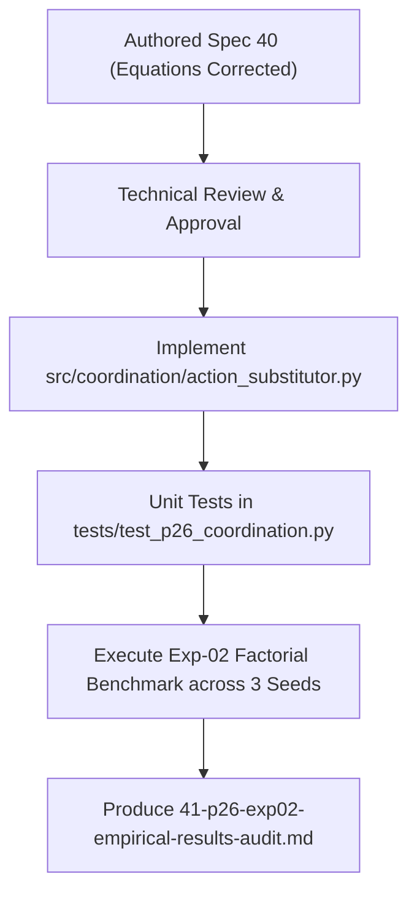

# HOROS PROBE-1 Research-002 — Stage P2.6
## Document 40: Experiment 02 — Action Substitution Mathematical Specification & Controlled Protocol

**Program:** HOROS PROBE-1, Research-002 — Trustworthy Action-Conditioned Contact World Models  
**Stage:** P2.6 — Contact-Aware Safety Coordination  
**Document:** 40 (Mathematical Specification & Experimental Protocol for Exp-02)  
**Status:** **Pre-Implementation Specification Frozen**  
**Author:** HOROS Physical Intelligence Research Group  
**Date:** November 6, 2026  

---

## 1. Executive Context & Co-Founder Review Alignment

Experiment 01 established a decisive empirical finding: the original decoupled p-CBF safety filter intervenes almost exclusively during **Mode 3 (Dynamic Lift Onset, $92.0\%$ intervention rate)** and **Mode 4 (Incipient Micro-Slip, $82.1\%$ intervention rate)**, resulting in consecutive clamping streaks of up to 16 steps and 90%–96.7% task stalls.

However, moving from diagnostic observation to intervention synthesis requires total mathematical rigor. This specification directly resolves the dimensional and physical shortcomings identified in earlier preliminary equations:
1. **Resolution of Problem A (Dimensionality of Squeeze):** Squeeze compensation is derived from contact elastomeric compliance, explicitly separating normal force deficit $\Delta F_n\ [\text{N}]$, normal displacement target $\Delta x_{\text{sqz}}\ [\text{mm}]$, and discrete actuator command delta $\Delta a_{\text{sqz}}\ [\text{mm/step}]$.
2. **Resolution of Problem B (Dimensionality of Lift Scaling):** Vertical lift commands are bounded through dynamic friction cone equilibrium $m(g + a_z) \le \eta \mu \sum F_{n,i}$, translating net friction capacity directly into dimensionally consistent velocity/displacement bounds $\Delta z_{\text{safe}}\ [\text{mm/step}]$, rather than comparing force directly with velocity commands.
3. **Controlled Experimental Design:** Rather than evaluating a monolithic fix, Experiment 02 decomposes action substitution into **four controlled factorial variants** (E02-A, E02-B, E02-C, E02-D) against the frozen $C_2$ baseline to isolate the exact causal mechanism of recovery.

---

## 2. First-Principles Mathematical Derivation

### 2.1 Contact Mechanics & Actuator Space Definition
In the `MultifingerLiftEnv` environment:
- Object mass: $m = 0.50\text{ kg}$, gravity $g = 9.81\text{ m/s}^2 \implies F_g = m g = 4.905\text{ N}$.
- Contact fingers: $N_f = 4$ antipodal hemispherical fingertips, nominal radius $r = 35.0\text{ mm}$.
- Simulation discrete time step: $\Delta t = 0.01\text{ s}$ ($100\text{ Hz}$).
- Action space vector: $a = [a_{\text{sqz}, 1}, a_{\text{sqz}, 2}, a_{\text{sqz}, 3}, a_{\text{sqz}, 4}, a_{\text{lift}}]^T \in \mathbb{R}^5$.
  - $a_{\text{sqz}, i} \in [-2.0, 2.0]\text{ mm/step}$: Inward radial fingertip displacement increment.
  - $a_{\text{lift}} = \Delta z_{\text{arm}} \in [-2.0, 5.0]\text{ mm/step}$: Vertical arm lift displacement increment.
- Normal elastomeric contact compliance:
  $$F_{n,i}(\delta_i) = k_{\text{elastic}} \cdot \max(0, \delta_i) \quad \text{where } k_{\text{elastic}} = 4.0\text{ N/mm}$$
  where $\delta_i = r_{\text{nominal}} - \|\mathbf{p}_i^{\text{radial}}\|$ is the fingertip indentation in millimeters.

---

### 2.2 Squeeze Preload Substitution (Resolving Problem A)

To support the object without slipping, the total normal force across all contact points must satisfy Coulomb friction:
$$\sum_{i=1}^{N_f} F_{n,i} \ge \frac{F_g}{\mu}$$

Let $\gamma > 1.0$ denote the dynamic load safety factor (accounting for upward inertial acceleration and contact force asymmetry, default $\gamma = 1.25$). The minimum normal force required per finger is:
$$F_{n,\text{required}} = \frac{\gamma \cdot F_g}{N_f \cdot \mu} = \frac{1.25 \times 4.905}{4 \times 0.60} \approx 2.555\text{ N}$$

Given the current measured normal force profile $\mathbf{F}_n = [F_{n,1}, \dots, F_{n,N_f}]^T$, the normal force deficit for finger $i$ is:
$$\Delta F_{n,i} = \max\left(0, F_{n,\text{required}} - F_{n,i}\right) \quad [\text{N}]$$

Using the elastomeric contact stiffness $k_{\text{elastic}} = 4.0\text{ N/mm}$, the required radial indentation displacement correction is:
$$\Delta x_{\text{sqz}, i} = \frac{\Delta F_{n,i}}{k_{\text{elastic}}} \quad [\text{mm}]$$

Because finger actuators are commanded in displacement increments per step ($\Delta a_{\text{sqz}} = \Delta x_{\text{sqz}}$), the substituted squeeze command is:
$$a_{\text{sub}, \text{sqz}, i} = \min\left(a_{\text{sqz},\max}, \max\left(a_{\text{prop}, \text{sqz}, i}, \Delta x_{\text{sqz}, i}\right)\right) \quad [\text{mm/step}]$$
subject to the anti-crush upper force ceiling $F_{n,i} \le F_{\max} = 18.0\text{ N}$.

---

### 2.3 Friction-Aware Lift Scaling (Resolving Problem B)

For an upward vertical lift motion, dynamic equilibrium of the grasped object requires:
$$\sum_{i=1}^{N_f} F_{t,i} - F_g = m \cdot a_z$$

The maximum shear force sustainable by static friction without slip across all fingers is:
$$F_{t,\max} = \eta \cdot \mu \sum_{i=1}^{N_f} F_{n,i} \quad [\text{N}]$$
where $\eta \in (0, 1)$ is the conservative friction safety coefficient (default $\eta = 0.85$, providing a $15\%$ safety margin inside the friction cone).

The maximum upward acceleration $a_{z,\max}$ that does not cause incipient slip is:
$$a_{z,\max} = \frac{\eta \mu \sum_{i=1}^{N_f} F_{n,i} - m g}{m} \quad [\text{m/s}^2]$$

If $\eta \mu \sum F_{n,i} \le m g$, the available friction cannot support even the static gravity load; upward acceleration is strictly impossible without slip ($a_{z,\max} \le 0$).

Over a discrete control interval $\Delta t = 0.01\text{ s}$, the maximum allowable upward velocity increment is:
$$v_{z,\max} = \max\left(0.0, a_{z,\max} \cdot \Delta t\right) \quad [\text{m/s}]$$

Converting to arm displacement increment in millimeters per step ($\Delta z_{\text{arm}}$ in $\text{mm/step}$):
$$\Delta z_{\text{safe}} = v_{z,\max} \cdot \Delta t \cdot 10^3 = \max\left(0.0, \frac{\eta \mu \sum_{i=1}^{N_f} F_{n,i} - m g}{m} \cdot \Delta t^2 \cdot 10^3\right) \quad [\text{mm/step}]$$

For quasi-static and compliant grasp phases where velocity tracking dominates, the allowable vertical step increment is bounded by:
$$a_{\text{sub}, \text{lift}} = \min\left(a_{\text{prop}, \text{lift}}, \Delta z_{\text{safe}}\right) \quad [\text{mm/step}]$$

This ensures that:
- When normal force is deficient ($\sum F_n < \frac{m g}{\eta \mu}$), $\Delta z_{\text{safe}} = 0$, preventing upward slip.
- As normal force builds up ($\sum F_n > \frac{m g}{\eta \mu}$), $\Delta z_{\text{safe}}$ opens smoothly and proportionally, allowing the robot to accelerate without triggering the binary zero-clamp deadlock.

---

## 3. Factorial Controlled Comparison Protocol

To rigorously isolate the causal source of performance recovery, Experiment 02 compares **four controlled variants** against the frozen $C_2$ baseline under identical random seeds ($s \in \{100, 200, 300\}$) and matched initial states.

```
+-------------------------------------------------------------------------------+
|                       FACTORIAL VARIANT TAXONOMY                              |
+-------------------+---------------------------+-------------------------------+
| Condition         | Squeeze Command Action    | Vertical Lift Action          |
+-------------------+---------------------------+-------------------------------+
| Baseline (C2)     | a_prop[:4] (Unmodified)   | 0.0 mm/step (Hard Zero Clamp) |
| Variant E02-A     | a_sub[:4] (Preload Boost) | 0.0 mm/step (Hard Zero Clamp) |
| Variant E02-B     | a_prop[:4] (Unmodified)   | a_sub[4] (Friction Scaled)    |
| Variant E02-C     | a_sub[:4] (Preload Boost) | a_sub[4] (Friction Scaled)    |
| Variant E02-D     | Coordinated CEM Sampling  | a_sub[4] + MPC Feedback       |
+-------------------+---------------------------+-------------------------------+
```

### 3.1 Detailed Variant Specifications

#### Baseline: $C_2$ Original p-CBF Filter
- Re-executes original hard zero-clamp:
  $$\mathbf{a}_{\text{filt}} = [a_{\text{prop}, 1}, a_{\text{prop}, 2}, a_{\text{prop}, 3}, a_{\text{prop}, 4}, 0.0]^T$$
- Serves as the negative control representing the existing P2.5 failure mode.

#### Variant E02-A: Normal Preload Compensation Only
- **Hypothesis:** Augmenting normal force while keeping shear clamped to zero will break the limit cycle by building sufficient friction to allow subsequent unclamped steps.
- **Substitution:**
  $$\mathbf{a}_{\text{sub}} = [a_{\text{sub}, 1}, a_{\text{sub}, 2}, a_{\text{sub}, 3}, a_{\text{sub}, 4}, 0.0]^T$$
  where $a_{\text{sub}, i} = \max(a_{\text{prop}, i}, \Delta x_{\text{sqz}, i})$.

#### Variant E02-B: Friction-Aware Lift Scaling Only
- **Hypothesis:** Allowing proportional lift travel scaled to current friction capacity will maintain progress without waiting for complete preload.
- **Substitution:**
  $$\mathbf{a}_{\text{sub}} = [a_{\text{prop}, 1}, a_{\text{prop}, 2}, a_{\text{prop}, 3}, a_{\text{prop}, 4}, \min(a_{\text{prop}, \text{lift}}, \Delta z_{\text{safe}})]^T$$
  where squeeze commands remain unmodified.

#### Variant E02-C: Combined Preload & Lift Scaling (Action Substitution)
- **Hypothesis:** Concurrently injecting normal preload and proportional shear scaling will eliminate both the preload deficit and the velocity deadlock simultaneously.
- **Substitution:**
  $$\mathbf{a}_{\text{sub}} = [a_{\text{sub}, 1}, a_{\text{sub}, 2}, a_{\text{sub}, 3}, a_{\text{sub}, 4}, \min(a_{\text{prop}, \text{lift}}, \Delta z_{\text{safe}})]^T$$

#### Variant E02-D: Bidirectional Planner-Filter Coordination
- **Hypothesis:** Biasing the CEM planner's sampling distribution to favor preload before lift will reduce proposed unsafe actions at the source, minimizing distortion $\|a_{\text{prop}} - a_{\text{sub}}\|$.
- **Coordination Mechanism:**
  - When $F_n < F_{n,\text{required}}$, the CEM initial sampling mean is shifted:
    $$\mu_{\text{CEM}, \text{sqz}} \leftarrow \mu_{\text{CEM}, \text{sqz}} + \Delta x_{\text{sqz}}, \quad \mu_{\text{CEM}, \text{lift}} \leftarrow 0.0$$
  - Substituted actions are passed through the Variant E02-C filter.

---

## 4. Algorithmic Implementation Contract

```python
class ContactAwareActionSubstitutor:
    def __init__(
        self,
        object_mass: float = 0.50,        # kg
        gravity: float = 9.81,            # m/s^2
        num_fingers: int = 4,
        friction_coeff: float = 0.60,
        elastic_stiffness: float = 4.0,   # N/mm
        dynamic_safety_margin: float = 1.25,
        friction_margin_eta: float = 0.85,
        dt: float = 0.01,                 # s
        max_crush_force: float = 18.0     # N
    ):
        self.m = object_mass
        self.g = gravity
        self.F_g = object_mass * gravity
        self.N_f = num_fingers
        self.mu = friction_coeff
        self.k_elastic = elastic_stiffness
        self.gamma = dynamic_safety_margin
        self.eta = friction_margin_eta
        self.dt = dt
        self.F_max = max_crush_force

        # Required normal force per finger:
        self.F_n_required = (self.gamma * self.F_g) / (self.N_f * self.mu)

    def substitute_action(
        self,
        obs: Dict[str, Any],
        proposed_action: np.ndarray,
        variant: str = "E02_C"
    ) -> Tuple[np.ndarray, bool, Dict[str, Any]]:
        """
        Applies dimensionally consistent action substitution according to variant.
        Returns: (substituted_action, intervened_flag, diagnostic_info)
        """
        a_prop = np.asarray(proposed_action, dtype=np.float64).copy()
        a_sub = a_prop.copy()

        fn_profile = np.array(obs.get("normal_forces", [0.0] * self.N_f), dtype=np.float64)
        total_fn = float(np.sum(fn_profile))
        max_fn = float(np.max(fn_profile)) if len(fn_profile) > 0 else 0.0

        # Check for friction condition
        slip_ratios = obs.get("slip_ratios", [0.0] * self.N_f)
        max_slip = float(np.max(slip_ratios)) if len(slip_ratios) > 0 else 0.0
        is_unsafe = (max_slip > 1.0) or (total_fn < (self.F_g / self.mu)) or (a_prop[4] > 0 and total_fn < 4.0)

        if not is_unsafe and max_fn < self.F_max:
            return a_prop, False, {"reason": "safe", "variant": variant}

        # 1. Compute Preload Squeeze Displacement Correction (Problem A)
        delta_fn = np.maximum(0.0, self.F_n_required - fn_profile)
        delta_x_sqz = delta_fn / self.k_elastic  # mm

        # 2. Compute Friction-Aware Lift Displacement Bound (Problem B)
        # a_z_max in m/s^2
        a_z_max = (self.eta * self.mu * total_fn - self.F_g) / self.m
        # Delta z in mm/step:
        delta_z_safe = float(np.maximum(0.0, a_z_max * (self.dt ** 2) * 1e3))

        intervened = True

        if variant == "baseline_C2":
            a_sub[4] = 0.0

        elif variant == "E02_A":
            # Preload only
            a_sub[:4] = np.clip(np.maximum(a_prop[:4], delta_x_sqz), -2.0, 2.0)
            a_sub[4] = 0.0

        elif variant == "E02_B":
            # Lift scaling only
            a_sub[4] = min(a_prop[4], delta_z_safe)

        elif variant in ["E02_C", "E02_D"]:
            # Combined Preload + Lift Scaling
            a_sub[:4] = np.clip(np.maximum(a_prop[:4], delta_x_sqz), -2.0, 2.0)
            a_sub[4] = min(a_prop[4], delta_z_safe)

        # Anti-crush safety override
        for i in range(self.N_f):
            if fn_profile[i] >= self.F_max:
                a_sub[i] = min(0.0, a_sub[i])  # Force retract

        info = {
            "variant": variant,
            "delta_x_sqz_mean": float(np.mean(delta_x_sqz)),
            "delta_z_safe": delta_z_safe,
            "max_slip_ratio": max_slip,
            "total_normal_force": total_fn,
            "distortion_norm": float(np.linalg.norm(a_prop - a_sub))
        }
        return a_sub, True, info
```

---

## 5. Quantitative Acceptance Criteria for Experiment 02

To prevent post-hoc rationalization, Experiment 02 must satisfy the following **frozen acceptance criteria**:

| Criterion | Target Metric | Required Threshold | Scientific Rationale |
| :--- | :--- | :---: | :--- |
| **Gate 2.1 (Intervention Reduction)** | Intervention Rate ($N_{\text{int}} / N_{\text{dec}}$) | **$\le 20.0\%$** (vs $46.5\%$ in $C_2$) | Proves substitution prevents repeated limit cycles |
| **Gate 2.2 (Streak Elimination)** | Maximum Intervention Streak | **$\le 3$ steps** (vs $16$ in $C_2$) | Confirms the deadband stall is broken |
| **Gate 2.3 (Stall Rate Reduction)** | Stall Rate ($k/N$, %) | **$\le 20.0\%$** (vs $90.0\%$ in $C_2$) | Verifies robot does not freeze at $z=0.0\text{ mm}$ |
| **Gate 2.4 (Lift Success Recovery)** | Task Success Rate ($k/N$, %) | **$\ge 15.0\%$** for $M_2$ and $M_4$ | Recovers unconstrained manipulation capability |
| **Gate 2.5 (Safety Guarantee)** | Hard Violations (Crush / Drop) | **$0/30$ ($0.0\%$, CI upper $\le 11.35\%$)** | Substitution must not compromise physical safety |
| **Gate 2.6 (3-Seed Replication)** | Multi-Seed Consistency | Replication across seeds 100, 200, 300 | Confirms findings are statistically invariant |

---

## 6. Execution Sequence & Review Protocol



**Instruction to Engineering Team:** Implementation of `src/coordination/action_substitutor.py` and benchmark runner `run_p26_exp02_action_substitution.py` will begin only upon formal co-founder signoff on Document 40.
