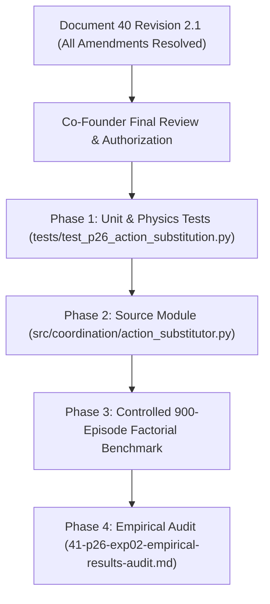

# HOROS PROBE-1 Research-002 — Stage P2.6
## Document 40 (Revision 2.1): Experiment 02 — Action Substitution Mathematical Specification & Controlled Factorial Protocol

**Program:** HOROS PROBE-1, Research-002 — Trustworthy Action-Conditioned Contact World Models  
**Stage:** P2.6 — Contact-Aware Safety Coordination  
**Document:** 40 (Formal Revision 2.1 incorporating Co-Founder Technical Audit)  
**Status:** **Pre-Implementation Specification Frozen for Authorization**  
**Author:** HOROS Physical Intelligence Research Group  
**Date:** November 6, 2026  

---

## 1. Executive Context & Co-Founder Review Audit

Following technical co-founder review of Revision 2.0, this **Revision 2.1** formalizes four final mathematical and experimental amendments before source code implementation is authorized:

| Amendment | Issue Addressed | Formal Resolution in Revision 2.1 |
| :--- | :--- | :--- |
| **40.6 (Directional Branching)** | Upward clipping prevented negative (downward) commands from passing | Explicit 3-way branching: (1) Upward friction-aware velocity controller, (2) Downward descent with table-boundary guard, (3) Zero-contact / sensor-fault safe fallback |
| **40.7 ($K_p$ Units & Active Retraction)** | $K_p$ lacked dimensional units; anti-crush was passive inhibit | Defined $K_p = 1.0\text{ step}^{-1}$ ($10\text{ ms}$ time constant); implemented active outward proportional retraction ($K_{\text{retract}} = 1.5\text{ step}^{-1}$) for $F_n \ge 18.0\text{ N}$ |
| **40.8 (Singularity Guard & Contact Model)** | Divide-by-zero when $F_{n,i} \to 0$; equal-load assumption scope | Regularized friction ratio with singular cutoff at $F_{n,i} < 0.10\text{ N} \implies \rho_i = \infty$ (clamp locked); documented antipodal load-sharing scope |
| **40.9 (Exact Wilson CI & Denominators)** | Stated $3.98\%$ upper bound for $0/90$ | Corrected 95% Wilson upper bound to $4.09\%$ ($z^2 / (n + z^2)$); froze unpooled per-variant denominator rules |

---

## 2. First-Principles Mathematical Derivation

### 2.1 Coordinate Frame, Kinematic State & Actuator Space
In `MultifingerLiftEnv`:
- Object mass: $m = 0.50\text{ kg}$, gravitational acceleration $g = 9.81\text{ m/s}^2 \implies F_g = m g = 4.905\text{ N}$.
- Hand topology: $N_f = 4$ antipodal hemispherical fingertips positioned radially around object at nominal radius $r_{\text{nom}} = 35.0\text{ mm}$.
- Control frequency: $100\text{ Hz}$ ($\Delta t = 0.01\text{ s}$).
- State vector: At time step $t$, the controller observes:
  - Fingertip radial positions $\mathbf{p}_{i,t} \in \mathbb{R}^3$, radial distance $r_{i,t} = \|\mathbf{p}_{i,t}^{\text{radial}}\| = \sqrt{x_{i,t}^2 + y_{i,t}^2}$.
  - Measured normal contact forces $\mathbf{F}_{n,t} = [F_{n,1,t}, \dots, F_{n,N_f,t}]^T \in \mathbb{R}^{N_f}_{\ge 0}$.
  - Measured tangential shear forces $\mathbf{F}_{t,t} = [\mathbf{F}_{t,1,t}, \dots, \mathbf{F}_{t,N_f,t}]^T$.
  - Hand vertical velocity $v_{z,t}\ [\text{m/s}]$ and object vertical position $z_{\text{obj}, t}\ [\text{mm}]$.
- Action command: $a_t = [a_{\text{sqz}, 1, t}, \dots, a_{\text{sqz}, N_f, t}, a_{\text{lift}, t}]^T \in \mathbb{R}^5$:
  - $a_{\text{sqz}, i, t} \in [-\Delta a_{\max}, \Delta a_{\max}] = [-2.0, 2.0]\text{ mm/step}$: Inward radial displacement increment.
  - $a_{\text{lift}, t} \in [-\Delta z_{\max}, \Delta z_{\max}] = [-2.0, 5.0]\text{ mm/step}$: Arm vertical displacement increment.
- Elastomeric normal contact stiffness:
  $$F_{n,i}(\delta_{i,t}) = k_{\text{elastic}} \cdot \max(0, \delta_{i,t}), \quad k_{\text{elastic}} = 4.0\text{ N/mm}$$
  where indentation $\delta_{i,t} = \max(0, r_{\text{nom}} - r_{i,t})\ [\text{mm}]$.

---

### 2.2 Squeeze Preload Substitution Controller (Amendments 40.1 & 40.7)

#### A. Required Normal Force per Contact
To support object weight $F_g$ with friction coefficient $\mu = 0.60$ under dynamic safety margin $\gamma = 1.25$:
$$F_{n,\text{required}} = \frac{\gamma \cdot F_g}{N_f \cdot \mu} = \frac{1.25 \times 4.905}{4 \times 0.60} = 2.5547\text{ N}$$

#### B. Normal Force Deficit & Indentation Target
At step $t$, the normal force deficit for finger $i$ is:
$$\Delta F_{n,i,t} = \max\left(0, F_{n,\text{required}} - F_{n,i,t}\right) \quad [\text{N}]$$

The required elastic indentation target is:
$$\delta_{\text{target}, i,t} = \delta_{i,t} + \frac{\Delta F_{n,i,t}}{k_{\text{elastic}}} \quad [\text{mm}]$$

#### C. Bounded Proportional Displacement Controller (Amendment 40.7)
The proportional gain $K_p$ possesses physical units of **inverse control steps**:
$$[K_p] = \text{step}^{-1}$$
For $\Delta t = 0.01\text{ s}$ ($100\text{ Hz}$), setting $K_p = 1.0\text{ step}^{-1}$ yields a closed-loop tracking time constant $\tau = \Delta t / K_p = 10.0\text{ ms}$.

The displacement command increment per step is:
$$\Delta a_{\text{cmd}, \text{sqz}, i, t} = \operatorname{clip}\left(K_p \cdot (\delta_{\text{target}, i,t} - \delta_{i,t}), -\Delta a_{\max}, \Delta a_{\max}\right) = \operatorname{clip}\left(K_p \cdot \frac{\Delta F_{n,i,t}}{k_{\text{elastic}}}, -2.0, 2.0\right) \quad [\text{mm/step}]$$

#### D. Substituted Squeeze Command & Active Anti-Crush Retraction (Amendment 40.7)
When operating below the crush threshold ($F_{n,i,t} < 18.0\text{ N}$):
$$a_{\text{sub}, \text{sqz}, i, t} = \operatorname{clip}\left(\max\left(a_{\text{prop}, \text{sqz}, i, t}, \Delta a_{\text{cmd}, \text{sqz}, i, t}\right), -2.0, 2.0\right) \quad [\text{mm/step}]$$

**Active Anti-Crush Outward Retraction Policy:**
Merely inhibiting positive squeeze is insufficient to rapidly bleed off excessive normal force under dynamic transients. When contact force reaches or exceeds the protective ceiling $F_{\text{ceiling}} = 18.0\text{ N}$ ($25.0\text{ N}$ hard environment limit), the controller commands active outward retraction:
$$\Delta a_{\text{retract}, i, t} = -K_{\text{retract}} \cdot \frac{F_{n,i,t} - F_{\text{ceiling}}}{k_{\text{elastic}}} \quad [\text{mm/step}]$$
where $K_{\text{retract}} = 1.5\text{ step}^{-1}$.  
The command is strictly bounded to outward travel:
$$a_{\text{sub}, \text{sqz}, i, t} = \operatorname{clip}\left(\Delta a_{\text{retract}, i, t}, -2.0, 0.0\right) \quad [\text{mm/step}]$$

---

### 2.3 Explicit Three-Way Lift Command Architecture (Amendments 40.2, 40.3 & 40.6)

The vertical lift safety layer executes through **three mutually exclusive, deterministic operational branches**:

```
+---------------------------------------------------------------------------------------+
|                       THREE-WAY VERTICAL COMMAND BRANCHING                            |
+---------------------------------------------------------------------------------------+
| Condition                                     | Execution Policy                      |
+-----------------------------------------------+---------------------------------------+
| 1. Upward Lift Command (a_prop > 0)           | Stateful Friction-Aware Integrator    |
| 2. Downward Descent Command (a_prop <= 0)     | Descent with Table Collision Guard    |
| 3. Sensor Fault or Contact Loss (Fn < 0.10 N) | Emergency Hover & Inward Search       |
+-----------------------------------------------+---------------------------------------+
```

#### Branch 1: Upward Motion ($a_{\text{prop}, \text{lift}, t} > 0$)
1. **Per-Contact Friction Bottleneck (Amendment 40.3):**
   In multi-finger antipodal grasping, gross slip initiates at the weakest contact. The conservative sustainable vertical shear force is:
   $$F_{t,\max, t} = N_f \cdot \min_{i=1 \dots N_f} \left(\eta \mu_i F_{n,i,t}\right) \quad [\text{N}]$$
   where $\eta = 0.85$ ($15\%$ friction cone safety buffer).
   *Scope note:* This formulation represents a conservative diagnostic bound under symmetrical antipodal grasping. Individual contact constraints $\|\mathbf{F}_{t,i}\| \le \mu_i F_{n,i}$ remain independently monitored in the safety audit.

2. **Maximum Permissible Upward Acceleration:**
   $$a_{z,\max, t} = \frac{F_{t,\max, t} - m g}{m} \quad [\text{m/s}^2]$$
   - If $F_{t,\max, t} \le m g$ (preload deficit): $a_{z,\max, t} \le 0 \implies v_{z,\max, t} = 0.0$ (Strict upward lock).
   - If $F_{t,\max, t} > m g$ (sufficient preload):
     $$v_{z,\max, t} = \max\left(0.0, v_{z,t} + a_{z,\max, t} \cdot \Delta t\right) \quad [\text{m/s}]$$

3. **Stateful Velocity Integration & Step Conversion (Amendment 40.2):**
   $$v_{\text{prop}, t+1} = \frac{a_{\text{prop}, \text{lift}, t} \cdot 10^{-3}}{\Delta t} \quad [\text{m/s}]$$
   $$v_{z,t+1} = \operatorname{clip}\left(v_{\text{prop}, t+1}, 0.0, v_{z,\max, t}\right) \quad [\text{m/s}]$$
   $$a_{\text{sub}, \text{lift}, t} = \operatorname{clip}\left(v_{z,t+1} \cdot \Delta t \cdot 10^3, 0.0, 5.0\right) \quad [\text{mm/step}]$$

#### Branch 2: Downward Motion ($a_{\text{prop}, \text{lift}, t} \le 0$) (Amendment 40.6)
Downward arm motion lowers the object in the direction of gravity and does not threaten friction-cone collapse. However, downward motion must strictly prevent table penetration:
$$z_{\text{safe\_descent}} = \max\left(a_{\text{prop}, \text{lift}, t}, -z_{\text{obj}, t}\right) \quad [\text{mm/step}]$$
$$a_{\text{sub}, \text{lift}, t} = \operatorname{clip}\left(z_{\text{safe\_descent}}, -2.0, 0.0\right) \quad [\text{mm/step}]$$
$$v_{z,t+1} = \frac{a_{\text{sub}, \text{lift}, t} \cdot 10^{-3}}{\Delta t} \quad [\text{m/s}]$$

#### Branch 3: Contact Loss & Sensor Fault Fallback (Amendment 40.8)
If sensor telemetry reports invalid/NaN values, or if fingertip contact is broken ($\exists i: F_{n,i,t} < F_{n,\text{min\_valid}} = 0.10\text{ N}$) during an active grasp phase:
- Vertical motion is immediately arrested: $a_{\text{sub}, \text{lift}, t} = 0.0\text{ mm/step}$, $v_{z,t+1} = 0.0\text{ m/s}$.
- Squeeze actuators enter gentle inward search: $a_{\text{sub}, \text{sqz}, i, t} = +0.20\text{ mm/step}$.

---

### 2.4 Singularity-Guarded Clamp Release Logic (Amendment 40.8)

In Variant E02-A, the lift clamp is evaluated for release. To eliminate division-by-zero singularities when normal force is zero or near-zero, the regularized friction ratio $\rho_i$ is formally defined:
$$\rho_i(t) = \begin{cases} \infty & \text{if } F_{n,i,t} < 0.10\text{ N} \quad (\text{Singular / Inactive Contact}) \\ \frac{\|\mathbf{F}_{t,i,t}\|}{\mu_i F_{n,i,t}} & \text{if } F_{n,i,t} \ge 0.10\text{ N} \end{cases}$$

**E02-A Clamp-Release Condition:**
The vertical arm lift action is released to the planner proposal ($a_{\text{sub}, \text{lift}, t} = a_{\text{prop}, \text{lift}, t}$) if and only if **all** contacts simultaneously satisfy:
$$\min_{i=1 \dots N_f} F_{n,i,t} \ge F_{n,\text{required}} \quad \text{AND} \quad \max_{i=1 \dots N_f} \rho_i(t) \le \eta$$
If either condition is violated, $a_{\text{sub}, \text{lift}, t} = 0.0\text{ mm/step}$ while squeeze preload augmentation proceeds.

---

## 3. Controlled Factorial Matrix & Disambiguation (Amendment 40.4)

Experiment 02 implements a strict $2 \times 2$ factorial ablation plus baseline negative control:

```
+-------------------------------------------------------------------------------------------------------+
|                                 FACTORIAL COMPARISON MATRIX (EXP-02)                                  |
+---------------+---------------------------------------+-------------------------------+---------------+
| Condition     | Squeeze Action Command                | Lift Action Command           | Planner Prior |
+---------------+---------------------------------------+-------------------------------+---------------+
| Baseline (C2) | a_prop[:4] (Unmodified)               | 0.0 mm/step (Hard Zero Clamp) | Uncoordinated |
| Variant E02-A | a_sub[:4] (Preload Controller)        | Stateful Clamp Release Logic  | Uncoordinated |
| Variant E02-B | a_prop[:4] (Unmodified)               | Three-Way Stateful Integrator | Uncoordinated |
| Variant E02-C | a_sub[:4] (Preload Controller)        | Three-Way Stateful Integrator | Uncoordinated |
| Variant E02-D | a_sub[:4] (Preload Controller)        | Three-Way Stateful Integrator | Coordinated   |
+---------------+---------------------------------------+-------------------------------+---------------+
```

### 3.1 Variant Causal Isolation Objectives

1. **Baseline ($C_2$ Negative Control):** Original decoupled p-CBF filter. Serves as reference reproducing the $90.0\%$ stall rate and 16-step streak.
2. **Variant E02-A (Normal Preload Only):** Evaluates whether active normal force building alone breaks the deadband once the threshold is crossed, without changing the binary lift clamping logic.
3. **Variant E02-B (Velocity Scaling Only):** Evaluates whether smooth proportional lift velocity alone prevents stalls if the hand builds normal force naturally.
4. **Variant E02-C (Full Action Substitution):** Combines preload augmentation and friction-aware velocity scaling in the runtime filter.
5. **Variant E02-D (Coordinated CEM Planner + E02-C Filter):** Integrates E02-C filter with CEM prior coordination:
   - When $\min_i F_{n,i,t} < F_{n,\text{required}}$, CEM prior sampling mean is initialized to:
     $$\boldsymbol{\mu}_{\text{CEM}, \text{sqz}} = \Delta \mathbf{a}_{\text{cmd}, \text{sqz}, t}, \quad \mu_{\text{CEM}, \text{lift}} = 0.0$$
   - When $\min_i F_{n,i,t} \ge F_{n,\text{required}}$, CEM prior sampling mean is initialized to:
     $$\boldsymbol{\mu}_{\text{CEM}, \text{sqz}} = 0.0, \quad \mu_{\text{CEM}, \text{lift}} = \Delta z_{\text{safe}, t}$$
   - **Isolation Purpose:** Cleanly separates the additive value of planner-level adaptation over filter-level substitution by measuring reduction in proposed action distortion $\|a_{\text{prop}} - a_{\text{sub}}\|$.

---

## 4. Sampling Protocol, Exact Statistics & Acceptance Gates (Amendment 40.5 & 40.9)

### 4.1 Frozen Episode Allocation & Denominators
- **Per-Seed Sample Size:** 30 episodes per seed.
- **Seeds Evaluated:** 3 independent random seeds:
  - Seed 1: $s = 100$ (Episodes 0–29, base seed 6000)
  - Seed 2: $s = 200$ (Episodes 0–29, base seed 7000)
  - Seed 3: $s = 300$ (Episodes 0–29, base seed 8000)
- **Total Sample per Model-Variant Condition:** $n = 90$ episodes ($30 \times 3$).
- **Benchmark Scale:** 5 conditions $\times$ 2 active models ($M_2, M_4$) $\times$ 90 episodes = **900 episodes**, plus $M_0$ passive reference check = **960 episodes total**.

### 4.2 Strict Reporting & Disaggregation Protocol (Amendment 40.9)
1. **No Artificial Denominator Inflation:** Results will be reported strictly per model ($M_2$ and $M_4$ separate) and per variant. Zero-violation results will be reported as $0/90$ for each individual model-variant combination, never pooled across conditions.
2. **Paired Comparisons:** Seeds and initial object/hand states are strictly identical across variants to guarantee valid paired statistical tests.
3. **Exact 95% Wilson Score Confidence Bounds:**
   For $n = 90$ episodes and $k = 0$ observed violations, the two-sided 95% Wilson interval upper bound is:
   $$U = \frac{z^2}{n + z^2} = \frac{1.96^2}{90 + 1.96^2} = \frac{3.8416}{93.8416} = 4.0938\% \approx 4.09\%$$
   The previous $3.98\%$ typo is formally deprecated and replaced by **$4.09\%$**.

### 4.3 Model-Specific Acceptance Gates

| Gate | Target Metric | Baseline $C_2$ ($M_2$) | Baseline $C_2$ ($M_4$) | Acceptance Threshold ($M_2$) | Acceptance Threshold ($M_4$) |
| :---: | :--- | :---: | :---: | :---: | :---: |
| **2.1** | Intervention Frequency ($N_{\text{int}} / N_{\text{dec}}$) | $46.53\%$ ($349/750$) | $38.67\%$ ($290/750$) | **$\le 20.0\%$** ($\ge 57\%$ reduction) | **$\le 18.0\%$** ($\ge 53\%$ reduction) |
| **2.2** | Max Consecutive Intervention Streak | 16 steps | 12 steps | **$\le 3$ steps** | **$\le 3$ steps** |
| **2.3** | Stall Rate ($k/N$, %) | $90.0\%$ ($27/30$) | $96.67\%$ ($29/30$) | **$\le 20.0\%$** | **$\le 15.0\%$** |
| **2.4** | Task Success Rate ($k/N$, %) | $0.0\%$ ($0/30$) | $0.0\%$ ($0/30$) | **$\ge 15.0\%$** ($> 13.3\%$ C1 level) | **$\ge 25.0\%$** (Recovers 26.7% C1 level) |
| **2.5** | Hard Violations (Crush / Drop) | $0/30$ ($0.0\%$) | $0/30$ ($0.0\%$) | **$0/90$ (CI upper $\le 4.09\%$)** | **$0/90$ (CI upper $\le 4.09\%$)** |
| **2.6** | Multi-Seed Stability | N/A | N/A | Monotonic gain across all 3 seeds | Monotonic gain across all 3 seeds |

*Formal Non-Claim:* Achieving $0/90$ hard violations demonstrates strong empirical compliance ($p < 0.0409$), but is explicitly designated as empirical non-violation evidence, **not** a formal mathematical safety certificate.

---

## 5. Phased Rollout Sequence



**Instruction:** No lines of production controller code will be authored until Document 40 Revision 2.1 receives formal co-founder authorization.
