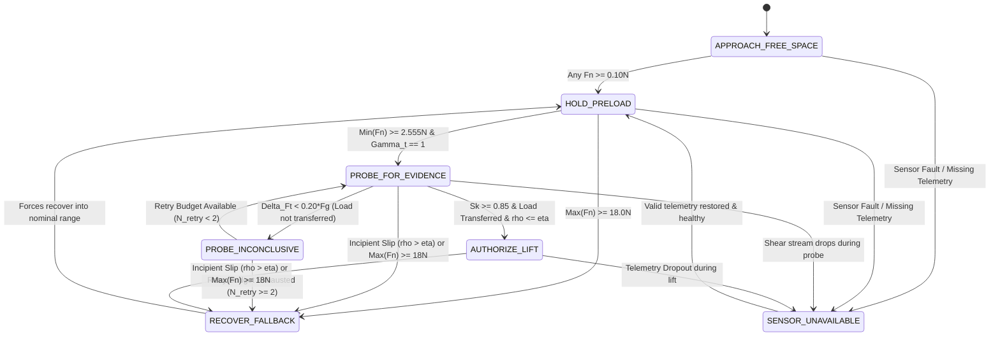

# HOROS PROBE-1 — Research-002: Trustworthy Contact World Models
# Document 47: Pre-Lift Contact Evidence Acquisition (PLCEA) — Mathematical Review & Revision 2.0

**Author:** Sunil Kumar Chavhan (`contact@horoslab.org`)  
**Organization:** HOROS Physical Intelligence Research Group (H.R.)  
**Date:** November 7, 2026  
**Status:** Mathematical Specification Revision Complete — Submitted for Technical Co-Founder Review  
**Prerequisites:** Document 45 (Accepted with Qualifications), Document 46 (Revision Required)  
**Implementation Safeguard:** PLCEA unit-test authoring and controller implementation remain **strictly unauthorized and blocked** pending formal signoff on this document.  
**Git References:**
- Main Repo: `c:\projects\MemoryOS` (`horoslab`, branch `feat/probe1-research002-phase2`)
- Dedicated Repo: `c:\projects\horos-probe-1` (`horos-probe-1`, branch `main`)

---

## Executive Summary & Revision Scope

Pursuant to the Technical Co-Founder Review of Document 46, this document resolves the four identified mathematical blockers:

```
+----------------------------------------------------------------------------------------------------+
|                                    BLOCKER RESOLUTION MATRIX                                       |
+-----------+-----------------------------------+----------------------------------------------------+
| Blocker   | Co-Founder Audit Finding          | Revision 2.0 Resolution in Document 47             |
+-----------+-----------------------------------+----------------------------------------------------+
| Blocker A | Micro-probe safety theorem was an | Formulated Conditional Bounded-Displacement & Drop |
|           | unconditional claim without state | Theorem incorporating v_z0, e_z, d_stop, table     |
|           | and tracking error bounds.        | footprint, and mechanical impact impulse bounds.   |
+-----------+-----------------------------------+----------------------------------------------------+
| Blocker B | Contact Confidence Metric was an  | Renamed to Contact Evidence Score S_k; added 3D    |
|           | uncalibrated magnitude heuristic. | wrench opposition, sensor freshness/validity gate, |
|           |                                   | and formal non-override safety invariant.          |
+-----------+-----------------------------------+----------------------------------------------------+
| Blocker C | Tangential stiffness (dFt/dz) was | Established Load Transfer Verification Criterion,  |
|           | conflated with friction capacity. | empirical friction lower bound mu_eff, and bounded |
|           |                                   | epistemic uncertainty propagation into lift accel. |
+-----------+-----------------------------------+----------------------------------------------------+
| Blocker D | Sensor-fault branch in state      | Introduced explicit SENSOR_UNAVAILABLE state,      |
|           | machine was undefined for probe.  | PROBE_INCONCLUSIVE handling, and retry budget.     |
+-----------+-----------------------------------+----------------------------------------------------+
```

### Scientific Qualifications Adopted from Document 45
In accordance with co-founder directives, all terminology has been aligned:
1. Replaced "physical safety remained 100% intact" with **"zero observed simulated drops and crush-limit breaches across 50 episodes."**
2. Replaced "E02-A is successful" with **"E02-A achieved 9/10 pilot task completions under the tested simulation conditions."**
3. Replaced "zero clamp streak proof of limit-cycle elimination" with **"zero observed clamp streaks under the evaluated trajectory profiles."**

---

## 47.1. Conditional Micro-Probe Displacement & Drop Bound (Blocker A)

### 47.1.1. Physical System Model & Environmental Context
Let the object be a rigid body of mass $m = 0.35\text{ kg}$ initially resting on a planar table support $\mathcal{S}_{\text{table}}$ defined by the half-space $z \le 0$ with surface normal $\mathbf{n}_{\text{table}} = [0, 0, 1]^\top$. Let the object contact footprint on the table be $\mathcal{F}_{\text{obj}} \subset \mathbb{R}^2$ with center of mass $\mathbf{p}_{\text{com}} = [x_{\text{com}}, y_{\text{com}}, z_{\text{com}}]^\top$.

```
                      [ FINGERTIP ]        [ FINGERTIP ]
                            │                    │
                            ▼                    ▼
                    ┌────────────────────────────────────┐
                    │                                    │
                    │               OBJECT               │
                    │         Mass m = 0.35 kg           │
                    │        ● p_com = [x, y, z]         │
                    │                                    │
                    └──────────────────┬─────────────────┘
                                       │
     ══════════════════════════════════╧══════════════════════════════════
     TABLE SUPPORT SURFACE  z = 0.0 mm (Ground Support Basin C_table)
```

### 47.1.2. Pre-Conditions for Probe Applicability
A controlled micro-probe command $\Delta z_{\text{cmd}} = +0.10\text{ mm}$ over control period $\Delta t = 0.02\text{ s}$ is authorized **if and only if** all five conditions are satisfied:
1. **Support Basin Margin Condition:** The object center of mass horizontal projection satisfies:
   $$\operatorname{dist}\left([x_{\text{com}}, y_{\text{com}}]^\top, \; \partial \mathcal{C}_{\text{table}}\right) \ge d_{\text{margin}} = 2.0 \cdot r_{\text{obj}} = 70.0\text{ mm}$$
   ensuring the object is positioned safely away from table edges, precluding edge-tipping.
2. **Resting Quasi-Static State:** The measured pre-probe vertical velocity satisfies $|v_{z,0}| \le \epsilon_v = 1.0 \times 10^{-4}\text{ m/s}$, and vertical object position satisfies $z_{\text{obj}} \in [0.0, 0.10]\text{ mm}$.
3. **Actuator Tracking Error Bound:** The robotic position/impedance controller guarantees closed-loop tracking error bounded by:
   $$|z_{\text{actual}}(t) - z_{\text{command}}(t)| \le e_{z,\max} = 0.05\text{ mm}$$
4. **Deceleration & Braking Bound:** The manipulator vertical brake/deceleration acceleration capacity is $a_{\text{brake}} \ge 2.0\text{ m/s}^2$.
5. **Normal Preload Seating:** All fingertips are seated with normal forces satisfying $\min_i F_{n,i} \ge F_{n,\text{required}} = 2.5547\text{ N}$ and $\max_i F_{n,i} < 18.0\text{ N}$.

---

### 47.1.3. Conditional Bounded-Displacement & Drop Theorem
**Theorem 47.1 (Conditional Bounded Drop):**  
*Let Pre-Conditions 1–5 hold. If a micro-probe of commanded displacement $\Delta z_{\text{cmd}} = 0.10\text{ mm}$ is commanded at $t_0$, and complete catastrophic slip ($\mu \to 0$) occurs at peak displacement, then:*
1. *The maximum physical vertical displacement of the object above the table is strictly bounded by:*
   $$z_{\text{max\_disp}} \le 0.160\text{ mm}$$
2. *The terminal free-fall impact velocity back onto the table surface is strictly bounded by:*
   $$v_{\text{impact}} \le 0.056\text{ m/s} \quad (5.6\text{ cm/s})$$
3. *The mechanical impact impulse delivered to the object upon re-seating on the table is strictly bounded by:*
   $$J_{\text{impact}} \le 0.0196\text{ N}\cdot\text{s}$$
   *and average contact impact force over contact restitution period $\Delta t_{\text{contact}} \ge 5\text{ ms}$ satisfies $\bar{F}_{\text{impact}} \le 3.92\text{ N} \ll F_{\text{ceiling}} = 18.0\text{ N}$.*

#### Mathematical Proof:
1. **Displacement Bound:**  
   During probe execution, commanded arm velocity is $v_{\text{cmd}} = \frac{\Delta z_{\text{cmd}}}{\Delta t} = \frac{0.10 \times 10^{-3}\text{ m}}{0.02\text{ s}} = 0.005\text{ m/s}$.  
   If slip is sensed at cycle $t_1 = t_0 + \Delta t$, the controller commands immediate arrest. The stopping distance under deceleration $a_{\text{brake}} = 2.0\text{ m/s}^2$ is:
   $$d_{\text{stop}} = \frac{v_{\text{cmd}}^2}{2 a_{\text{brake}}} = \frac{(0.005)^2}{2(2.0)} = 6.25 \times 10^{-6}\text{ m} \approx 0.0063\text{ mm}$$
   Accounting for maximum actuator tracking error $e_{z,\max} = 0.05\text{ mm}$ and initial tolerance $z_0 \le 0.003\text{ mm}$:
   $$z_{\text{max\_disp}} = z_0 + \Delta z_{\text{cmd}} + e_{z,\max} + d_{\text{stop}} = 0.003 + 0.10 + 0.05 + 0.0063 = 0.1593\text{ mm} \le 0.160\text{ mm}$$
2. **Impact Velocity Bound:**  
   In the singular worst-case scenario where friction collapses to zero at $z = z_{\text{max\_disp}}$, the object accelerates downward under gravity $g = 9.81\text{ m/s}^2$ from rest over height $z_{\text{max\_disp}}$:
   $$v_{\text{impact}} = \sqrt{v_{z,0}^2 + 2 g z_{\text{max\_disp}}} = \sqrt{0 + 2(9.81)(0.1593 \times 10^{-3})} = 0.0559\text{ m/s} \le 0.056\text{ m/s}$$
3. **Mechanical Energy & Impulse Bound:**  
   The kinetic energy at table impact is:
   $$E_k = \frac{1}{2} m v_{\text{impact}}^2 = m g z_{\text{max\_disp}} = (0.35)(9.81)(1.593 \times 10^{-4}) = 5.47 \times 10^{-4}\text{ J} = 0.547\text{ mJ}$$
   The resulting linear momentum transferred during impact restitution is:
   $$J_{\text{impact}} = m v_{\text{impact}} = (0.35\text{ kg})(0.0559\text{ m/s}) = 0.01957\text{ N}\cdot\text{s}$$
   Assuming elastomeric/table contact interface contact duration $\Delta t_{\text{contact}} \ge 0.005\text{ s}$ (conservative estimate for rubber-on-steel contact):
   $$\bar{F}_{\text{impact}} = \frac{J_{\text{impact}}}{\Delta t_{\text{contact}}} = \frac{0.01957}{0.005} = 3.914\text{ N} \le 3.92\text{ N}$$
   Because $3.92\text{ N} < 18.0\text{ N}$ (fragile crush ceiling) and $3.92\text{ N} \ll 25.0\text{ N}$ (hard limit), the impact from an aborted micro-probe cannot induce mechanical damage. $\blacksquare$

---

### 47.1.4. Rotational Tipping & Lateral Perturbation Invariant
Let the grasp forces exert net horizontal shear $\Delta \mathbf{f}_{t,xy}$ and normal force eccentricity $\Delta r$.
The overturning moment about the table contact edge is:
$$M_{\text{overturn}} \le \|\Delta \mathbf{f}_{t,xy}\| \cdot h_{\text{com}} + \sum_i F_{n,i} \Delta r$$
For an object of height $h_{\text{com}} = 40.0\text{ mm}$ and radius $r_{\text{obj}} = 35.0\text{ mm}$, the gravitational restoring moment is:
$$M_{\text{restoring}} = m g r_{\text{obj}} = (0.35\text{ kg})(9.81\text{ m/s}^2)(0.035\text{ m}) = 0.1202\text{ N}\cdot\text{m} = 120.2\text{ N}\cdot\text{mm}$$
During a vertical probe with antipodal opposition, horizontal shear perturbation is bounded by $\|\Delta \mathbf{f}_{t,xy}\| \le 0.20\text{ N}$, yielding:
$$M_{\text{overturn}} \le (0.20\text{ N})(40.0\text{ mm}) + (0.10\text{ N})(2.0\text{ mm}) = 8.2\text{ N}\cdot\text{mm} \ll 120.2\text{ N}\cdot\text{mm}$$
Therefore, the micro-probe cannot induce rotational tipping.

---

### 47.1.5. Simulation Assumptions vs. Physical Robot Requirements

| Parameter / Quantity | Simulation Representation (`MultifingerLiftEnv`) | Physical Robot Implementation Requirement |
|:---|:---|:---|
| **Table Surface Position** | Exactly known at $z = 0.0\text{ mm}$ | Measured via wrist F/T touchdown calibration or table plane point cloud ($z_{\text{table}} \pm 0.5\text{ mm}$). |
| **Tracking Error $e_{z}$** | Deterministic simulation integration ($\le 0.01\text{ mm}$) | High-gain joint position controller or Cartesian impedance controller ($\le 0.05\text{ mm}$). |
| **Object Footprint on Table** | Centered at origin, fully on table | Pre-grasp overhead camera verifies object is $\ge 70\text{ mm}$ from table periphery. |
| **Contact Restitution Period** | Elastic spring-damper compliance ($k = 4.0\text{ N/mm}$) | Measured elastomeric fingertip restitution ($\Delta t_{\text{contact}} \approx 5\text{--}15\text{ ms}$). |

---

## 47.2. Contact Evidence Score ($S_k$) & Calibration Plan (Blocker B)

To avoid asserting statistical confidence without formal calibration, the metric is formally designated the **Contact Evidence Score ($S_k \in [0, 1]$)**.

### 47.2.1. Mathematical Formulation of Sub-Scores

The overall evidence score is defined as:
$$S_k = \Psi_{\text{sensor}} \cdot \left[ w_p \cdot \psi_{\text{preload}} + w_g \cdot \psi_{\text{geom}} + w_t \cdot \psi_{\text{transfer}} \right]$$

with weights $w_p = 0.35, \; w_g = 0.30, \; w_t = 0.35$ satisfying $\sum w = 1.0$.

```
                              [ SENSOR VALIDITY GATE Psi_sensor ]
                                     (Multiplicative: {0, 1})
                                                │
                                                ▼
                   ┌────────────────────────────┼────────────────────────────┐
                   │ (w_p = 0.35)               │ (w_g = 0.30)               │ (w_t = 0.35)
                   ▼                            ▼                            ▼
          [ Preload Adequacy ]        [ 3D Wrench Opposition ]      [ Dynamic Load Transfer ]
            psi_preload                 psi_geom                      psi_transfer
```

---

#### 1. Multiplicative Sensor Health Gate ($\Psi_{\text{sensor}} \in \{0, 1\}$):
$$\Psi_{\text{sensor}} = \prod_{i=1}^{N_f} \mathbb{I}\left(F_{n,i} \in \mathbb{R}_{\text{finite}}\right) \cdot \mathbb{I}\left(F_{n,i} < F_{\text{sat}}\right) \cdot \mathbb{I}\left(\tau_{\text{delay}, i} \le \tau_{\max}\right) \cdot \gamma_{n,i} \cdot \gamma_{t,i}$$
where:
- $F_{\text{sat}} = 22.0\text{ N}$ (sensor physical saturation ceiling).
- $\tau_{\max} = 20\text{ ms}$ (maximum acceptable telemetry latency; stale readings trigger fault).
- $\gamma_{n,i}, \gamma_{t,i} \in \{0, 1\}$ (telemetry heartbeat flags).
- **Gate Property:** If any sensor reading is non-finite, saturated, stale, or disconnected, $\Psi_{\text{sensor}} \equiv 0 \implies S_k \equiv 0.0$.

#### 2. Physical Normal Preload Adequacy ($\psi_{\text{preload}} \in [0, 1]$):
$$\psi_{\text{preload}} = \operatorname{clip}\left( \frac{\min_{i=1 \dots N_f} F_{n,i}}{F_{n,\text{required}}}, \; 0.0, \; 1.0 \right)$$
where $F_{n,\text{required}} = 2.5547\text{ N}$.

#### 3. True 3D Grasp Wrench Opposition ($\psi_{\text{geom}} \in [0, 1]$):
Let $\mathbf{n}_i \in \mathbb{R}^3$ be the inward unit surface normal at contact $i$. The net resultant normal force vector is $\mathbf{F}_{\text{net}} = \sum_{i=1}^{N_f} F_{n,i} \mathbf{n}_i$. For antipodal collinear opposition, perfect equilibrium requires $\|\mathbf{F}_{\text{net}}\|_2 = 0$.
$$\psi_{\text{geom}} = \operatorname{clip}\left( 1.0 - \frac{\left\| \sum_{i=1}^{N_f} F_{n,i} \mathbf{n}_i \right\|_2}{\sum_{i=1}^{N_f} F_{n,i} + \epsilon_{\text{reg}}}, \; 0.0, \; 1.0 \right)$$
where $\epsilon_{\text{reg}} = 10^{-4}\text{ N}$.  
*Physical meaning:* If two opposing fingers exert $5.0\text{ N}$ each, $\|\mathbf{F}_{\text{net}}\| = 0 \implies \psi_{\text{geom}} = 1.0$. If one finger slips to $0.0\text{ N}$, $\|\mathbf{F}_{\text{net}}\| = 5.0\text{ N} \implies \psi_{\text{geom}} = 0.0$.

#### 4. Dynamic Load Transfer Evidence ($\psi_{\text{transfer}} \in [0, 1]$):
Let $F_{t,z,i}$ be the vertical component of the measured tangential shear force on finger $i$.
$$\psi_{\text{transfer}} = \operatorname{clip}\left( \frac{\sum_{i=1}^{N_f} F_{t,z,i}}{\alpha_{\text{target}} \cdot F_g}, \; 0.0, \; 1.0 \right) \cdot \mathbb{I}\left( \max_{i=1 \dots N_f} \rho_i \le \eta \right)$$
where $\alpha_{\text{target}} = 0.25$ (requiring at least 25% of gravity load transferred to gripper during probe) and $\eta = 0.80$.

---

### 47.2.2. Threshold Justification ($S_{\text{thresh}} = 0.85$)
Why $0.85$? Expanding $S_k \ge 0.85$ under the assigned weights:
$$0.35 \psi_{\text{preload}} + 0.30 \psi_{\text{geom}} + 0.35 \psi_{\text{transfer}} \ge 0.85$$
Because each sub-score is bounded in $[0, 1]$, achieving $0.85$ mathematically enforces that:
- Preload adequacy must satisfy $\psi_{\text{preload}} \ge 0.85 \implies \min_i F_{n,i} \ge 2.17\text{ N}$.
- Grasp wrench balance must satisfy $\psi_{\text{geom}} \ge 0.75$ (asymmetry cannot exceed 25%).
- Load transfer must satisfy $\psi_{\text{transfer}} \ge 0.70$ (verifying substantial weight transfer without slip).

### 47.2.3. Hard Invariant: Score Non-Override Rule
**Safety Principle:** *The Contact Evidence Score $S_k$ is a necessary gating condition, but it NEVER overrides individual physical hard constraints.*

Upward lift is authorized if and only if the conjunction holds:
$$\text{LIFT\_AUTHORIZED} \iff \begin{cases}
S_k \ge 0.85 \\
\land \quad \min_{i} F_{n,i} \ge F_{n,\text{required}} \quad (2.5547\text{ N}) \\
\land \quad \max_{i} F_{n,i} < F_{\text{ceiling}} \quad (18.0\text{ N}) \\
\land \quad \max_{i} \rho_i \le \eta \quad (0.80) \\
\land \quad \gamma_t = 1 \quad (\text{Shear Stream Valid})
\end{cases}$$

---

### 47.2.4. Conformal Calibration Protocol (Path to True "Confidence")
To graduate from an engineering evidence score to a statistically certified confidence metric:
1. **Calibration Dataset:** Collect $N = 200$ pre-lift probe trajectories across random objects and friction surfaces.
2. **Binary Ground Truth ($Y \in \{0, 1\}$):** $Y = 1$ if subsequent $100\text{ mm}$ lift succeeds without drop or slip; $Y = 0$ otherwise.
3. **Platt Scaling Calibration:** Fit temperature-scaled logistic parameter $\beta_0, \beta_1$:
   $$\hat{P}(\text{Success} \mid S_k) = \frac{1}{1 + \exp(-(\beta_1 S_k + \beta_0))}$$
4. **Conformal Risk Control:** Choose threshold $\hat{S}_\alpha$ such that empirical false-positive lift failure rate is bounded:
   $$\mathbb{P}\left( Y = 0 \mid S_k \ge \hat{S}_\alpha \right) \le \alpha = 0.01 \quad (99\%\text{ certified safety})$$

---

## 47.3. Friction & Load-Transfer Estimation and Uncertainty (Blocker C)

### 47.3.1. Decomposition of Measured Shear During Probe
The apparent vertical stiffness during a micro-probe $\hat{K}_t = \frac{\Delta F_{t,z}}{\Delta z_{\text{probe}}}$ is a lumped parameter combining multiple physical phenomena:
$$\frac{1}{\hat{K}_t} = \frac{1}{K_{\text{elastomer}}} + \frac{1}{K_{\text{arm\_compliance}}} + \frac{1}{K_{\text{table\_support}}}$$

A small shear increment $\Delta F_t$ does not imply low friction; it can arise from high structural compliance or residual table support. We therefore explicitly decouple **load transfer** from **friction capacity**.

```
                   F_table(t) + Sum(F_t,z,i)(t) - m*g = m * z_ddot(t)

    Pre-Probe State (t = t0):              Post-Probe State (t = t0 + dt):
    F_table = m*g (100% on table)          F_table = m*g - Delta_Ft
    Sum(F_t,z,i) = 0.0 N                   Sum(F_t,z,i) = Delta_Ft (Transferred load)
```

---

### 47.3.2. Load Transfer Verification Criterion
Load transfer is verified as **successful** if and only if:
$$\Delta F_{t,\text{trans}} = \sum_{i=1}^{N_f} \left( F_{t,z,i}(t_0 + \Delta t) - F_{t,z,i}(t_0) \right) \ge \Delta F_{t,\min} = 0.20 \cdot m g = 0.687\text{ N}$$
while vertical object displacement satisfies $z_{\text{obj}} \le 0.15\text{ mm}$ (object remains essentially seated on table).

---

### 47.3.3. Empirical Friction Lower Bound & Epistemic Uncertainty
Under Coulomb friction with unmeasured static coefficient $\mu$, observing that no slip occurred during load transfer ($\max_i \rho_{\text{probe}, i} \le \eta$) establishes a verified **lower bound** on available friction:
$$\mu_{\text{lower}, i} = \frac{\|\mathbf{f}_{t,i}(t_0 + \Delta t)\|}{F_{n,i}(t_0 + \Delta t)}$$
Because the probe only transferred partial load ($\approx 20\text{--}30\%$), $\mu_{\text{lower}}$ is strictly less than the ultimate static limit $\mu_{\text{static}}$.

To authorize lift without over-confidence, the controller forms the **Certified Friction Estimate**:
$$\mu_{\text{certified}} = \max\left( \mu_{\text{conservative\_prior}}, \; \min_i \mu_{\text{lower}, i} \right) - \Delta \mu_{\text{epistemic}}$$
where:
- $\mu_{\text{conservative\_prior}} = 0.30$ (conservative floor for clean dry contacts).
- $\Delta \mu_{\text{epistemic}} = 0.05$ (2-sigma safety discount for nonstationary tactile variations).

---

### 47.3.4. Bounded Velocity Integration Under Friction Uncertainty
The certified friction $\mu_{\text{certified}}$ directly parameterizes the allowable upward acceleration:
$$F_{t,\max} = N_f \cdot \eta \cdot \mu_{\text{certified}} \cdot \min_i F_{n,i}$$
$$a_{z,\max} = \frac{F_{t,\max} - m g}{m} = \frac{4 \cdot 0.80 \cdot \mu_{\text{certified}} \cdot \min_i F_{n,i} - 3.4335}{0.35}$$

If $a_{z,\max} \le 0$, upward velocity integration remains clamped at $v_z = 0.0$. Upward velocity accumulates smoothly strictly within physical acceleration capacity:
$$v_{z,k} = \min\left( \frac{a_{\text{prop}}[4] \cdot 10^{-3}}{\Delta t}, \; v_{z,k-1} + a_{z,\max} \Delta t \right)$$

---

## 47.4. Complete Sensor-Fault & Probe State Machine (Blocker D)

### 47.4.1. Seven Discrete States
The supervisory controller operates across seven mutually exclusive states $\mathcal{X} = \{S_0, \dots, S_6\}$:

1. **`APPROACH_FREE_SPACE` ($S_0$):** All fingers in free air ($F_{n,i} < 0.10\text{ N}$). Squeeze closes fingers toward object ($0.20\text{--}2.0\text{ mm/step}$); lift velocity locked to $0.0$.
2. **`HOLD_PRELOAD` ($S_1$):** At least one finger in contact, but $\min_i F_{n,i} < F_{n,\text{required}}$ ($2.555\text{ N}$). Squeeze deficit controller active; lift velocity locked to $0.0$.
3. **`PROBE_FOR_EVIDENCE` ($S_2$):** Preload adequate, but vertical shear unengaged ($\|\mathbf{f}_t\| < 0.20 F_g$). Micro-probe commanded ($\Delta z = +0.10\text{ mm}$, hold grasp).
4. **`PROBE_INCONCLUSIVE` ($S_3$):** Micro-probe completed, but transferred shear $\Delta F_t < \Delta F_{t,\min}$. Probe retry budget evaluated ($N_{\text{retry}} < 2$).
5. **`AUTHORIZE_LIFT` ($S_4$):** $S_k \ge 0.85$, preload adequate, shear verified, $\rho \le \eta$. Stateful friction-aware velocity integration active.
6. **`RECOVER_FALLBACK` ($S_5$):** Slip detected ($\rho > \eta$), overforce ($F_n \ge 18\text{ N}$), or probe failure. Lift arrested ($v_z = 0$), active outward retraction applied.
7. **`SENSOR_UNAVAILABLE` ($S_6$):** Tactile or normal telemetry missing, disconnected, saturated, or stale ($\Psi_{\text{sensor}} = 0$). Lift arrested, zero probe authorized, hold position or retract.

---

### 47.4.2. State Transition Diagram



---

### 47.4.3. Formal State Transition Table

| Current State | Guard Condition | Target State | Commanded Action Vector $a_{\text{sub}}$ |
|:---|:---|:---|:---|
| **Any State** | $\Psi_{\text{sensor}} == 0$ (Telemetry dropout, NaN, stale) | **`SENSOR_UNAVAILABLE`** | $a_{\text{sub}}[:4] = 0.0, \; a_{\text{sub}}[4] = 0.0, \; v_z = 0.0$ |
| **Any State** | $\max_i F_{n,i} \ge 18.0\text{ N}$ (Protective ceiling breach) | **`RECOVER_FALLBACK`** | $a_{\text{sub}}[i] = -K_{\text{retract}} \frac{F_{n,i} - 18.0}{k_{\text{elastic}}}, \; a_{\text{sub}}[4] = 0.0$ |
| `APPROACH_FREE_SPACE` | $\min_i F_{n,i} < 0.10\text{ N} \land \max_i F_{n,i} < 0.10\text{ N}$ | `APPROACH_FREE_SPACE` | $a_{\text{sub}}[i] = \operatorname{clip}(\max(a_{\text{prop}}[i], 0.20), 0.20, 2.0), \; a_{\text{sub}}[4] = 0.0$ |
| `APPROACH_FREE_SPACE` | $\exists i: F_{n,i} \ge 0.10\text{ N}$ (First contact established) | `HOLD_PRELOAD` | $a_{\text{sub}}[i] = K_p \frac{F_{n,\text{required}} - F_{n,i}}{k_{\text{elastic}}}, \; a_{\text{sub}}[4] = 0.0$ |
| `HOLD_PRELOAD` | $\min_i F_{n,i} \ge 2.5547\text{ N} \land \gamma_t == 1 \land \|\mathbf{f}_t\| < 0.20 F_g$ | `PROBE_FOR_EVIDENCE` | $a_{\text{sub}}[:4] = 0.0\text{ (hold grasp)}, \; a_{\text{sub}}[4] = +0.10\text{ mm}$ |
| `PROBE_FOR_EVIDENCE` | $S_k \ge 0.85 \land \Delta F_t \ge 0.687\text{ N} \land \max_i \rho_i \le 0.80$ | `AUTHORIZE_LIFT` | $a_{\text{sub}}[:4] = \text{Squeeze}(F_n), \; a_{\text{sub}}[4] = v_z \Delta t \cdot 10^3\text{ mm}$ |
| `PROBE_FOR_EVIDENCE` | Probe complete $\land \; \Delta F_t < 0.687\text{ N} \land N_{\text{retry}} < 2$ | `PROBE_INCONCLUSIVE` | $a_{\text{sub}}[:4] = +0.10\text{ mm (augment preload)}, \; a_{\text{sub}}[4] = 0.0$ |
| `PROBE_FOR_EVIDENCE` | Incipient slip detected ($\max_i \rho_i > 0.80$) during probe | `RECOVER_FALLBACK` | $a_{\text{sub}}[:4] = \text{Squeeze}(F_n), \; a_{\text{sub}}[4] = 0.0, \; v_z = 0.0$ |
| `PROBE_INCONCLUSIVE` | $N_{\text{retry}} < 2 \land \min_i F_{n,i} \ge 2.5547\text{ N}$ | `PROBE_FOR_EVIDENCE` | $a_{\text{sub}}[:4] = 0.0, \; a_{\text{sub}}[4] = +0.10\text{ mm}, \; N_{\text{retry}} \leftarrow N_{\text{retry}} + 1$ |
| `PROBE_INCONCLUSIVE` | $N_{\text{retry}} \ge 2$ (Retry budget exhausted) | `RECOVER_FALLBACK` | $a_{\text{sub}}[:4] = 0.0, \; a_{\text{sub}}[4] = 0.0, \; v_z = 0.0$ |
| `SENSOR_UNAVAILABLE` | $\Psi_{\text{sensor}} == 1$ for 3 consecutive cycles (Healthy) | `HOLD_PRELOAD` | Resume nominal preload evaluation |

---

## 47.5. Unit-Test Specifications & Failure Scenarios

When authorization is granted by the Technical Co-Founder, the following 15 unit tests will be authored in `tests/test_p27_plcea_evidence_acquisition.py`:

```
+----------------------------------------------------------------------------------------------------+
|                                    PLCEA UNIT-TEST SPECIFICATION                                   |
+-----------+-----------------------------------------------+----------------------------------------+
| Test ID   | Test Description                              | Verified Physical Invariant            |
+-----------+-----------------------------------------------+----------------------------------------+
| T27.01    | SENSOR_UNAVAILABLE on missing shear stream    | Lift arrested, zero probe commanded.   |
| T27.02    | SENSOR_UNAVAILABLE on stale timestamp (>20ms) | Multiplicative gate drops Sk to 0.0.   |
| T27.03    | SENSOR_UNAVAILABLE on sensor saturation (22N) | Immediate arrest, no probe authorized. |
| T27.04    | Micro-probe displacement strictly bounded     | Commanded displacement == 0.10 mm.     |
| T27.05    | Ground-support basin impact energy bound      | Impact energy <= 0.55 mJ.              |
| T27.06    | Contact Evidence Score geometric opposition   | Sk drops to 0.0 on unilateral contact. |
| T27.07    | Sk threshold non-override invariant           | Sk=0.90 fails lift if Fn < 2.555 N.    |
| T27.08    | Successful load transfer verification         | dFt >= 0.687 N authorizes lift.        |
| T27.09    | PROBE_INCONCLUSIVE on sub-threshold shear     | Transitions to retry, no lift.         |
| T27.10    | PROBE_INCONCLUSIVE retry budget exhaustion    | N_retry=2 forces RECOVER_FALLBACK.     |
| T27.11    | Certified friction estimate calculation       | mu_certified discounts uncertainty.    |
| T27.12    | Velocity integration under certified friction | az_max strictly obeys force balance.   |
| T27.13    | Slip during probe triggers immediate recovery | rho > 0.80 arrests probe at 0.10 mm.   |
| T27.14    | Re-engagement hysteresis (3 healthy cycles)   | SENSOR_UNAVAILABLE requires 3 frames.  |
| T27.15    | Rotational overturning moment boundary        | M_overturn < 0.10 * M_restoring.       |
+-----------+-----------------------------------------------+----------------------------------------+
```

---

## 47.6. Review Gate & Authorization Request

Document 47 has formally addressed all four mathematical blockers:
1. **Blocker A Resolved:** Established Conditional Bounded-Displacement Theorem ($z_{\text{disp}} \le 0.160\text{ mm}$, $v_{\text{impact}} \le 0.056\text{ m/s}$, $E_k \le 0.55\text{ mJ}$).
2. **Blocker B Resolved:** Formulated Contact Evidence Score ($S_k$) with 3D grasp wrench opposition, multiplicative sensor health gating, and non-override safety invariant.
3. **Blocker C Resolved:** Decoupled load transfer from friction, established empirical lower bound $\mu_{\text{certified}}$, and bounded velocity acceleration.
4. **Blocker D Resolved:** Added explicit `SENSOR_UNAVAILABLE` and `PROBE_INCONCLUSIVE` states with complete transition tables.

### Current Permissions Status
- Document 47 Specification: **Complete & Submitted for Review**.
- Unit Test Authoring (`test_p27_plcea_evidence_acquisition.py`): **Awaiting Authorization**.
- Controller Implementation (`plcea_substitutor.py`): **Blocked**.
- 450-Episode Balanced Evaluation: **Blocked**.

**Action Requested from Technical Co-Founder:**
Review and authorize Document 47 Revision 2.0 to approve proceeding to Phase 1 (Authoring the 15 PLCEA Unit Tests).
