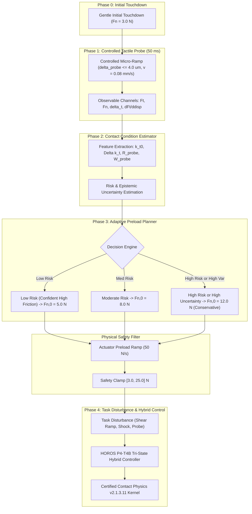

# HOROS PROBE-1 — Phase 5 Task 1 (P5-T1) Research Specification
## Adaptive Pre-Contact Preload Planner & Controlled Tactile Probing

**Project:** HOROS Physical Interaction Data Engine (PIDE)  
**Research Program:** PROBE-1  
**Task:** P5-T1  
**Date:** November 23, 2026  
**Status:** ACTIVE RESEARCH SPECIFICATION & PRE-REGISTERED CRITERIA  
**Starting Point:** Reconciled P4-T4B Tri-State Hybrid Grasp Controller & Actuator Rate Limit Findings  
**Primary Objective:** Move HOROS from reactive and predictive grasp stabilization toward adaptive selection of initial normal gripping force based on observable physical contact information before significant tangential loading begins.

---

## 1. Research Problem & Theoretical Motivation

In P4-T4B, the benchmark revealed that closed-loop feedback controllers (predictive or reactive) are constrained by physical actuator rate limits ($\dot{F}_{\max} \le 50.0\,\text{N/s}$):
- On high-speed shear disturbances ($v_{\text{shear}} \ge 5.0\,\text{mm/s}$) and low-friction interfaces ($\mu_s \le 0.35$), macroscopic gross slip breakaway occurs in $< 5\,\text{ms}$.
- Within $5\,\text{ms}$, an actuator rate-limited to $0.05\,\text{N/ms}$ can add at most $\Delta F_n = 0.25\,\text{N}$, which is physically insufficient to prevent slip.
- However, P4-T4B experimentally proved that when initial normal force is conservatively set to $F_{n,0} = 12.0\,\text{N}$, low-friction grasp success jumps from $0.0\%$ to $52.0\%$ (and from $44.0\%$ to $52.0\%$ for the hybrid controller).
- **The Core Dilemma:** Blindly applying $F_{n,0} = 12.0\,\text{N}$ to every object wastes mechanical energy, increases workpiece stress, and risks crushing delicate items.

### Core Scientific Hypothesis:
A low-amplitude, non-destructive **Controlled Tactile Probe** ($F_{n,\text{probe}} = 3.0\,\text{N}$, $\delta_{\text{probe}} \le 4.0\,\mu\text{m}$, duration $50\,\text{ms}$) can measure observable tangential compliance softening ($\Delta K_t / \Delta \delta_t$) and force ratios prior to task loading. An **Adaptive Preload Planner** can map these causal observables to contact risk and select an optimal initial preload $F_{n,0} \in \{5.0, 8.0, 12.0\}\,\text{N}$, maximizing grasp reliability while minimizing workpiece force exposure.

---

## 2. Planner Architecture & Information Flow

---

## 3. Mathematical Probe Formulation & Safety Guarantee

### 3.1 Contact Mechanics Derivation
Under Cattaneo-Mindlin spherical contact, initial tangential stiffness at zero displacement is:
$$K_{t,0} = 8 G^* a = 8 G^* \left( \frac{3 F_n R}{4 E^*} \right)^{1/3}$$

The critical tangential displacement at which macroscopic gross slip initiates is:
$$\delta_{\text{crit}} = \frac{3 \mu_s F_n}{16 G^* a}$$

For a partial-slip displacement $\delta_t < \delta_{\text{crit}}$, tangential force follows:
$$F_t(\delta_t) = \mu_s F_n \left[ 1 - \left( 1 - \frac{\delta_t}{\delta_{\text{crit}}} \right)^{3/2} \right]$$

Expanding for small probe displacements $\delta_t \ll \delta_{\text{crit}}$:
$$F_t(\delta_t) \approx K_{t,0} \delta_t - \frac{3}{4} \frac{K_{t,0}^2}{\mu_s F_n} \delta_t^2 + \mathcal{O}(\delta_t^3)$$

Differentiating with respect to $\delta_t$:
$$K_t(\delta_t) = \frac{dF_t}{d\delta_t} \approx K_{t,0} - \frac{3}{2} \frac{K_{t,0}^2}{\mu_s F_n} \delta_t$$

The tangential compliance softening rate is:
$$\frac{dK_t}{d\delta_t} \approx -\frac{3}{2} \frac{K_{t,0}^2}{\mu_s F_n}$$

**Key Physical Property:** The softening rate is strictly inversely proportional to static friction $\mu_s$. On low-friction surfaces ($\mu_s = 0.35$), the contact softens **$2.14\times$ faster** per micrometer of displacement than on high-friction surfaces ($\mu_s = 0.75$).

### 3.2 Probe Safety Invariant (Non-Destructive Guarantee)
- **Normal Load:** $F_{n,\text{probe}} = 3.0\,\text{N}$
- **Probe Displacement:** $\delta_{\text{probe}} = 4.0\,\mu\text{m}$ (ramped over $50\,\text{ms}$, velocity $v_{\text{probe}} = 0.08\,\text{mm/s}$)
- **Worst-Case Physical Limit:** Under lowest friction $\mu_s = 0.35$, $E^* \approx 1.25\,\text{MPa}$, $R = 15\,\text{mm}$:
  $$\delta_{\text{crit}} \approx 25.0\,\mu\text{m}$$
- **Safety Ratio:**
  $$\frac{\delta_{\text{probe}}}{\delta_{\text{crit}}} = \frac{4.0}{25.0} = 0.160$$
- **Stick Ratio at Peak Probe:**
  $$\frac{c}{a} = \sqrt{1 - \frac{\delta_{\text{probe}}}{\delta_{\text{crit}}}} = \sqrt{1 - 0.160} = 0.9165 > 0.80$$
- **Mathematical Safety Contract:** The contact remains solidly inside the sticking core ($c/a \ge 0.916 > 0.80$). Gross slip is **physically impossible** during the probe, guaranteeing zero probe-induced grasp failures.

---

## 4. Evaluated Preload Approaches

Six distinct planning strategies are implemented and benchmarked under identical downstream control (HOROS P4-T4B Tri-State Hybrid Controller):

1. **Fixed 3.0 N Preload:** Minimal force baseline ($F_{n,0} = 3.0\,\text{N}$).
2. **Fixed 5.0 N Preload:** Standard nominal baseline ($F_{n,0} = 5.0\,\text{N}$).
3. **Fixed 8.0 N Preload:** Firm preload baseline ($F_{n,0} = 8.0\,\text{N}$).
4. **Fixed 12.0 N Preload:** Conservative high-force baseline ($F_{n,0} = 12.0\,\text{N}$).
5. **Rule-Based Adaptive Preload:**
   - Extracts probe force ratio $R_{\text{probe}} = \max |F_t| / F_{n,\text{probe}}$ and stiffness softening $\Delta K_t / K_{t,0}$.
   - Rule:
     - If $R_{\text{probe}} \ge 0.14$ or softening $\ge 25\%$: Select $F_{n,0} = 12.0\,\text{N}$ (Low friction / High risk).
     - Else if $R_{\text{probe}} \ge 0.08$ or softening $\ge 12\%$: Select $F_{n,0} = 8.0\,\text{N}$ (Moderate friction).
     - Else: Select $F_{n,0} = 5.0\,\text{N}$ (High friction / Low risk).
6. **Learned Uncertainty-Aware Adaptive Preload:**
   - Feature vector: $\mathbf{x}_{\text{probe}} = [F_{n,\text{probe}}, |F_{t,\max}|, k_{t,\text{init}}, \Delta k_t, R_{\text{probe}}, W_{\text{probe}}] \in \mathbb{R}^6$.
   - Multi-layer estimator outputs risk score $\hat{r} \in [0, 1]$ and epistemic uncertainty $\hat{\sigma}_r^2$.
   - **Decision Contract:**
     - If $\hat{\sigma}_r^2 \ge 0.20$ (High uncertainty): Fall back conservatively to $F_{n,0} = 12.0\,\text{N}$.
     - Else if $\hat{r} \ge 0.60$: Select $F_{n,0} = 12.0\,\text{N}$.
     - Else if $\hat{r} \ge 0.30$: Select $F_{n,0} = 8.0\,\text{N}$.
     - Else: Select $F_{n,0} = 5.0\,\text{N}$.

---

## 5. Pre-Registered Scientific Acceptance Criteria (Stage B8)

| Criterion | Requirement for PASS | Requirement for CONDITIONAL PASS | Fail Condition |
|---|---|---|---|
| **1. Overall Grasp Success** | $\ge 70.0\%$ across all matched scenarios | $\ge 62.0\%$ across all matched scenarios | $< 62.0\%$ |
| **2. Low-Friction Stabilization** | $\ge 50.0\%$ on $\mu_s = 0.35$ | $\ge 45.0\%$ on $\mu_s = 0.35$ | $< 40.0\%$ |
| **3. High-Friction Force Efficiency** | Average $F_n \le 14.0\,\text{N}$ on $\mu_s = 0.75$ with $\ge 80\%$ success | Average $F_n \le 18.0\,\text{N}$ on $\mu_s = 0.75$ | $> 20.0\,\text{N}$ |
| **4. Superiority over Fixed 5 N** | Statistically significant higher success ($p < 0.05$) | Higher success in $\ge 2$ friction strata | Equal or lower success |
| **5. Force Savings vs Fixed 12 N** | Lower mean normal force ($F_n < 15.0\,\text{N}$) while retaining within $3\%$ of Fixed-12N success | Lower mean normal force ($F_n < 18.0\,\text{N}$) | Higher force or $>5\%$ worse success |
| **6. Non-Destructive Probe Safety** | Exactly 0 probe-induced slips ($c/a \ge 0.80$ throughout probe) | 0 probe-induced slips | Any probe-induced slip |
| **7. Causality & Non-Leakage** | Zero privileged simulation states ($c, a, \mu_s$) accessed | Zero privileged states | Any state leakage |
| **8. Real-Time Planning Latency** | Preload decision time $\le 0.50\,\text{ms}$ | Preload decision time $\le 1.0\,\text{ms}$ | $> 1.0\,\text{ms}$ |

---

## 6. Experimental Test Matrix & Seed Allocation

- **Reserved Research Seed Range:** `4500001` through `4500300` (strictly non-overlapping with production `3300000+`, reserve `3390000+`, and prior research seeds).
- **Episode Count:** 300 matched closed-loop scenarios:
  - 100 Low Friction ($\mu_s = 0.35$)
  - 100 Moderate Friction ($\mu_s = 0.55$)
  - 100 High Friction ($\mu_s = 0.75$)
- **Disturbance Modes (60 episodes per mode):**
  - Quasi-static shear ramp ($v \in \{1.0, 2.5, 5.0\}\,\text{mm/s}$)
  - Fast shear ramp ($v = 8.0\,\text{mm/s}$)
  - Micro-probe cyclic oscillation ($10\,\text{Hz}$)
  - Tangential shock ($2.5 \times v$ pulse)
  - Normal perturbation (unload dip)
