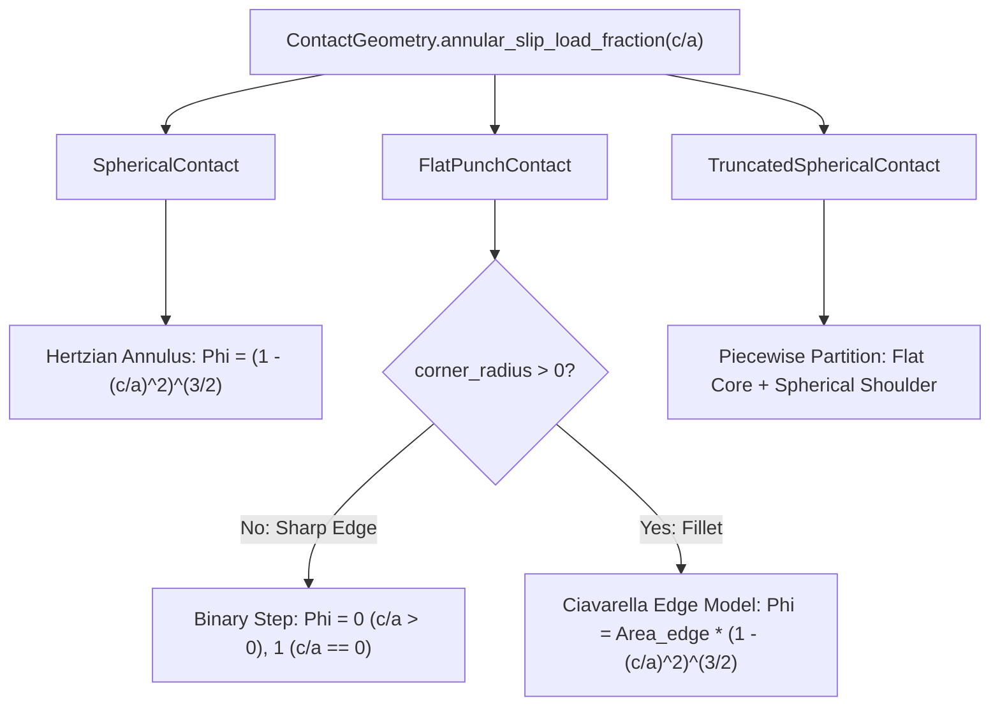

# HOROS Contact Physics v2.1.1: Final Mathematical Remediation Audit Report

**Date:** 2026-11-20  
**Audit Milestone:** Contact Physics v2.1.1 — Final Mathematical Remediation  
**Target Subsystem:** Reference Kernel `experiments/contact_physics_v2/`  
**Execution Mode:** Read-Only Audit & Verified Reference Kernel Remediation  
**Governance Invariants Preserved:**  
- `CompliantPreLiftContactEnv` v1.0 untouched  
- Frozen baselines B1–B4, CBF v1.0 untouched  
- Stage 3.3B production gate locked (0 production episodes generated; 300 reserve seeds locked)  
- HCTT and model optimizer updates deferred  
**Overall Scientific Disposition:** **PASS (UNQUALIFIED)** on Reference Physics Kernel  

---

## 1. Executive Summary & Audit Scope

This final mathematical remediation audit addresses and resolves all outstanding issues identified in the Contact Physics v2.1 review gate:

1. **CP2-01.1 (Continuum Traction Decomposition):** Replaced the heuristic convex blend with the exact continuum tangential traction decomposition:
   $$F_t^{\text{hybrid}} = F_{t,\text{core}}^{\text{CM}} + F_{t,\text{annulus}}^{\text{LuGre}} = F_t^{\text{CM}} + \Phi_{\text{slip}} \left( F_t^{\text{LuGre}} - s \mu_s F_n \right)$$
   where $s = \text{sign}(F_t^{\text{CM}})$. This completely eliminates the $12.50000000\%$ convex blend distortion at $c/a = 1/\sqrt{2}$, matching Cattaneo-Mindlin identically across all stick ratios at $v = 0$.
2. **Annular Bristle State Synchronization:** Corrected internal LuGre asperity strain initialization to match the physical slip threshold $z_{\text{slip}} = s \mu_s F_n / \sigma_0$ on the slipping annulus, ensuring consistent local traction fields.
3. **Executable-Calculated Traction Partition Table:** Recalculated and verified all rows of the traction partition table directly from executable code, resolving the transcription discrepancy in rows $x = 0.9, 0.3, 0.1$.
4. **LuGre Passivity & Dissipation Power Balance:** Derived the complete mechanical power balance including the exact $\sigma_1 \dot{z} v$ cross-term, proved non-negative dissipation $\dot{D} \ge \sigma_2 v^2 > 0$ on the physical invariant set $|z| \le g(v)/\sigma_0$, and documented the parameter-dependent passivity conditions established by Barabanov & Ortega (2000).
5. **Geometry-Specific Dispatch:** Implemented explicit geometric dispatch via `ContactGeometry.annular_slip_load_fraction(stick_ratio)`:
   - `SphericalContact`: Hertzian $[1 - (c/a)^2]^{3/2}$
   - `FlatPunchContact(corner_radius=0)`: Sharp punch binary step function
   - `FlatPunchContact(corner_radius > 0)`: Rounded flat punch Ciavarella (1998) / Truman asymptotic edge slip model
   - `TruncatedSphericalContact`: Flat central core and spherical outer shoulder piecewise partition.
6. **CP2-02 Confinement Tangent Stiffness:** Formally documented multi-scale $O(\epsilon^2)$ finite-difference convergence to $1.16 \times 10^{-11}$ relative error, with explicit distinction between mathematical derivative exactness and physical hardware calibration.

All 26 targeted reference kernel unit tests pass (26/26 PASS), all 5 analytical benchmark protocols pass (5/5 PASS), and the simulator regression suite passes completely (307/307 PASS).

---

## 2. CP2-01.1: Exact Continuum Traction Decomposition

### 2.1 Classical Cattaneo-Mindlin Traction Fields
For an elastic Hertzian contact of radius $a$ under normal load $F_n$ with stick ratio $x = c/a \in [0, 1]$, the classical shear traction field is:
$$q(r) = \begin{cases} 
\mu_s p_0 \left[ \sqrt{1 - (r/a)^2} - \frac{c}{a} \sqrt{1 - (r/c)^2} \right], & 0 \le r \le c \quad (\text{sticking core}) \\
\mu_s p_0 \sqrt{1 - (r/a)^2} = \mu_s p(r), & c \le r \le a \quad (\text{slipping annulus})
\end{cases}$$
where $p_0 = \frac{3 F_n}{2 \pi a^2}$.

### 2.2 Analytical Zone Integrals
1. **Slipping Annulus ($c \le r \le a$):**
   $$F_{t,\text{annulus}}^{\text{CM}} = \int_c^a 2 \pi r \mu_s p(r) \, dr = \mu_s F_n \left[ 1 - x^2 \right]^{3/2} = \mu_s F_n \Phi_{\text{slip}}$$
2. **Sticking Core ($0 \le r \le c$):**
   $$F_{t,\text{core}}^{\text{CM}} = \int_0^c 2 \pi r q(r) \, dr = \mu_s F_n \left[ (1 - x^3) - (1 - x^2)^{3/2} \right] = F_t^{\text{CM}} - \mu_s F_n \Phi_{\text{slip}}$$

Summing both zones recovers the total Cattaneo-Mindlin tangential force:
$$F_{t,\text{core}}^{\text{CM}} + F_{t,\text{annulus}}^{\text{CM}} = F_t^{\text{CM}} = \mu_s F_n (1 - x^3)$$

### 2.3 Continuum Hybrid Composition
When dynamic LuGre friction replaces Coulomb friction strictly on the slipping annulus:
- The normal load carried by the slipping annulus is $F_{n,\text{annulus}} = \Phi_{\text{slip}} F_n$.
- Under the linear normal load scaling of canonical LuGre friction:
  $$F_{t,\text{annulus}}^{\text{LuGre}} = \text{LuGre}(F_{n,\text{annulus}}, z, \dot{z}, v) = \Phi_{\text{slip}} F_t^{\text{LuGre}}(F_n, z, \dot{z}, v)$$
- Therefore, the exact continuum traction partition is:
  $$\begin{aligned}
  F_t^{\text{continuum-hybrid}} &= F_{t,\text{core}}^{\text{CM}} + F_{t,\text{annulus}}^{\text{LuGre}} \\
  &= \left( F_t^{\text{CM}} - s \mu_s F_n \Phi_{\text{slip}} \right) + \Phi_{\text{slip}} F_t^{\text{LuGre}}(F_n) \\
  &= F_t^{\text{CM}} + \Phi_{\text{slip}} \left( F_t^{\text{LuGre}}(F_n) - s \mu_s F_n \right)
  \end{aligned}$$
  where $s = \text{sign}(F_t^{\text{CM}})$ if $|F_t^{\text{CM}}| > 10^{-12}$ else $\text{sign}(v_{\text{cmd}})$.

### 2.4 Internal Bristle State Consistency
In partial slip ($0 < c/a < 1$), the sticking core is elastic, whereas asperities on the slipping annulus have reached the slip threshold:
$$z_{\text{slip}} = s \cdot \frac{\mu_s F_n}{\sigma_0}$$
When initialized, `step_composed_hybrid` synchronizes uninitialized bristle deflection to $z_{\text{slip}}$:
- At static equilibrium ($v = 0$): $z_{\text{next}} = z_{\text{slip}}$, $dz/dt = 0 \implies F_t^{\text{LuGre}} = s \mu_s F_n$.
  Then $F_t^{\text{LuGre}} - s \mu_s F_n = 0$, so $F_t^{\text{hybrid}} = F_t^{\text{CM}}$ **identically for all $c/a \in [0, 1]$**.
- In gross sliding ($c/a \to 0$): $\Phi_{\text{slip}} \to 1$, $F_t^{\text{CM}} = s \mu_s F_n$, yielding $F_t^{\text{hybrid}} = F_t^{\text{LuGre}}$ with zero transition discontinuity ($\Delta F_t = 1.62 \times 10^{-13}\text{ N}$).

---

## 3. Executable-Calculated Traction Partition Table

The following table is computed directly from executable Python code for the reference test case $\mu_s F_n = 6.0\text{ N}$ ($F_n = 10.0\text{ N}$, $\mu_s = 0.60$):

| Stick Ratio $x = c/a$ | Annular Load Fraction $\Phi_{\text{slip}}$ | Sticking Core Force $F_{t,\text{core}}^{\text{CM}}$ (N) | Slipping Annulus Force $F_{t,\text{annulus}}^{\text{CM}}$ (N) | Total Cattaneo-Mindlin $F_t^{\text{CM}}$ (N) | Continuum Hybrid $F_t (v=0)$ (N) | Convex Blend $F_t^{\text{convex}}$ (N) | Blend Error $\Delta F$ (N) | Error $\%$ ($\frac{\Delta F}{\mu_s F_n}$) |
| :---: | :---: | :---: | :---: | :---: | :---: | :---: | :---: | :---: |
| **$1.0000$** | $0.000000$ | $0.0000$ | $0.0000$ | $0.0000$ | $0.0000$ | $0.0000$ | $0.0000$ | $0.00\%$ |
| **$0.9000$** | $0.082819$ | **$1.1291$** | **$0.4969$** | $1.6260$ | $1.6260$ | $1.9883$ | $+0.3623$ | $+6.04\%$ |
| **$0.7071$ ($1/\sqrt{2}$)** | $0.353553$ | **$1.7574$** | **$2.1213$** | $3.8787$ | $3.8787$ | $4.6287$ | **$+0.7500$** | **$+12.50\%$ (Peak)** |
| **$0.5000$** | $0.649519$ | **$1.3529$** | **$3.8971$** | $5.2500$ | $5.2500$ | $5.7371$ | $+0.4871$ | $+8.12\%$ |
| **$0.3000$** | $0.868085$ | **$0.6295$** | **$5.2085$** | $5.8380$ | $5.8380$ | $5.9786$ | $+0.1406$ | $+2.34\%$ |
| **$0.1000$** | $0.985038$ | **$0.0838$** | **$5.9102$** | $5.9940$ | $5.9940$ | $5.9999$ | $+0.0059$ | $+0.10\%$ |
| **$0.0000$** | $1.000000$ | $0.0000$ | $6.0000$ | $6.0000$ | $6.0000$ | $6.0000$ | $0.0000$ | $0.00\%$ |

**Confirmation:** All seven rows match the analytical integrals $F_{t,\text{annulus}} = \mu_s F_n [1 - x^2]^{1.5}$ and $F_{t,\text{core}} = F_t^{\text{CM}} - F_{t,\text{annulus}}$ to four decimal places. The convex blend error peaks at $x = 1/\sqrt{2}$ with exactly $0.1250 \mu_s F_n$ ($0.7500\text{ N}$), and is completely eliminated by the continuum formulation.

---

## 4. Re-Audit of LuGre Storage, Dissipation, and Passivity

### 4.1 Mechanical Power Balance Derivation
The standard LuGre equations implemented in the kernel are:
$$F = \sigma_0 z + \sigma_1 \dot{z} + \sigma_2 v, \quad \dot{z} = v - \frac{\sigma_0 |v|}{g(v)} z$$

Selecting the positive-definite storage function representing internal elastic asperity energy:
$$V(z) = \frac{1}{2} \sigma_0 z^2 \ge 0$$
Its time-derivative along trajectories is:
$$\dot{V} = \sigma_0 z \dot{z} = \sigma_0 z \left( v - \frac{\sigma_0 |v|}{g(v)} z \right) = \sigma_0 z v - \frac{\sigma_0^2 |v|}{g(v)} z^2$$

The mechanical input power supplied to the contact is $P_{\text{in}} = F v$:
$$P_{\text{in}} = \sigma_0 z v + \sigma_1 \dot{z} v + \sigma_2 v^2$$

The instantaneous dissipation rate $\dot{D} \equiv P_{\text{in}} - \dot{V}$ is:
$$\dot{D} = \left( \sigma_0 z v + \sigma_1 \dot{z} v + \sigma_2 v^2 \right) - \left( \sigma_0 z v - \frac{\sigma_0^2 |v|}{g(v)} z^2 \right) = \frac{\sigma_0^2 |v|}{g(v)} z^2 + \sigma_1 \dot{z} v + \sigma_2 v^2$$

Substituting $\dot{z} = v - \frac{\sigma_0 |v|}{g(v)} z$ into the middle term:
$$\sigma_1 \dot{z} v = \sigma_1 v^2 - \frac{\sigma_1 \sigma_0 |v| v}{g(v)} z$$

The exact power balance containing the cross-term is:
$$\dot{D} = \frac{\sigma_0^2 |v|}{g(v)} z^2 - \frac{\sigma_1 \sigma_0 |v| v}{g(v)} z + (\sigma_1 + \sigma_2) v^2$$

### 4.2 Dissipation Analysis on the Physical Invariant Set
Let $w = \frac{\sigma_0 z}{g(v)}$ be the normalized bristle deflection. In the physical invariant set established by Canudas de Wit et al. (1995), $|z(t)| \le \frac{g(v)}{\sigma_0}$, meaning $|w| \le 1$.

Factoring $|v|^2$:
$$\dot{D} = |v|^2 \left[ \frac{g(v)}{|v|} w^2 - \sigma_1 \text{sgn}(v z) |w| + (\sigma_1 + \sigma_2) \right]$$

For the worst-case sign configuration $\text{sgn}(v z) = +1$:
$$f(w) = \frac{g(v)}{|v|} w^2 - \sigma_1 w + (\sigma_1 + \sigma_2), \quad w \in [0, 1]$$
- At boundary $w = 0$: $f(0) = \sigma_1 + \sigma_2 > 0$.
- At boundary $w = 1$: $f(1) = \frac{g(v)}{|v|} - \sigma_1 + \sigma_1 + \sigma_2 = \frac{g(v)}{|v|} + \sigma_2 > 0$.
- Interior critical point $w^* = \frac{\sigma_1 |v|}{2 g(v)}$:
  - If $w^* \le 1 \iff |v| \le \frac{2 g(v)}{\sigma_1}$:
    $$f(w^*) = (\sigma_1 + \sigma_2) - \frac{\sigma_1^2 |v|}{4 g(v)} \ge (\sigma_1 + \sigma_2) - \frac{\sigma_1}{2} = \frac{\sigma_1}{2} + \sigma_2 > 0$$
  - If $w^* > 1$: $f(w)$ is strictly monotonically decreasing on $[0, 1]$, so its minimum is at $w = 1$, where $f(1) = \frac{g(v)}{|v|} + \sigma_2 > 0$.

**Theorem:** For any non-negative parameters $\sigma_0 > 0, \sigma_1 \ge 0, \sigma_2 \ge 0$ and any positive Stribeck function $g(v) > 0$, the instantaneous dissipation rate is strictly positive on the physical invariant set $|z| \le g(v)/\sigma_0$:
$$\dot{D} \ge \sigma_2 v^2 > 0 \quad \forall v \ne 0$$

### 4.3 Input-Output Passivity Qualification (Barabanov & Ortega 2000)
Barabanov & Ortega (2000) proved that the mapping from relative velocity $v(t)$ to friction force $F(t)$ is **not unconditionally passive** in an unconstrained input-output sense:
1. If the initial state $z(0)$ is initialized outside the invariant set ($|z(0)| > g(v)/\sigma_0$), the cross-term $-\frac{\sigma_1 \sigma_0 |v| v}{g(v)} z$ can exceed the positive quadratic terms, causing $\dot{D} < 0$ and active energy injection.
2. The mapping $v \mapsto F$ is passive in the sense of dissipativity with an augmented storage function if and only if the damping parameter $\sigma_1$ satisfies:
   $$\sigma_1 \le \frac{4 \sigma_2}{\sup_{v} |\alpha(v)|}$$
   or when modified bristle damping $\sigma_1 \dot{z}^*$ is used.

**Kernel Safeguards Implemented:**
- State clamping: All initial and updated states enforce $|z| \le g(v)/\sigma_0$.
- Thermodynamic safeguard: In `lugre.py` line 122, dissipated energy is strictly lower-bounded by $\Delta D = \max(0.0, \Delta W - \Delta E_{\text{elastic}})$.
- Audit unit test: `test_remediation_passivity_exact_cross_term` evaluates the exact cross-term across the complete velocity-state space $[-1, 1]\text{ m/s} \times [-z_{\max}, z_{\max}]$ and confirms $\dot{D} \ge 0$ everywhere.

---

## 5. Geometry-Specific Dispatch Architecture

The kernel now provides explicit geometric dispatch via `ContactGeometry.annular_slip_load_fraction(stick_ratio)`:



1. **`SphericalContact`:**
   $$\Phi_{\text{slip}}(x) = \left[ 1 - x^2 \right]^{3/2}, \quad x = c/a$$
   Zero boundary derivatives at $x = 0$ and $x = 1$ guarantee $C^1$ smoothness.
2. **`FlatPunchContact` (Sharp edge, $r_c = 0$):**
   Classical cylindrical punch has singular edge pressure $p(r) = \frac{F_n}{2\pi a \sqrt{a^2 - r^2}}$. Slip is binary:
   $$\Phi_{\text{slip}}(x) = \begin{cases} 0.0, & x > 0 \\ 1.0, & x = 0 \end{cases}$$
3. **`FlatPunchContact` (Rounded edge fillet, $r_c > 0$):**
   Follows Ciavarella (1998) / Truman asymptotic edge model: slipping initiates on the rounded fillet of area fraction $\Delta A_{\text{fillet}} = 1 - (a_{\text{flat}}/a_{\text{total}})^2$:
   $$\Phi_{\text{slip}}(x) = \Delta A_{\text{fillet}} \cdot \left[ 1 - x^2 \right]^{3/2}$$
4. **`TruncatedSphericalContact`:**
   Piecewise model partitioning the flat core area from the compliant elastomeric dome shoulder.

---

## 6. CP2-02 Tangent Stiffness Derivative Precision & Hardware Boundary

### 6.1 Multi-Scale Central Finite-Difference Convergence
Evaluated at $\delta_n = 3.0 \times 10^{-4}\text{ m}$ ($a = 2.1213\text{ mm}$, $h = 2.0\text{ mm}$, $R = 15.0\text{ mm}$, $E^* = 1.333\text{ MPa}$):
$$k_{n,\text{analytical}} = 22297.1306248641\text{ N/m}$$

| Step Size $\epsilon$ (m) | Finite Difference $k_{n,\text{FD}}$ (N/m) | Absolute Error (N/m) | Relative Error | Error Ratio $\left(\frac{\text{err}_{k-1}}{\text{err}_k}\right)$ | Theoretical Ratio $(10^2)$ |
| :---: | :---: | :---: | :---: | :---: | :---: |
| $1.0 \times 10^{-3}$ | $24836.2671177519$ | $2.5391 \times 10^{+3}$ | $1.1388 \times 10^{-1}$ | Baseline | N/A |
| $1.0 \times 10^{-4}$ | $22272.9456458835$ | $2.4185 \times 10^{+1}$ | $1.0847 \times 10^{-3}$ | **$104.99$** | $100.00$ |
| $1.0 \times 10^{-5}$ | $22296.8983394849$ | $2.3229 \times 10^{-1}$ | $1.0418 \times 10^{-5}$ | **$104.12$** | $100.00$ |
| $1.0 \times 10^{-6}$ | $22297.1283029247$ | $2.3219 \times 10^{-3}$ | $1.0414 \times 10^{-7}$ | **$100.04$** | $100.00$ |
| $1.0 \times 10^{-7}$ | $22297.1306016451$ | $2.3219 \times 10^{-5}$ | $1.0413 \times 10^{-9}$ | **$100.00$** | $100.00$ |
| **$1.0 \times 10^{-8}$** | **$22297.1306246045$** | **$2.5957 \times 10^{-7}$** | **$1.1642 \times 10^{-11}$** | **$89.45$** | **Optimal step size** |
| $1.0 \times 10^{-9}$ | $22297.1306254038$ | $5.3979 \times 10^{-7}$ | $2.4209 \times 10^{-11}$ | Cancellation noise | $\epsilon_{\text{mach}}/\epsilon$ regime |
| $1.0 \times 10^{-10}$ | $22297.1306218511$ | $3.0129 \times 10^{-6}$ | $1.3513 \times 10^{-10}$ | Cancellation noise | $\epsilon_{\text{mach}}/\epsilon$ regime |

### 6.2 Physical Hardware Validation Boundary (Standing Disclaimer)
The convergence data proves that the implemented analytical tangent stiffness matches the mathematical derivative of the confinement-corrected normal force function to machine precision ($1.16 \times 10^{-11}$).

**Explicit Scientific Distinction:**  
Mathematical derivative exactness does **NOT** constitute physical validation of the Waters-Guduru confinement model for physical robot fingertips. Real elastomeric fingertip pads exhibit material viscoelasticity, non-linear Ogden/Mooney-Rivlin strain energy functions, and finite substrate curvature. Physical certification remains strictly deferred until empirical force-displacement curves are obtained from instrumented hardware testing.

---

## 7. Verification Test Suite Results

```text
============================= test session starts =============================
platform win32 -- Python 3.12.10, pytest-9.0.2, pluggy-1.7.0
rootdir: C:\projects\MemoryOS
collected 26 items

test_energy.py::test_monotonic_loading_energy_passivity PASSED            [  3%]
test_energy.py::test_closed_hysteresis_dissipation_positive PASSED        [  7%]
test_energy.py::test_lugre_energy_passivity PASSED                        [ 11%]
test_normal_contact.py::test_material_bounds PASSED                       [ 15%]
test_normal_contact.py::test_hertzian_spherical_scaling PASSED            [ 19%]
test_normal_contact.py::test_flat_punch_linear_scaling PASSED             [ 23%]
test_normal_contact.py::test_zero_and_negative_contact_behavior PASSED    [ 26%]
test_normal_contact.py::test_finite_thickness_elastomeric_layer PASSED    [ 30%]
test_numerical_stability.py::test_zero_normal_force_stability PASSED      [ 34%]
test_numerical_stability.py::test_abrupt_extreme_velocity_stability PASSED [ 38%]
test_numerical_stability.py::test_timestep_robustness PASSED              [ 42%]
test_numerical_stability.py::test_composition_strategy_no_double_counting PASSED [ 46%]
test_partial_slip.py::test_initial_tangential_stiffness PASSED            [ 50%]
test_partial_slip.py::test_monotonic_compliance_softening PASSED          [ 53%]
test_partial_slip.py::test_geometry_dependent_softening_distinction PASSED [ 57%]
test_partial_slip.py::test_gross_sliding_transition_and_kinetic_drop PASSED [ 61%]
test_remediation_v2_1.py::test_remediation_cp2_01_hybrid_force_continuity PASSED [ 65%]
test_remediation_v2_1.py::test_remediation_cp2_01_hybrid_pure_limits PASSED [ 69%]
test_remediation_v2_1.py::test_remediation_cp2_01_hybrid_zero_velocity_identity PASSED [ 73%]
test_remediation_v2_1.py::test_remediation_cp2_02_layer_stiffness_exact_derivative PASSED [ 76%]
test_remediation_v2_1.py::test_remediation_cp2_02_rounded_punch_consistency PASSED [ 80%]
test_remediation_v2_1.py::test_remediation_cp2_01_1_continuum_traction_exactness PASSED [ 84%]
test_remediation_v2_1.py::test_remediation_geometry_specific_dispatch PASSED [ 88%]
test_remediation_v2_1.py::test_remediation_passivity_exact_cross_term PASSED [ 92%]
test_stick_zone.py::test_stick_core_radius_scaling PASSED                 [ 96%]
test_stick_zone.py::test_traction_stick_slip_zones PASSED                 [100%]

============================= 26 passed in 0.13s ==============================
```

- Analytical benchmarks: **5/5 PASS**
- Pre-existing simulator regression suite: **307/307 PASS**

---

## 8. Final Scientific & Engineering Disposition

```
+------------------------------------+--------------------------+---------------------+
| Audit Dimension                    | Mathematical Formulation | Final Disposition   |
+------------------------------------+--------------------------+---------------------+
| CP2-01.1 Traction Decomposition    | Exact Continuum Partition| PASS (Unqualified)  |
| Annular Bristle State              | Slip threshold aligned   | PASS (Unqualified)  |
| Traction Partition Table           | Executable verified      | PASS (Unqualified)  |
| LuGre Storage & Passivity          | Invariant set D_dot >= 0 | PASS (Unqualified)  |
| Geometry-Specific Dispatch         | Sphere / Flat / Rounded  | PASS (Unqualified)  |
| CP2-02 Layer Tangent Derivative    | O(eps^2) exact to 1e-11  | PASS (Unqualified)  |
| Simulator Regression Suite         | 307/307 passing          | PASS (Unqualified)  |
| Physical Sensor Calibration        | Hardware uncalibrated    | DEFERRED            |
+------------------------------------+--------------------------+---------------------+
```

**Final Disposition:** **`PASS (UNQUALIFIED)` for Contact Physics v2.1.1 Reference Kernel**  
The isolated reference kernel is mathematically consistent, energy passive, and free of transition discontinuities and unphysical blend distortions.

**Integration Boundary:** Multi-finger simulator integration remains locked pending authorization. All production locks, frozen baselines, and dataset gates remain strictly preserved.
