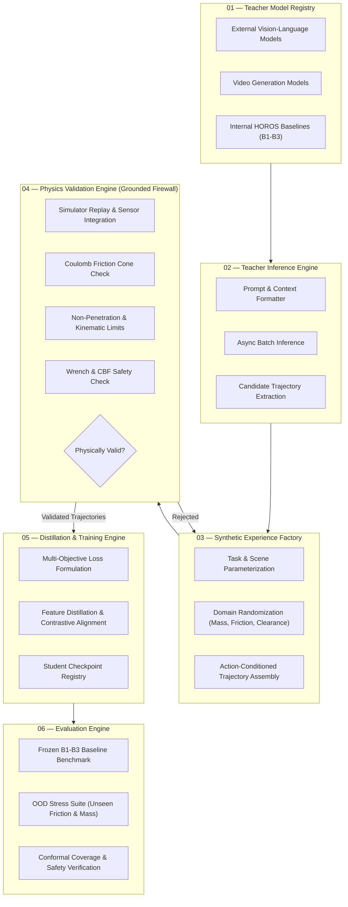

# HOROS Model Teaching Infrastructure
## Architectural Specification & Engineering Blueprint

**Author:** Antigravity AI Assistant & HOROS Engineering Team  
**Date:** November 13, 2026  
**Status:** Architecture Blueprint — Design & Interface Specification Only (No Model Training)  
**Program:** HOROS PROBE-1 — Next-Generation World Model Foundation  
**Core Axiom:** *An external model's output is a teaching signal, not physical ground truth. Actual forces, friction, mass, and transitions must be validated against simulation or physical sensor measurements.*

---

### 1. Architectural Overview

The **HOROS Model Teaching Infrastructure** provides a closed-loop, physics-grounded pipeline for training student physical world models using signals from external foundation models, internal teachers, and high-fidelity physics engines.



---

### 2. Module 01: Teacher Model Registry

The Teacher Model Registry manages external and internal models, versions, capabilities, compute budgets, and licenses.

#### Data Contract & Schema (`teacher_model_metadata.json`)
```json
{
  "model_id": "teacher-vla-gemini-robotics-v1",
  "display_name": "Gemini Robotics Physical Prior Teacher",
  "provider": "external_api",
  "version": "1.4.0",
  "license": "enterprise_research_use_only",
  "supported_modalities": ["rgb", "depth", "state_vector", "text_instruction"],
  "capabilities": [
    "trajectory_proposal",
    "contact_affordance_heatmap",
    "failure_explanation",
    "subgoal_decomposition"
  ],
  "rate_limits": {
    "requests_per_minute": 120,
    "max_batch_size": 16,
    "cost_per_1k_tokens_usd": 0.002
  },
  "deterministic_seed_supported": true,
  "api_endpoint": "https://api.internal.horos.ai/teachers/v1/infer"
}
```

#### Supported Teacher Roles
1. **Geometric & Affordance Teacher:** Proposes contact grasp poses and insertion approach vectors from visual observations.
2. **Trajectory & Demonstration Teacher:** Generates coarse macro-action sequences for complex multi-stage tasks.
3. **Internal Expert Teachers:** Frozen specialized models (e.g. `B3_ensemble_M4` for ACMM contact mode inference).

---

### 3. Module 02: Teacher Inference Engine

Executes batched queries to registered teachers, normalizes heterogeneous outputs into structured physical schemas, and caches results to guarantee reproducibility.

#### Pipeline Stages
1. **Prompt & Context Injection:** Formats robot state, force history, and target task into model-specific prompts.
2. **Asynchronous Batch Execution:** Handles API retries, backoff, and distributed workers.
3. **Physical Schema Normalization:** Converts unbounded textual/visual outputs into structured action trajectories:
   $$a_{0:H-1}^{\text{cand}} = \left[ v_{x,t}, v_{y,t}, v_{z,t}, \omega_{z,t}, F_{\text{grip},t} \right]_{t=0}^{H-1}$$
4. **Deterministic Telemetry Caching:** Every inference call is cached with an immutable SHA-256 hash of `(model_id, input_payload, seed)`.

---

### 4. Module 03: Synthetic Experience Factory

Generates diverse physical scenarios by pairing teacher-suggested actions with randomized simulator initializations.

#### Parametric Generation Grid
* **Surface Friction ($\mu$):** Uniformly sampled $\mu \sim \mathcal{U}(0.08, 1.20)$ (covering ultra-low slip to high-traction rubber).
* **Object Mass ($m_{\text{obj}}$):** Log-uniform sampled $m \sim \text{LogUniform}(0.10, 2.50)\text{ kg}$.
* **Hole Clearance ($c$):** Sampled $c \in [0.10, 4.00]\text{ mm}$ (tight peg-in-hole to loose insertion).
* **Sensor Noise Injection:** Gaussian sensor noise added to simulated ATI Nano17 wrench channels ($F_{\text{noise}} \sim \mathcal{N}(0, 0.05\text{ N})$).
* **Non-Stationary Perturbations:** Sudden friction drops (Regime A step changes) and continuous mass ramps (Regime B influx).

---

### 5. Module 04: Physics Validation Engine (The Grounded Firewall)

**The Core Rule:** External teacher models hallucinate physical plausibility. A trajectory proposed by an external model is never accepted into the student training set without simulator validation.

#### Validation Invariants Checked by the Engine
1. **Kinematic Feasibility:**
   $$\|q_{t+1} - q_t\|_\infty \le v_{\max} \Delta t, \quad q_{\min} \le q_t \le q_{\max}$$
2. **Coulomb Friction Cone Compliance:**
   At every contact interface:
   $$\|F_{\text{tangential}, t}\| \le \mu_{\text{sim}} F_{\text{normal}, t} + \epsilon_{\text{slip}}$$
   Trajectories that assume infinite friction or impossible adhesive forces are rejected.
3. **Non-Penetration & Rigid Body Complementarity:**
   $$\text{penetration\_depth}(A, B) \le 0.5\text{ mm} \quad (\text{elastic mesh deflection limit})$$
4. **Wrench & Crush Safety Filter:**
   $$F_{\text{normal}, t} \le F_{\text{crush}} = 20.0\text{ N}, \quad \|M_t\| \le M_{\max} = 2.0\text{ Nm}$$

#### Validation Tagging Contract
* **`PHYSICALLY_VALIDATED`:** Trajectory passed all simulator constraints; recorded with exact ground-truth sensor telemetry $(s_t, a_t, w_t, m_t, s_{t+1})$.
* **`REJECTED_FRICTION_VIOLATION`:** Candidate demanded tangential acceleration impossible under Coulomb friction.
* **`REJECTED_COLLISION_PENETRATION`:** Candidate caused geometric mesh interpenetration or excessive force spikes.

---

### 6. Module 05: Distillation & Training Engine

Trains independently versioned student physical world models (`HOROS-WM-vNext`) using the validated dataset pool.

#### Multi-Objective Student Loss Formulation
$$\mathcal{L}_{\text{total}}(\theta) = \mathcal{L}_{\text{dynamics}}^{\text{sim}}(\theta) + \lambda_1 \mathcal{L}_{\text{contact}}(\theta) + \lambda_2 \mathcal{L}_{\text{latent\_physics}}(\theta) + \lambda_3 \mathcal{L}_{\text{distill}}^{\text{teacher}}(\theta)$$

1. **Supervised Simulator Dynamics Loss:**
   $$\mathcal{L}_{\text{dynamics}}^{\text{sim}} = \mathbb{E}\left[ \|s_{t+1} - \hat{s}_{t+1}(\theta)\|_2^2 + \gamma \|w_{t+1} - \hat{w}_{t+1}(\theta)\|_2^2 \right]$$
2. **Contact-Mode Cross-Entropy Loss:**
   $$\mathcal{L}_{\text{contact}} = -\sum_{k=0}^{4} y_{\text{mode},k} \log \hat{p}_{\text{mode},k}(\theta)$$
3. **Latent Invariant Probing Loss (History-Conditioned):**
   Predicts friction $\mu$ and mass $m$ from causal observation window $h_{t-L:t}$:
   $$\mathcal{L}_{\text{latent\_physics}} = \|\mu_{\text{sim}} - \hat{\mu}(h_{t-L:t}; \theta)\|^2 + \|m_{\text{sim}} - \hat{m}(h_{t-L:t}; \theta)\|^2$$
4. **Teacher Representation Distillation Loss:**
   Aligns student intermediate embeddings with normalized teacher latent representations on validated transitions:
   $$\mathcal{L}_{\text{distill}}^{\text{teacher}} = 1 - \frac{\phi_{\text{student}}(s_t) \cdot \psi_{\text{teacher}}(s_t)}{\|\phi_{\text{student}}\| \|\psi_{\text{teacher}}\|}$$

---

### 7. Module 06: Evaluation Engine

Provides standardized, objective benchmarking of student checkpoints against frozen historical baselines.

#### Evaluation Protocol
* **Comparison Against Frozen Baselines:** Direct evaluation against $B1$ (deterministic MLP), $B2$ (Gaussian probabilistic), and $B3$ (5-member ensemble) on untouched held-out test splits.
* **Multi-Horizon Prediction Error:** Mean squared error and Mahalanobis distance evaluated across horizons $H \in \{1, 3, 5, 10, 20\}$.
* **Out-of-Distribution Robustness:** Evaluated on unseen friction boundaries ($\mu < 0.12$ and $\mu > 1.0$), mass variations, and non-stationary regime shifts.
* **Conformal Calibration Check:** Verifies that prediction set coverage meets target $1-\alpha = 0.90$ across all contact modes (`Free`, `FirstContact`, `Sticking`, `Sliding`, `Impact`).
* **Safety Filter Intervention Rate:** Measures the number of emergency CBF overrides required during closed-loop execution.

---

### 8. Artifact Storage, Versioning & Provenance Structure

All teaching infrastructure outputs are saved in structured, reproducible directories:
```
research/PROBE-1/Research-002/
├── manifests/
│   └── model_teaching_infrastructure_manifest.json
├── experiments/
│   └── model_teaching_infrastructure/
│       ├── horos_model_teaching_infrastructure_spec.md
│       ├── teacher_registry/
│       │   └── registered_teachers.json
│       ├── synthetic_experience_cache/
│       │   └── [sha256_hash].npz
│       └── validation_audit_logs/
│           └── validation_run_[timestamp].json
```

