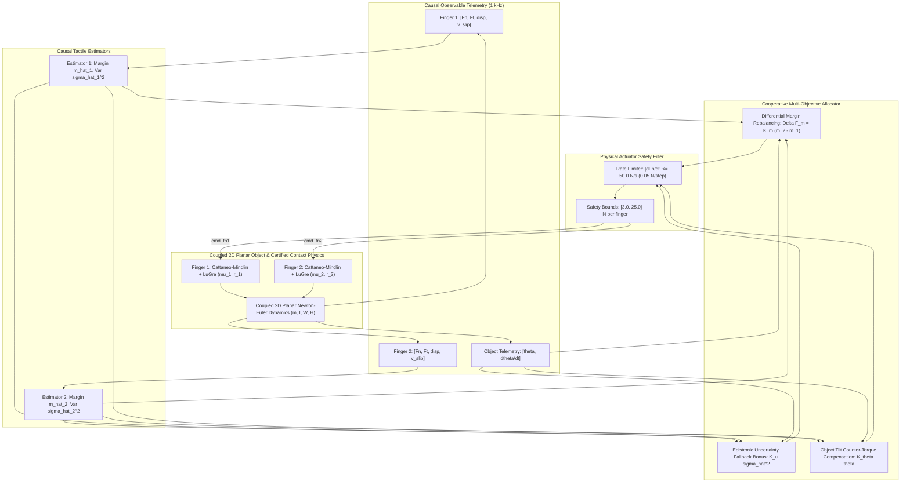

# HOROS PROBE-1 — Phase 5 Task 2 (P5-T2) Research Specification
## Multi-Finger Cooperative Preload Distribution & Tactile Balancing

**Project:** HOROS Physical Interaction Data Engine (PIDE)  
**Research Program:** PROBE-1  
**Task:** P5-T2  
**Date:** November 23, 2026  
**Status:** **ACTIVE RESEARCH SPECIFICATION & PRE-REGISTERED CRITERIA (Stage B9)**  
**Previous Milestones:** P4-T4B (Reflexive Grasp Stabilization), P5-T1 (Adaptive Pre-Contact Preload Planning)  
**Primary Objective:** Extend HOROS from single-contact adaptive preload planning to coordinated multi-finger physical interaction, investigating how multiple robotic fingers can cooperatively distribute normal gripping forces to maintain stable contact, minimize unnecessary gripping force, and recover from asymmetric disturbances and tilting moments.

---

## 1. Research Problem & Theoretical Motivation

In P5-T1, the adaptive preload planner established that causal tactile micro-probing can estimate local contact compliance and select appropriate initial gripping forces. However, real-world robotic manipulation relies on multi-contact interaction (e.g., multi-finger hands, opposing pinch grippers, tool grasps).

When transitioning from single-contact to multi-contact physical interaction, three fundamental coupled physical phenomena emerge:

1. **Wrench Equilibrium & Force Coupling:**
   In an opposing two-finger pinch grasp, internal grasping force is determined by the minimum normal force $\min(F_{n,1}, F_{n,2})$. Any normal force disparity $(F_{n,2} - F_{n,1})$ produces net lateral acceleration on the object. If independent single-contact planners command disparate forces (e.g., $12.0\,\text{N}$ on finger 1 and $5.0\,\text{N}$ on finger 2), the object accelerates laterally unless a cooperative balance is maintained.
2. **Asymmetric Friction & Local Breakaway:**
   Robotic hands frequently grasp heterogeneous objects where surface friction differs across contact patches (e.g., silicone vs metal, greasy vs dry surfaces). When one contact approaches partial-slip runaway, the system must redistribute normal force toward the threatened contact without destabilizing object position.
3. **Off-Center Disturbance & Tilting Moments:**
   External disturbances rarely pass through the object's center of mass. An off-center shear load $F_{y,\text{ext}}$ with moment arm $d_{\text{offset}}$ generates a rotational torque $\tau_{\text{ext}} = F_{y,\text{ext}} \cdot d_{\text{offset}}$. Rotational equilibrium requires a counteracting tangential force couple $\frac{W}{2}(F_{t,2} - F_{t,1}) = \tau_{\text{ext}}$, which demands asymmetric normal force capacity.

### Core Scientific Hypothesis:
A cooperative, uncertainty-aware multi-finger controller that dynamically rebalances normal forces based on causal stability margins ($m_1, m_2$), epistemic uncertainty ($\hat{\sigma}^2$), and object tilt ($\theta$) will significantly outperform fixed symmetric clamping and uncoordinated independent single-contact planners under asymmetric friction and off-center loading, without violating actuator rate limits ($50\,\text{N/s}$).

---

## 2. Multi-Contact Architecture & System Overview

---

## 3. Mathematical Formulation of Coupled Multi-Finger Dynamics

### 3.1 Object Planar Newton-Euler Equations of Motion
Consider a rigid workpiece of mass $m$, width $W$, height $H$, and rotational moment of inertia $I = \frac{1}{12} m (W^2 + H^2)$ grasped by two opposing hemispherical fingertips at contact locations $\mathbf{r}_1 = [+\frac{W}{2}, 0]^T$ and $\mathbf{r}_2 = [-\frac{W}{2}, 0]^T$.

The governing equations of motion in the 2D plane are:

1. **Squeeze Translation ($x$-axis):**
   $$m \ddot{x} = (F_{n,2} - F_{n,1}) - c_x \dot{x}$$
   where $c_x$ is linear damping. In steady grasp, $F_{n,1} = F_{n,2} \implies \ddot{x} = 0$.

2. **Shear / Vertical Translation ($y$-axis):**
   $$m \ddot{y} = -(F_{t,1} + F_{t,2}) + F_{y,\text{ext}} - c_y \dot{y}$$
   where $F_{t,i}$ is the tangential traction force developed at contact $i$, and $F_{y,\text{ext}}$ is external disturbance/gravity.

3. **Rotational Pitch Tilt ($\theta$-axis):**
   $$I \ddot{\theta} = \frac{W}{2}(F_{t,2} - F_{t,1}) + \tau_{\text{ext}} - c_\theta \dot{\theta}$$
   where $\tau_{\text{ext}} = F_{y,\text{ext}} \cdot d_{\text{offset}} + \tau_{\text{pulse}}$ is the external moment about the center of mass.

### 3.2 Certified Contact Physics Composition
Each contact pad $i \in \{1, 2\}$ is governed independently by the certified Contact Physics v2.1.3.11 hybrid kernel:
- **Normal Hertzian Contact:**
  $$a_i = \left(\frac{3 F_{n,i} R_i}{4 E_i^*}\right)^{1/3}, \quad \delta_{n,i} = \frac{a_i^2}{R_i}$$
- **Tangential Cattaneo-Mindlin Stick-Slip Boundary:**
  $$\frac{c_i}{a_i} = \left(1 - \frac{|F_{t,i}|}{\mu_{s,i} F_{n,i}}\right)^{1/3}$$
- **Synchronized LuGre Friction & Dissipation:**
  $$\dot{z}_i = v_{\text{rel},i} - \frac{\sigma_{0,i} |v_{\text{rel},i}|}{g(v_{\text{rel},i})} z_i$$
  with dynamic kinematic contact velocity:
  $$v_{\text{rel},1} = (\dot{y} + \frac{W}{2} \dot{\theta}) - v_{\text{ext}}, \quad v_{\text{rel},2} = (\dot{y} - \frac{W}{2} \dot{\theta}) - v_{\text{ext}}$$

---

## 4. Evaluated Controllers

1. **Equal Force Distribution Baseline:**
   Fixed symmetric command $F_{n,1} = F_{n,2} = 8.0\,\text{N}$.
2. **Fixed Total Force Baseline:**
   Maintains constant total force $F_{n,1} + F_{n,2} = 16.0\,\text{N}$ divided equally.
3. **Rule-Based Cooperative Balancing Controller:**
   Monitors causal force ratios $R_i = |F_{t,i}| / F_{n,i}$; shifts normal force toward the contact with higher ratio:
   $$F_{n,1}^* = F_{\text{base}} + K_b (R_1 - R_2), \quad F_{n,2}^* = F_{\text{base}} - 0.5 K_b (R_1 - R_2)$$
4. **Predictive Margin Balancing Controller:**
   Estimates causal stability margin $\hat{m}_i = 1 - (R_i / \mu_{\text{est}})$; boosts normal force when margin drops below safety threshold and applies tilt compensation.
5. **Independent P5-T1 Adaptive Extension:**
   Each finger independently commands preload according to P5-T1 rules ($12.0\,\text{N}$ on low-friction, $8.0\,\text{N}$ on moderate, $5.0\,\text{N}$ on high) without cross-contact coordination.
6. **Learned Uncertainty-Aware Cooperative Allocation Controller:**
   Combines differential margin balancing, epistemic uncertainty fallback bonus ($\hat{\sigma}^2 \ge 0.15$), and tilt counter-torque compensation:
   $$F_{n,1}^* = F_{\text{base}} + K_m (m_2 - m_1) \cdot 0.5 + K_u \hat{\sigma}_1^2 + K_\theta \theta$$
   $$F_{n,2}^* = F_{\text{base}} - K_m (m_2 - m_1) \cdot 0.5 + K_u \hat{\sigma}_2^2 - K_\theta \theta$$
   subject to rate limits $|\dot{F}_{n,i}| \le 50.0\,\text{N/s}$ and bounds $[3.0, 25.0]\,\text{N}$.

---

## 5. Pre-Registered Acceptance Criteria (Stage B9)

| Criterion | Metric | Pre-Registered Threshold | Primary Objective |
|---|---|---|---|
| **C1. Overall Grasp Success** | Success rate across 300 matched scenarios | $\ge 75.0\%$ (PASS) $\ge 68.0\%$ (CONDITIONAL) | High overall grasp stability across diverse regimes |
| **C2. Asymmetric Friction Stratum** | Success rate on $\mu_1=0.35, \mu_2=0.75$ | $\ge 70.0\%$ (PASS) $\ge 60.0\%$ (CONDITIONAL) | Reliable grasp under mismatched surface friction |
| **C3. Off-Center Torque Stratum** | Success rate on $d_{\text{offset}}=20\,\text{mm}$ | $\ge 65.0\%$ (PASS) $\ge 58.0\%$ (CONDITIONAL) | Stability against tilting moments and shocks |
| **C4. Superiority over Fixed 8 N** | McNemar paired test vs Equal Force 8N | Statistically significant ($p < 0.05$) or higher success | Defensible advantage over static symmetric clamp |
| **C5. Superiority over Indep P5-T1** | Success comparison vs Independent P5-T1 | Success $\ge$ Independent P5-T1 ($p < 0.05$) | Proof that cooperative allocation prevents lateral instability |
| **C6. Tilt Angle Containment** | Mean maximum tilt under torque | $\le 15.0^{\circ}$ ($0.26\,\text{rad}$) | Rotational stability preservation |
| **C7. Telemetry Causality** | Hidden state audit | Strictly Causal (0 oracle leaks) | Deployable purely on physical sensor telemetry |
| **C8. Execution Latency** | Controller step time | P95 $\le 0.20\,\text{ms}$ (1 kHz loop) | Real-time control loop compatibility |
