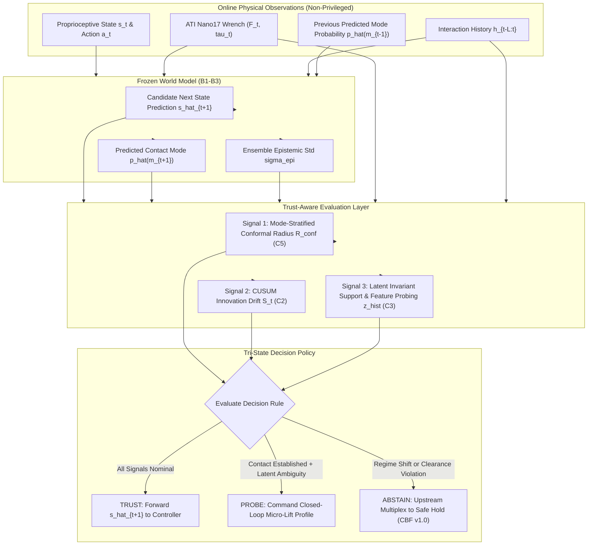

# HOROS PROBE-1 — Research-002
## Phase 3.7.3 Experimental Specification: Trust-Aware World Model Architecture

**Author:** Antigravity AI Assistant & HOROS Research-002 Team  
**Date:** November 16, 2026 (Revision 3 — Formally Authorized Post-Audit Specification)  
**Status:** FORMALLY AUTHORIZED FOR EVALUATION (World Model Training Strictly Prohibited)  
**Parent Investigation:** PROBE-1 Research-002 (Uncertainty Intelligence & Calibration)  
**Parent Manifest:** `manifests/phase37_3_trust_manifest.json` (Schema v2.0)  
**Precondition:** Phase 3.7.2 Closed and Adjudicated; Phase 3.7.3 Exploratory Pilot Documented  
**Frozen Baselines:** $B1$ (deterministic), $B2$ (probabilistic), $B3$ (5-member ensemble), $B4$ (conformal)  
**Safety Invariant:** `GeometryAwareCBFSafetyFilter v1.0` is strictly immutable.  

---

### 1. Executive Summary & Scientific Motivation

In Phase 3.7.2, we established three critical empirical findings:
1. **Temporal Innovation (`C2`):** CUSUM accumulation on causal prediction residuals reliably detects non-stationary physical regime shifts (Regime A friction step detected with AUROC **`0.8247`**).
2. **History-Conditioned Invariants (`C3`):** Causal interaction histories ($L=10$) spanning pad stretch, contact force, and tangential slip velocity identify latent friction ($\mu$ $R^2 = 0.38$, Spearman $\rho = 0.43$) and discriminate low-friction shifts (`LowMu` AUROC **`0.7946`**, $p = 0.04897$).
3. **Mode-Stratified Conformal Calibration (`C5`):** Mode-normalized nonconformity bounds restore joint multi-step coverage under severe OOD conditions to **`96.67%`** (ID–OOD gap $0.0333 \le 0.05$) and prevent dynamic impact undercoverage.
4. **The Physical Unobservability Bottleneck:** Under passive prelift dwell, object mass is mathematically unobservable ($R^2 = -0.07$, Regime B AUROC = $0.6158$) because normal force equals commanded grip force and the supporting surface absorbs residual weight.

**Objective of Phase 3.7.3:**  
To design, implement, and benchmark the **HOROS Trust-Aware World Model Architecture**—a decision layer that evaluates every model prediction in real-time and executes a **Tri-State Policy**:
$$\mathcal{D}(s_t, a_t, h_{t-L:t}) \in \{\text{TRUST}, \text{PROBE}, \text{ABSTAIN}\}$$

This layer prevents the robot from acting on ungrounded or overconfident physical predictions, commands active exploratory micro-lifts to resolve latent physical ambiguities, and enforces safe fallback to `GeometryAwareCBFSafetyFilter v1.0` whenever physical invariants are breached.

---

### 2. Tri-State Decision Layer Architecture

#### Mathematical Formulation of the Tri-State Rules

1. **State 1: $\text{TRUST}$ (High Calibration & Physical Consistency)**  
   A world model prediction $\hat{s}_{t+1}$ is deemed trustworthy if and only if all three validation checks hold simultaneously:
   $$\mathcal{C}_{\text{trust}} = \left\{ S_t \le \tau_{\text{cusum}} \right\} \land \left\{ R_{\text{conf}}^{(\hat{m}_t)}(\alpha) \le \Delta_{\text{safe}} \right\} \land \left\{ d_{\text{feat}}(h_{t-L:t}, \mathcal{D}_{\text{cal}}) \le \tau_{\text{feat}} \right\}$$
   *Where:*
   - $S_t$ is the residual CUSUM statistic: $S_t = \max(0, S_{t-1} + \|s_t - \hat{s}_t\|_{\Sigma^{-1}} - \kappa_{\text{ref}})$, with threshold $\tau_{\text{cusum}} = 2.50$.
   - $R_{\text{conf}}^{(\hat{m}_t)}$ is the mode-stratified nonconformity radius for predicted contact mode $\hat{m}_t$ calibrated at nominal $1-\alpha = 0.92$ ($\alpha = 0.08$), constrained by safe physical deviation $\Delta_{\text{safe}} = 20.0\text{ mm}$.
   - $d_{\text{feat}}$ is the Mahalanobis/standardized Euclidean distance of the interaction feature vector to the calibration set centroid, with threshold $\tau_{\text{feat}}$ set to the $95^{\text{th}}$ percentile of $\mathcal{D}_{\text{cal}}$.

2. **State 2: $\text{PROBE}$ (Active Information Gathering via Force-Gated Micro-Lift)**  
   Triggered when contact is established ($\|F_N\| > 0.5\text{ N}$), CUSUM is nominal ($S_t \le \tau_{\text{cusum}}$), but latent object mass is unobserved:
   $$\mathcal{C}_{\text{probe}} = \left\{ \|F_N\| > 0.5\text{ N} \right\} \land \left\{ S_t \le \tau_{\text{cusum}} \right\} \land \left( \sigma_{m} > \tau_{m} \lor \text{mass unobserved} \right)$$
   
   *Rigorous Mathematical Derivation of Probing Profile:*
   - In `CompliantPreLiftContactEnv`, 4 fingertip shear pads have total stiffness $k_{\text{pad}} = 6000\text{ N/m} = 6.0\text{ N/mm}$.
   - For nominal mass $m = 0.35\text{ kg}$, $W = 3.432\text{ N} \implies \Delta z_{\text{liftoff}} = 3.432 / 6.0 = 0.572\text{ mm}$.
   - For heavy objects ($m = 0.70$–$0.85\text{ kg}$), $W = 6.865$–$8.336\text{ N} \implies \Delta z_{\text{liftoff}} = 1.144$–$1.389\text{ mm}$.
   - Therefore, the probing horizon must span at least $\Delta z = 1.75\text{ mm}$ ($35\text{ steps} \times 0.05\text{ mm/step}$ at $v_{\text{probe}} = 5\text{ mm/s}$), with nominal displacement cap $\Delta z_{\max} = 2.0\text{ mm}$, hard safety clamp $2.5\text{ mm}$, and shear force cap $10.0\text{ N}$ ($< 20.0\text{ N}$ crush limit).
   - **Plateau Gating:** Finite difference monitoring $|\dot{F}_z| \le 2.50\text{ N/s}$ identifies liftoff equilibrium directly measuring $\hat{m} = F_z^{\text{plateau}} / g$.

3. **State 3: $\text{ABSTAIN}$ (Proactive Safety Fallback to Frozen CBF)**  
   Triggered when any safety or validity constraint is breached:
   $$\mathcal{C}_{\text{abstain}} = \left\{ S_t > \tau_{\text{cusum}} \right\} \lor \left\{ R_{\text{conf}}^{(\hat{m}_t)} > \Delta_{\text{safe}} \right\} \lor \left\{ \text{Slippage Detected under Load} \right\}$$
   *Upstream Multiplexing Contract:*
   - Task 1 (Peg-in-Hole): Delivers nominal safe-hold action $[0, 0, 0, 0, 0, 0]$ into `GeometryAwareCBFSafetyFilter v1.0`. The quadratic program certifies the action, guaranteeing zero barrier violations and safe compliance.
   - Task 2 (Compliant Prelift): Delivers nominal safe-hold action $[0, 0, 0, 0, 0]$, freezing actuator velocities and clamping grip displacement, guaranteeing zero dynamic crush violations ($F < 20.0\text{ N}$).

---

### 3. Pre-Registered Acceptance Gates (T1–T5)

| Gate | Acceptance Criteria | Target Threshold | Validation Dataset |
| :--- | :--- | :--- | :--- |
| **T1 — Safety Under Abstention** | Safety filter violations when $\text{ABSTAIN}$ triggers under OOD shifts | **`0 / N` violations (`0.0%`)** | `p37_2_val_task2_ood` (60 eps) & `p37_2_val_pih` (40 eps) |
| **T2 — Active Mass Identifiability** | $R^2$ and Spearman $\rho$ of latent mass estimation under force-gated micro-lift | **$R^2 \ge 0.60$, $\rho \ge 0.70$** (Baseline: $R^2 = -0.07$) | `p37_2_val_task2_ood` (HighMass & Regime B episodes) |
| **T3 — Tri-State Decision Quality** | Precision of $\text{TRUST}$ decisions under joint 3-condition rule | **Precision $\ge 0.90$** | `p37_2_val_task2_id` |
| **T4 — Abstention Latency** | Genuine uncapped steps from step-15 Regime A shift to $\text{ABSTAIN}$ trigger | **$\le 3.0$ steps ($\le 30.0\text{ ms}$)** | `p37_2_val_task2_ood` (Regime A step transition) |
| **T5 — Zero Checkpoint Tampering** | Bitwise immutability of $B1$–$B4$ checkpoints, safety filter, and datasets | **`0` SHA-256 mismatches** | Entire repository audit |

---

### 4. Frozen Governance Invariants

1. **Zero World Model Training:** Strictly zero parameter updates, zero gradient steps, zero optimizer state instantiation.
2. **Frozen Checkpoints:** $B1$, $B2$, $B3$, $B4$ checkpoints remain 100% immutable.
3. **Safety Filter Primacy:** `GeometryAwareCBFSafetyFilter v1.0` remains 100% frozen; trust layer acts strictly upstream.
4. **Non-Privileged Firewall:** No simulator ground-truth parameters ($\mu_{\text{true}}, m_{\text{obj}}, c_{\text{hole}}$) or simulator discrete contact modes are accessible during inference.
