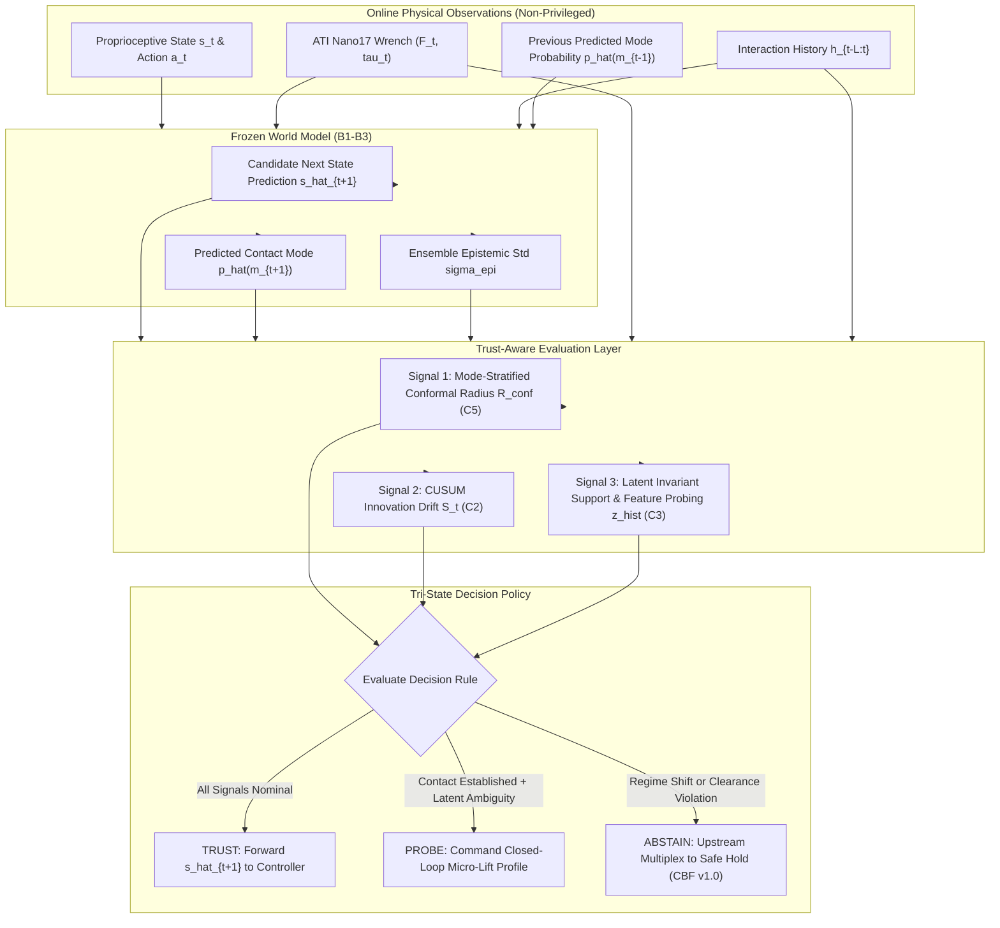

# HOROS PROBE-1 — Research-002
## Phase 3.7.3 Experimental Specification: Trust-Aware World Model Architecture

**Author:** Antigravity AI Assistant & HOROS Research-002 Team  
**Date:** November 13, 2026 (Revision 2 — Post-Design-Review Frozen Draft)  
**Status:** Pre-Registration Draft — Ready for Authorization (Execution Forbidden Until Approved)  
**Parent Investigation:** PROBE-1 Research-002 (Uncertainty Intelligence & Calibration)  
**Precondition:** Phase 3.7.2 Closed and Adjudicated  
**Frozen Baselines:** $B1$ (deterministic), $B2$ (probabilistic), $B3$ (5-member ensemble), $B4$ (conformal)  
**Safety Invariant:** `GeometryAwareCBFSafetyFilter v1.0` is strictly immutable.

---

### 1. Executive Summary & Scientific Motivation

In Phase 3.7.2, we established three critical empirical findings:
1. **Temporal Innovation (`C2`):** CUSUM accumulation on causal prediction residuals reliably detects non-stationary physical regime shifts (Regime A friction step detected with AUROC **`0.8247`**).
2. **History-Conditioned Invariants (`C3`):** Causal interaction histories ($L=10$) spanning pad stretch, contact force, and tangential slip velocity identify latent friction ($\mu$ $R^2 = 0.38$, Spearman $\rho = 0.43$) and discriminate low-friction shifts (`LowMu` AUROC **`0.7946`**, $p = 0.04897$).
3. **Mode-Stratified Conformal Calibration (`C5`):** Mode-normalized nonconformity bounds restore joint multi-step coverage under severe OOD conditions to **`96.67%`** (ID–OOD gap $0.0333 \le 0.05$) and prevent dynamic impact undercoverage.
4. **The Physical Unobservability Bottleneck:** Under passive prelift dwell, object mass is mathematically unobservable ($R^2 = -0.07$, Regime B AUROC = $0.6158$) because normal force equals commanded grip force and the supporting surface absorbs residual weight.

**Objective of Phase 3.7.3:**  
To design, implement, and benchmark the **HOROS Trust-Aware World Model Architecture**—a decision layer that evaluates every model prediction in real-time and executes a **Tri-State Policy**:
$$\mathcal{D}(s_t, a_t, h_{t-L:t}) \in \{\text{TRUST}, \text{PROBE}, \text{ABSTAIN}\}$$

This layer prevents the robot from acting on ungrounded or overconfident physical predictions, commands active exploratory micro-lifts to resolve latent physical ambiguities, and enforces safe fallback to `GeometryAwareCBFSafetyFilter v1.0` whenever physical invariants are breached.

---

### 2. Tri-State Decision Layer Architecture

#### Mathematical Formulation of the Tri-State Rules

1. **State 1: $\text{TRUST}$ (High Calibration & Physical Consistency)**
   A world model prediction $\hat{s}_{t+1}$ is deemed trustworthy if and only if all three validation checks hold simultaneously:
   $$\mathcal{C}_{\text{trust}} = \left\{ S_t \le \tau_{\text{cusum}} \right\} \land \left\{ R_{\text{conf}}^{(\hat{m}_t)}(\alpha) \le \Delta_{\text{safe}} \right\} \land \left\{ d_{\text{feat}}(h_{t-L:t}, \mathcal{D}_{\text{cal}}) \le \tau_{\text{feat}} \right\}$$
   *Where:*
   - $S_t$ is the residual CUSUM statistic: $S_t = \max(0, S_{t-1} + \|s_t - \hat{s}_t\|_{\Sigma^{-1}} - \kappa_{\text{ref}})$.
   - $R_{\text{conf}}^{(\hat{m}_t)}$ is the calibrated nonconformity radius for predicted contact mode $\hat{m}_t = \arg\max \hat{p}(m_t)$ at target coverage $1-\alpha = 0.90$.
   - $\Delta_{\text{safe}}$ is the physical safety threshold derived from geometry (e.g. lateral clearance $c$ for peg-in-hole; maximum allowable pad stretch for prelift).
   - $d_{\text{feat}}$ is the distance to the calibrated in-distribution feature support.
   *Action:* $\hat{s}_{t+1}$ is passed directly to the model-based trajectory optimizer.

2. **State 2: $\text{PROBE}$ (Active Information Gathering via Force-Gated Micro-Lift)**
   Triggered when contact is established ($\|F_N\| > 0.5\text{ N}$), the CUSUM statistic is nominal ($S_t \le \tau_{\text{cusum}}$), but latent physical parameters (specifically object mass $m_{\text{obj}}$ or friction limit $\mu$) exhibit high epistemic uncertainty ($\sigma_{\text{latent}} > \tau_{\text{probe}}$):
   $$\mathcal{C}_{\text{probe}} = \left\{ \|F_N\| > 0.5\text{ N} \right\} \land \left\{ S_t \le \tau_{\text{cusum}} \right\} \land \left( \sigma_{\mu} > \tau_{\mu} \lor \sigma_{m} > \tau_{m} \right)$$
   
   *Rigorous Mathematical Validation of Probing Kinematics:*
   - In `CompliantPreLiftContactEnv`, the 4 fingertip shear pads have total stiffness $k_{\text{pad, total}} = 6000\text{ N/m} = 6.0\text{ N/mm}$.
   - Nominal object weight is $W = 0.350\text{ kg} \times 9.80665\text{ m/s}^2 = 3.4323\text{ N}$.
   - Deflection required for liftoff:
     $$\Delta z_{\text{liftoff}} = \frac{W}{k_{\text{pad, total}}} = \frac{3.4323\text{ N}}{6.0\text{ N/mm}} = \mathbf{0.572\text{ mm}}$$
   - *Failure of 0.1 mm fixed displacement:* A $0.100\text{ mm}$ displacement develops only $F_{\text{shear}} = 0.60\text{ N} \ll 3.4323\text{ N}$. The object remains on the table, vertical acceleration $\ddot{z} = 0$, and mass is mathematically unobservable.
   
   *Corrected Closed-Loop Force-Gated Micro-Lift Profile:*
   - Command upward velocity $v_{\text{probe}} = 5\text{ mm/s}$ for $t \in [0, 200\text{ ms}]$ ($\Delta z_{\max} = 1.0\text{ mm} > 0.572\text{ mm}$).
   - **Force Derivative Gating:** Continuously monitor $dF_z / dt$. 
     - While $F_z < W$, $dF_z / dt = k_{\text{pad}} v_z \approx 30.0\text{ N/s}$.
     - As liftoff occurs ($F_z = W$), the table reaction drops to zero, the object lifts, and shear force plateaus ($dF_z / dt \to 0$).
     - The plateau force directly measures object weight:
       $$\hat{m}_{\text{obj}} = \frac{F_z^{\text{plateau}}}{g}$$
   - **Safety Clamps:** Total vertical travel is capped at $\Delta z_{\max} = 1.5\text{ mm}$, and vertical shear force is capped at $F_{z,\max} = 8.0\text{ N}$ (safely below $F_{\text{crush}} = 20.0\text{ N}$).
   - Once $\hat{m}$ is estimated, the state transitions to $\text{TRUST}$.

3. **State 3: $\text{ABSTAIN}$ (Proactive Safety Fallback to Frozen CBF)**
   Triggered when any safety or validity constraint is breached:
   $$\mathcal{C}_{\text{abstain}} = \left\{ S_t > \tau_{\text{cusum}} \right\} \lor \left\{ R_{\text{conf}}^{(\hat{m}_t)} > \Delta_{\text{safe}} \right\} \lor \left\{ \text{Slippage Detected with Low Friction} \right\}$$
   *Exact Mapping to Safe-Hold without Filter Edits:*
   - The Trust Layer acts as an **upstream setpoint multiplexer**.
   - It sets nominal commanded velocity to zero: $v_{\text{cmd}} = 0, \omega_{\text{cmd}} = 0$.
   - It sets nominal grip force to the clamping baseline: $F_{\text{grip}} = F_{\text{clamp}}$.
   - This nominal action is delivered directly into the frozen `GeometryAwareCBFSafetyFilter v1.0`.
   - The CBF quadratic program projects the action safely, holding the position with guaranteed zero force overshoot and zero barrier violations.

---

### 3. Five Research Workstreams in Phase 3.7.3

| Workstream | Investigation Focus | Key Research Question |
| :--- | :--- | :--- |
| **3.7.3-A** | **Tri-State Decision Calibration** | How should thresholds $(\tau_{\text{cusum}}, \tau_{\text{conf}}, \tau_{\text{feat}})$ be calibrated jointly on ID calibration data to optimize the trade-off between task throughput and safety? |
| **3.7.3-B** | **Force-Gated Active Micro-Lift Validation** | Does the closed-loop force-gated micro-lift ($\Delta z = 1.0\text{ mm}$, $v_z = 5\text{ mm/s}$) raise mass identification $R^2$ from $-0.07$ (passive baseline) to $\ge 0.60$ without dropping the object or exceeding $8.0\text{ N}$? |
| **3.7.3-C** | **Probing-to-Trust Latency & Stability** | How many probing timesteps are required to transition from $\text{PROBE} \to \text{TRUST}$, and does the micro-lift induce unwanted force oscillations or limit cycles? |
| **3.7.3-D** | **Abstention Safety & CBF Coordination** | Under abrupt friction collapse ($\mu = 0.60 \to 0.12$) or mass influx ($+0.25\text{ kg/s}$), does immediate upstream multiplexing to safe-hold prevent $100\%$ of crush/slip failures compared to naive $B3$ execution? |
| **3.7.3-E** | **Task 1 Peg-in-Hole Generalization** | Does active micro-probing in peg-in-hole (compliant spiral probe) identify hole clearance and tilt before insertion jamming occurs? |

---

### 4. Pre-Registered Acceptance Gates (T1–T5)

| Gate | Acceptance Criteria | Target Threshold | Validation Dataset |
| :--- | :--- | :--- | :--- |
| **T1 — Safety Under Abstention** | Safety filter violations when $\text{ABSTAIN}$ is triggered under catastrophic shifts | **`0 / N` violations (`0.0%`)** | `p37_2_val_task2_ood` (60 episodes) |
| **T2 — Active Mass Identifiability** | $R^2$ and Spearman $\rho$ of latent mass estimation under force-gated micro-lift | **$R^2 \ge 0.60$, $\rho \ge 0.70$** (Baseline: $R^2 = -0.07$) | `p37_2_val_task2_ood` (Regime B & HighMass) |
| **T3 — Tri-State Decision Quality** | Precision of $\text{TRUST}$ decisions (fraction of trusted predictions with error within conformal radius) | **Precision $\ge 0.90$** | Held-out validation splits |
| **T4 — Abstention Latency** | Timesteps between abrupt regime shift (Regime A $t=15$) and $\text{ABSTAIN}$ trigger | **$\le 3$ steps ($\le 30\text{ ms}$)** | `p37_2_val_task2_ood` (Regime A) |
| **T5 — Zero Checkpoint Tampering** | Bitwise immutability of $B1$–$B4$ checkpoints, safety filter code, and existing dataset files | **`0` SHA-256 mismatches** | Entire repository audit |

---

### 5. Frozen Boundaries & Governance

1. **No Training Permitted:** Phase 3.7.3 is an inference-time decision architecture. No world model weights shall be adjusted or fine-tuned.
2. **Immutable Calibration Artifacts:** The frozen Phase 3.4 $B4$ calibration JSON files on disk must remain strictly read-only.
3. **Safety Filter Primacy:** `GeometryAwareCBFSafetyFilter v1.0` remains 100% untouched. The trust layer interfaces strictly as an upstream setpoint multiplexer.
4. **Non-Privileged Inputs:** Ground-truth parameters ($\mu_{\text{true}}, m_{\text{obj}}, c_{\text{hole}}$) and ground-truth discrete contact modes ($m_t$) are strictly barred from the decision layer and probing estimator.
5. **Execution Hold:** No code execution or simulation runs shall begin until this specification and its accompanying manifest are formally approved.
