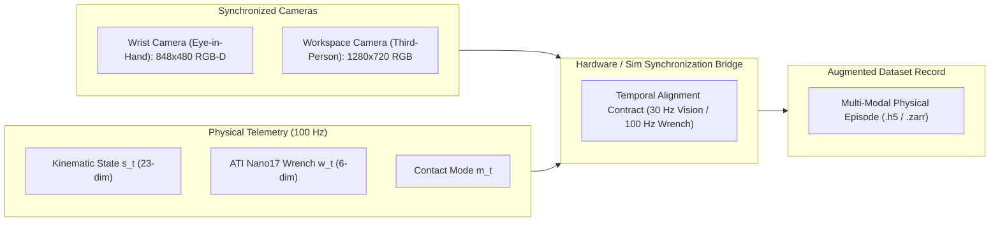

# HOROS PROBE-1 — Research-002
## Comprehensive Dataset Modality Audit & Visual World Modeling Requirements

**Author:** Antigravity AI Assistant & HOROS Data Architecture Team  
**Date:** November 13, 2026  
**Status:** Completed Diagnostic Data Audit (Read-Only)  
**Scope:** PROBE-1 Research-002 Datasets (`phase3_4` and `phase3_7_2`)  
**Core Finding:** *Current PROBE-1 datasets contain structured proprioceptive state, action, contact-mode, and 6-axis wrench telemetry. Visual observations (RGB, depth, point cloud, and video) are entirely absent.*

---

### 1. Executive Summary & Audit Methodology

To ground future model teaching and world model development in empirical reality, we executed a comprehensive inspection across all 12 dataset archives residing in `research/PROBE-1/Research-002/datasets/`. 

Every dataset was inspected programmatically for array keys, dimensional shapes, dtypes, and associated JSON metadata.

```
Total Datasets Audited:    12 archives
Total Episodes:            700 episodes (360 Phase 3.4 + 340 Phase 3.7.2)
Total Transitions:         21,981 physical transitions
Visual / Video Streams:    0 (Completely absent)
```

---

### 2. Inventory of Existing PROBE-1 Datasets

| Dataset Path | Task | Split / Condition | Episodes | Transitions | State Dim | Action Dim | Wrench Dim | Modes Present |
| :--- | :--- | :--- | :---: | :---: | :---: | :---: | :---: | :---: |
| `phase3_4/compliant_prelift_calibration.npz` | Compliant Prelift | Calibration | 60 | 1,874 | $\mathbb{R}^{23}$ | $\mathbb{R}^5$ | $\mathbb{R}^6$ | Yes (`int64`) |
| `phase3_4/compliant_prelift_M0_passive.npz` | Compliant Prelift | M0 Baseline | 60 | 3,000 | $\mathbb{R}^{23}$ | $\mathbb{R}^5$ | $\mathbb{R}^6$ | Yes (`int64`) |
| `phase3_4/compliant_prelift_M4_acmm.npz` | Compliant Prelift | M4 ACMM | 60 | 1,190 | $\mathbb{R}^{23}$ | $\mathbb{R}^5$ | $\mathbb{R}^6$ | Yes (`int64`) |
| `phase3_4/peg_in_hole_calibration.npz` | Peg-in-Hole | Calibration | 60 | 1,630 | $\mathbb{R}^{15}$ | $\mathbb{R}^6$ | $\mathbb{R}^6$ | Yes (`int64`) |
| `phase3_4/peg_in_hole_M0_passive.npz` | Peg-in-Hole | M0 Baseline | 60 | 2,311 | $\mathbb{R}^{15}$ | $\mathbb{R}^6$ | $\mathbb{R}^6$ | Yes (`int64`) |
| `phase3_4/peg_in_hole_M4_acmm.npz` | Peg-in-Hole | M4 ACMM | 60 | 1,532 | $\mathbb{R}^{15}$ | $\mathbb{R}^6$ | $\mathbb{R}^6$ | Yes (`int64`) |
| `phase3_7_2/p37_2_calib_pih.npz` | Peg-in-Hole | Frozen Calib | 60 | 1,802 | $\mathbb{R}^{15}$ | $\mathbb{R}^6$ | $\mathbb{R}^6$ | Yes (`int64`) |
| `phase3_7_2/p37_2_calib_task2_id.npz` | Compliant Prelift | Frozen Calib ID | 60 | 1,887 | $\mathbb{R}^{23}$ | $\mathbb{R}^5$ | $\mathbb{R}^6$ | Yes (`int64`) |
| `phase3_7_2/p37_2_calib_task2_ood.npz` | Compliant Prelift | Frozen Calib OOD | 60 | 2,369 | $\mathbb{R}^{23}$ | $\mathbb{R}^5$ | $\mathbb{R}^6$ | Yes (`int64`) |
| `phase3_7_2/p37_2_val_pih.npz` | Peg-in-Hole | Val Held-Out | 40 | 1,133 | $\mathbb{R}^{15}$ | $\mathbb{R}^6$ | $\mathbb{R}^6$ | Yes (`int64`) |
| `phase3_7_2/p37_2_val_task2_id.npz` | Compliant Prelift | Val Held-Out ID | 60 | 1,846 | $\mathbb{R}^{23}$ | $\mathbb{R}^5$ | $\mathbb{R}^6$ | Yes (`int64`) |
| `phase3_7_2/p37_2_val_task2_ood.npz` | Compliant Prelift | Val Held-Out OOD | 60 | 2,219 | $\mathbb{R}^{23}$ | $\mathbb{R}^5$ | $\mathbb{R}^6$ | Yes (`int64`) |

---

### 3. Detailed Modality Analysis: What Exists

Every archive reliably provides the following five physical telemetry arrays:

1. **Structured Robot & Object States (`states`, `next_states`):**
   - **Task 2 (`compliant_prelift`, Dim 23):** Gripper position $(x, y, z)$, gripper velocity, finger span, finger pad deformation/stretch $(s_L, s_R)$, object center-of-mass pose $(x_{\text{obj}}, y_{\text{obj}}, z_{\text{obj}}, \theta_{\text{obj}})$, object linear/angular velocity, surface contact indicator, table reaction state.
   - **Task 1 (`peg_in_hole`, Dim 15):** Peg tip 3D position $(x, y, z)$, peg orientation quaternion/Euler angles, linear velocity $(\dot{x}, \dot{y}, \dot{z})$, angular velocity $(\omega_x, \omega_y, \omega_z)$, hole relative clearance vector.
2. **Control Action Signals (`actions`):**
   - **Task 2 (Dim 5):** Commanded end-effector Cartesian velocities $(v_x, v_y, v_z)$, rotational velocity $\omega_z$, commanded gripper normal force $F_{\text{grip}}$.
   - **Task 1 (Dim 6):** 6-DoF end-effector velocity commands $(v_x, v_y, v_z, \omega_x, \omega_y, \omega_z)$.
3. **Calibrated Force-Torque Telemetry (`wrenches`, `next_wrenches`):**
   - 6-axis ATI Nano17 F/T sensor readings: $[F_x, F_y, F_z, M_x, M_y, M_z]^T$ in physical units of Newtons ($\text{N}$) and Newton-meters ($\text{Nm}$).
4. **Discrete Contact Modes (`modes`):**
   - Categorical integer labels tracking contact phases:
     - `0`: **Free Space** (no contact)
     - `1`: **First Contact** (initial impact transient)
     - `2`: **Sticking** (stable Coulomb friction lock)
     - `3`: **Sliding** (tangential relative velocity exceeding stick threshold)
     - `4`: **Impact / Jamming** (excessive normal/reaction forces)
5. **Rich Experimental Metadata (`episode_metadata_json`):**
   - Episode seeds, physical parameters ($\mu_{\text{true}}, m_{\text{obj}}, c_{\text{hole}}$), non-stationary regime labels (`Regime A`, `Regime B`), and safety violation logs.

---

### 4. What Is Missing: The Visual & Video Void

Across all 12 dataset archives, the following modalities are **completely absent**:
* **RGB Images:** No color camera frames (neither wrist-mounted nor third-person).
* **Depth Maps:** No structured-light or stereo depth channels.
* **Point Clouds:** No 3D surface point clouds or mesh representations.
* **Video Sequences:** No sequential video files (`.mp4`, `.avi`, or uncompressed frame stacks).
* **Camera Extrinsics & Intrinsics:** No camera calibration matrices ($K, [R|t]$) or optical parameters.

#### Scientific Implication
Current models ($B1$–$B4$) are **blind tactile-proprioceptive models**. They predict physics purely from kinematic and wrench coordinates. While highly effective for low-level contact stabilization and safety filtering, **they cannot perform visual grounding, affordance perception, or cross-scene visual physical generalization**.

---

### 5. Data Requirements for Visual Physical World Modeling (`HOROS-WM-vNext`)

To bridge the gap between blind physical dynamics and multimodal world modeling, future data collection campaigns must augment the simulator environment with synchronized visual pipelines.



#### Specification of Required Visual Modalities

1. **Dual-Camera Geometry:**
   - **Wrist-Mounted Camera (Eye-in-Hand):**
     - Sensor: Simulated Intel RealSense D435i equivalent.
     - Resolution: $848 \times 480$ RGB + aligned 16-bit Depth ($z \in [0.1, 1.5]\text{ m}$).
     - Purpose: Captures finger-pad compliant deformation, contact slip, and micro-alignment.
   - **Static Workspace Camera (Third-Person):**
     - Sensor: Simulated 1080p camera mounted at $45^\circ$ elevation overlooking the fixture.
     - Resolution: $1280 \times 720$ RGB.
     - Purpose: Captures global object pose, approach trajectory, and obstacle context.
2. **Temporal Synchronization Contract:**
   - Physical simulation and ATI Nano17 wrench telemetry run at **$100\text{ Hz}$** ($\Delta t = 10\text{ ms}$).
   - Camera visual streams render at **$30\text{ Hz}$** ($\Delta t \approx 33.3\text{ ms}$).
   - Synchronization Rule: Each image frame $I_k$ is timestamped and paired with the exact physical state $s_{t_k}$, with intermediate $100\text{ Hz}$ wrench bursts $(w_{t_k}, \dots, w_{t_k+3})$ recorded as sub-step dynamics.
3. **Data Storage & Packaging Format:**
   - NPZ archives are poorly suited for video frames.
   - The visual dataset must transition to **HDF5 (`.h5`)** or **Zarr (`.zarr`)** chunked storage:
     - `rgb_wrist`: `(N, H, W, 3)`, `uint8`, compressed with blosc/lz4.
     - `depth_wrist`: `(N, H, W)`, `uint16` (millimeters).
     - `states`: `(N, 23)`, `float32`.
     - `actions`: `(N, 5)`, `float32`.
     - `wrenches`: `(N, 6)`, `float32`.
     - `modes`: `(N,)`, `int64`.
4. **Estimated Data Footprint:**
   - A 50-step episode ($5\text{ seconds}$ at $30\text{ Hz} = 150\text{ frames}$):
     - Uncompressed RGB-D: $\approx 240\text{ MB}$ per episode.
     - Compressed H.264 / PNG depth: $\approx 8.5\text{ MB}$ per episode.
   - A 1,000-episode foundation dataset requires $\approx \mathbf{8.5\text{ GB}}$ of storage.

---

### 6. Recommended Staging Plan

1. **Stage 1 (Immediate / Phase 3.7.3):** Proceed with existing structured state, wrench, and contact datasets. Calibrate trust and active probing using established physical coordinates.
2. **Stage 2 (Parallel Experience Pilot):** Integrate virtual camera sensors into `CompliantPreLiftContactEnv` and `PegInHoleEnv` in MuJoCo/PyBullet.
3. **Stage 3 (Foundation Dataset Generation):** Execute the Synthetic Experience Factory with synchronized video capture to produce the multimodal training pool for `HOROS-WM-vNext`.
