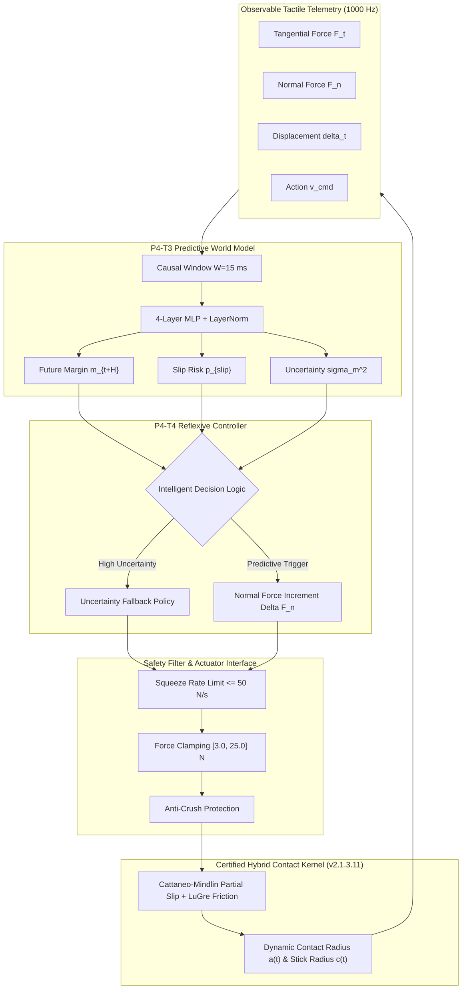

# HOROS PROBE-1 — Phase 4 Task 4 (P4-T4) Research Specification
## Reflexive Pre-Slip Control Policy & Closed-Loop Grasp Stabilization

**Project:** HOROS Physical Interaction Data Engine (PIDE)  
**Research Program:** PROBE-1  
**Task:** P4-T4  
**Starting Point:** Certified P4-T3 Level 2 Force-History Predictive Model & Post-Merge Scientific Audit  
**Primary Objective:** Active closed-loop grasp stabilization before gross slip occurs via physical stability prediction.

---

## 1. Research Problem & Scientific Hypothesis

In manual grasping and industrial manipulation, external disturbances (object weight during lift, acceleration inertial forces, unexpected collisions, or friction drops) alter the contact interface. Traditional robotic grasp controllers operate in one of two suboptimal extremes:
1. **Excessive Clamping Force:** Statically applying high gripping forces, which risks crushing delicate objects, saturating tactile sensors, and expending excessive actuator energy.
2. **Delayed Reactive Recovery:** Waiting until macroscopic gross slip velocity ($|v_{\text{slip}}| \ge 10^{-4}\,\text{m/s}$) is detected before increasing gripping force. On fast disturbances or low-friction contacts, this reaction is too late, resulting in dropped objects.

### Core Scientific Hypothesis:
A controller equipped with a **causal predictive physical world model** that forecasts future contact margin $\hat{m}_{t+H}$, slip probability $\hat{p}_{\text{slip}}$, and prediction uncertainty $\hat{\sigma}_m^2$ can initiate a stabilizing normal force reflex **tens of milliseconds before macroscopic gross slip occurs**, arresting slip while expending significantly lower continuous gripping force than static baselines.

---

## 2. System Architecture

---

## 3. Mathematical Formulation of Controllers

### Controller 1: Fixed-Force Baseline
Maintains a constant commanded gripping force:

$$F_{n,t+1}^{\text{cmd}} = F_{n,0}$$

### Controller 2: Reactive Slip Controller
Monitors estimated slip velocity $\hat{v}_{\text{slip}}$. If macroscopic slip is detected ($|v_{\text{slip}}| \ge v_{\text{threshold}} = 10^{-4}\,\text{m/s}$):

$$F_{n,t+1}^{\text{cmd}} = \min\left( F_{n,\max}, F_{n,t}^{\text{cmd}} + \Delta F_{\text{recovery}} \right) \quad (\Delta F_{\text{recovery}} = 12.0\,\text{N})$$

### Controller 3: Threshold-Based Margin Controller
Monitors the instantaneous tangential force ratio $R_F(t) = \frac{|F_t(t)|}{F_n(t)}$. When $R_F \ge \theta_{\text{ratio}} = 0.45$:

$$F_{n,t+1}^{\text{cmd}} = F_{n,t}^{\text{cmd}} + K_p \left( R_F(t) - R_{\text{target}} \right) \quad (K_p = 15.0, R_{\text{target}} = 0.35)$$

### Controller 4: RLS-Based Predictive Controller
Uses the Level 1 RLS compliance estimator to track estimated tangential stiffness $k_t(t)$ and normalized margin $\hat{m}_{\text{RLS}}(t) = k_t / k_{t,0}$. When $\hat{m}_{\text{RLS}} \le 0.40$:

$$F_{n,t+1}^{\text{cmd}} = F_{n,t}^{\text{cmd}} + K_{\text{RLS}} \left( 0.40 - \hat{m}_{\text{RLS}} \right) \quad (K_{\text{RLS}} = 20.0)$$

### Controller 5: HOROS Predictive MLP Controller
Uses the multi-task outputs from the certified P4-T3 neural world model:
1. **Uncertainty Fallback Check:**
   $$\text{If } \hat{\sigma}_m^2 \ge \theta_{\text{uncertainty}} = 0.25 \implies \text{Trigger protective fallback } (\Delta F_n = +5.0\,\text{N})$$
2. **Predictive Pre-Slip Intervention:**
   $$\text{If } \hat{m}_{t+H} \le \theta_{\text{margin}} = 0.35 \quad \text{or} \quad \hat{p}_{\text{slip}} \ge \theta_{\text{risk}} = 0.40:$$
   $$\Delta F_{n,t} = K_m \max\left(0, 0.50 - \hat{m}_{t+H}\right) + K_p \hat{p}_{\text{slip}} \quad (K_m = 25.0, K_p = 15.0)$$
3. **Safe Force Relaxation:**
   $$\text{If } \hat{m}_{t+H} \ge 0.75 \quad \text{and} \quad \hat{p}_{\text{slip}} < 0.10 \quad \text{and} \quad F_n > F_{n,\min} + 1.0\,\text{N}:$$
   $$\Delta F_{n,t} = -1.0\,\text{N/s} \times \Delta t \quad (\text{gentle relaxation preserving energy})$$

---

## 4. Safety Constraints & Actuator Rate Limits

To reflect real-world robotic gripper actuator dynamics and protect objects:
1. **Physical Force Bounds:**
   $$F_{n,t+1} = \text{clip}\left( F_{n,t+1}^{\text{cmd}}, F_{n,\min}, F_{n,\max} \right) \quad (F_{n,\min} = 3.0\,\text{N}, F_{n,\max} = 25.0\,\text{N})$$
2. **Actuator Squeeze Rate Limits:**
   $$\left| \frac{dF_n}{dt} \right| \le \dot{F}_{\max} = 50.0\,\text{N/s} \implies |\Delta F_n| \le 0.05\,\text{N per ms}$$
3. **Causality & Non-Leakage Contract:**
   Controllers have access strictly to observable channels ($F_t, F_n, \delta_t, v_{\text{cmd}}$) with ATI Nano17 noise. True stick radius $c(t)$, true friction coefficient $\mu_s$, and future measurements are strictly sealed inside the simulation environment for post-hoc evaluation.

---

## 5. Experimental Test Matrix

The benchmark evaluates 30 distinct physical interaction scenarios across three axes:
1. **Friction Strata:** Low ($\mu_s = 0.35$), Moderate ($\mu_s = 0.55$), High ($\mu_s = 0.75$).
2. **Disturbance Profiles:**
   - **Monotonic Shear Ramp:** Tangential velocity $v_{\text{shear}} \in \{1.0, 2.5, 5.0\}\,\text{mm/s}$.
   - **Dynamic Micro-Probe:** High-frequency cyclic shear oscillation ($10\,\text{Hz}$).
   - **Tangential Shock:** Sudden shear velocity step impulse ($+10\,\text{mm/s}$ at $t = 0.25\,\text{s}$).
3. **Initial Clamping Forces:** $F_{n,0} \in \{3.0, 5.0, 8.0\}\,\text{N}$.
4. **Research Seeds:** Seeds `4300001` through `4300030` (verified outside all locked intervals).
