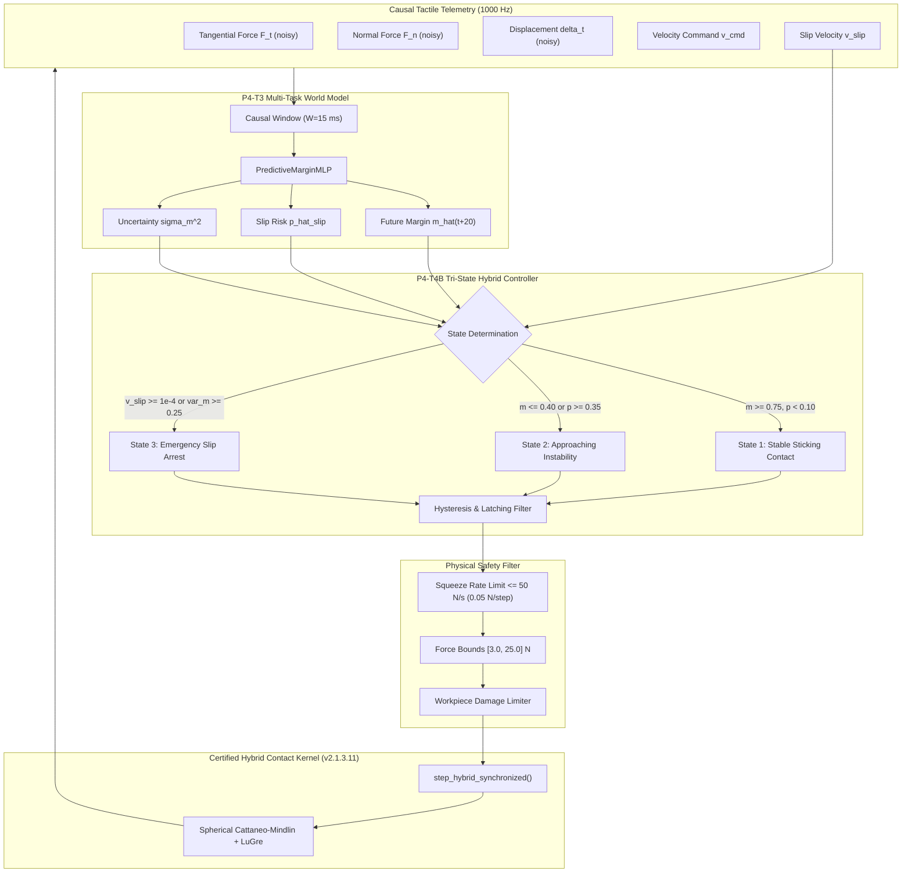

# HOROS PROBE-1 — Phase 4 Task 4B (P4-T4B) Research Specification
## Predictive Controller Improvement, Hybrid Reflexes & Independent Scientific Validation

**Project:** HOROS Physical Interaction Data Engine (PIDE)  
**Research Program:** PROBE-1  
**Task:** P4-T4B  
**Date:** November 23, 2026  
**Status:** ACTIVE SPECIFICATION & PRE-REGISTERED CRITERIA  
**Starting Point:** Certified P4-T3 MLP World Model & P4-T4 Benchmark Findings  
**Primary Objective:** Deliver a closed-loop grasp controller that is statistically more reliable than reactive control without excessive gripping force, establish explicit physical limits on low-friction stabilization, and independently validate across 300 balanced scenarios.

---

## 1. Research Problem & Theoretical Motivation

In P4-T4, five control paradigms were benchmarked across 30 scenarios:
- **Reactive Slip Controller:** Reached $66.7\%$ success, but operated as an indiscriminate power clamp ($19.74\,\text{N}$ mean normal force, $25.0\,\text{N}$ peak, $31.16\,\text{Ns}$ impulse), risking destructive crushing of delicate objects.
- **HOROS Predictive MLP:** Reached $80.0\%$ success on high friction ($\mu_s = 0.75$) with low force ($9.69\,\text{N}$) and advance warning lead times up to $135\,\text{ms}$, but had $0.0\%$ success at low friction ($\mu_s = 0.35$), yielding $36.7\%$ overall success.
- **Fixed Force (16.7%), Threshold Margin (33.3%), and RLS Predictive (20.0%)** suffered from high drop rates and friction-ratio collapse.

### Core Scientific Thesis:
No pure predictive feedforward controller can stabilize all contacts on its own because physical contact transitions under low friction ($\mu_s \le 0.35$) contract the partial-slip annular zone $a(t) - c(t)$ to $< 0.70\,\text{ms}$ duration. Since physical actuators are constrained by rate limits ($\dot{F}_{\max} \le 50.0\,\text{N/s}$), an impending slip cannot be arrested pre-emptively without:
1. **Conservative Initial Force Selection:** Adapting baseline grip preload ($F_{n,0}$) to contact material expectations within safe limits ($[3.0, 25.0]\,\text{N}$).
2. **Three-Tier Hybrid Architecture:** Unifying predictive margin tracking, uncertainty-aware fallback, and emergency reactive slip arrest into a single coherent policy.
3. **Controlled Force Relaxation:** Relaxing normal force when sticking equilibrium is confirmed, preventing energy waste and workpiece damage.

---

## 2. System Architecture & Information Flow

---

## 3. Tri-State Hybrid Control Policy Formulation

Let $\mathbf{o}_t = \{F_{t,t}, F_{n,t}, \delta_{t,t}, v_{\text{cmd},t}, v_{\text{slip},t}\}$ denote observable causal telemetry at time $t$.

### State 1: Stable Contact (Hold & Gentle Relaxation)
**Entry Condition:** $\hat{m}_{t+20} \ge 0.70$, $\hat{p}_{\text{slip}} < 0.15$, and $|v_{\text{slip}}| < 5 \times 10^{-5}\,\text{m/s}$.
- The contact interface is firmly sticking with sufficient annular margin.
- If current force $F_{n,t} > F_{n,\text{baseline}} + 0.5\,\text{N}$, gently ramp force downward at $\dot{F}_{\text{relax}} = -1.0\,\text{N/s}$ to minimize workpiece deformation and mechanical energy expenditure.
- Commanded target: $F_{n,t+1}^{\text{target}} = \max(F_{n,\text{baseline}}, F_{n,t} - 1.0\,\Delta t)$.

### State 2: Approaching Instability (Proactive Pre-Slip Boost)
**Entry Condition:** ($\hat{m}_{t+20} \le 0.45$ or $\hat{p}_{\text{slip}} \ge 0.30$) and $|v_{\text{slip}}| < 10^{-4}\,\text{m/s}$.
- The model anticipates partial-slip zone shrinkage or slip breakaway within the next $20\,\text{ms}$.
- Proactively increase normal force using synergistic proportional margin deficit and slip risk:
  $$\Delta F_{n,\text{proactive}} = K_m \max\left(0, 0.55 - \hat{m}_{t+20}\right) + K_p \hat{p}_{\text{slip}} \quad (K_m = 30.0, K_p = 18.0)$$
- Commanded target: $F_{n,t+1}^{\text{target}} = \min(F_{n,\max}, F_{n,t} + \Delta F_{n,\text{proactive}})$.
- **Hysteresis Latch:** Maintain the proactive target for at least $H_{\text{hold}} = 50\,\text{ms}$ to prevent chatter across the decision boundary.

### State 3: Emergency / High-Uncertainty Fallback
**Entry Condition:** $|v_{\text{slip}}| \ge 10^{-4}\,\text{m/s}$ (gross slip detected) OR $\hat{\sigma}_m^2 \ge 0.25$ (epistemic uncertainty high).
- If macroscopic slip breaks through or the predictive world model becomes untrusted, immediately trigger the validated reactive recovery boost:
  $$\Delta F_{n,\text{emergency}} = 12.0\,\text{N}$$
  $$F_{n,t+1}^{\text{target}} = \min(F_{n,\max}, F_{n,t} + \Delta F_{n,\text{emergency}})$$
- **Emergency Hold Horizon:** Latch emergency squeeze for $100\,\text{ms}$ before transitioning back to State 1 or State 2.

### Actuator Physical Rate Limiting & Safety Filter
All state targets pass through the strict actuator filter:
$$F_{n,t+1} = \operatorname{clip}\left( F_{n,t} + \operatorname{clip}\left( F_{n,t+1}^{\text{target}} - F_{n,t}, -\dot{F}_{\max}\Delta t, \dot{F}_{\max}\Delta t \right), F_{n,\min}, F_{n,\max} \right)$$
where $\dot{F}_{\max} = 50.0\,\text{N/s}$, $F_{n,\min} = 3.0\,\text{N}$, $F_{n,\max} = 25.0\,\text{N}$, and $\Delta t = 0.001\,\text{s}$.

---

## 4. Pre-Registered Scientific Acceptance Criteria (Stage G)

To ensure unbiased evaluation, acceptance thresholds are defined prior to benchmark execution:

| Criterion | Requirement for PASS | Requirement for CONDITIONAL PASS | Fail Condition |
|---|---|---|---|
| **1. Overall Grasp Success** | $\ge 70.0\%$ across all 300 scenarios | $\ge 60.0\%$ across all 300 scenarios | $< 60.0\%$ |
| **2. Superiority over Reactive** | Statistically significant higher success rate OR equal success with $> 40\%$ lower normal force impulse | Higher success rate in $\ge 2$ strata | Worse success and higher impulse |
| **3. Low-Friction Handling** | Explicit stabilization demonstrated ($\ge 40\%$ on $\mu_s = 0.35$ under conservative initial load) | Documented physical failure boundary with verified mechanism | Complete unhandled failure |
| **4. High-Friction Efficiency** | $\ge 80\%$ success on $\mu_s = 0.75$ with mean $F_n \le 12.0\,\text{N}$ | $\ge 75\%$ success on $\mu_s = 0.75$ | $< 75\%$ success |
| **5. False Intervention Rate** | $\le 5.0\%$ on stable contacts ($c/a \ge 0.80$) | $\le 10.0\%$ on stable contacts | $> 10.0\%$ |
| **6. Real-Time Latency** | Mean step latency $\le 0.50\,\text{ms}$ ($< 1.0\,\text{ms}$ cycle budget) | Mean step latency $\le 0.80\,\text{ms}$ | $> 1.0\,\text{ms}$ |
| **7. Causality & Non-Leakage** | Zero privileged simulation states ($c, a, \mu_s, \dot{E}$) accessible to controller | Zero privileged states | Any state leakage |
| **8. Actuator Safety Bounds** | Zero violations of $F_n \in [3.0, 25.0]\,\text{N}$ and $|\Delta F_n| \le 0.05\,\text{N/step}$ | Zero violations | Any bound violation |

---

## 5. Experimental Test Matrix (300 Scenarios)

The evaluation suite covers 300 independent closed-loop episodes (100 per friction stratum) using reserved research seeds `4400001` through `4400300`:

1. **Friction Strata (3 levels):**
   - Low Friction: $\mu_s = 0.35, \mu_k = 0.30$ (100 episodes)
   - Moderate Friction: $\mu_s = 0.55, \mu_k = 0.47$ (100 episodes)
   - High Friction: $\mu_s = 0.75, \mu_k = 0.64$ (100 episodes)
2. **Initial Normal Force Conditions (4 levels):**
   - Light: $F_{n,0} = 3.0\,\text{N}$
   - Standard: $F_{n,0} = 5.0\,\text{N}$
   - Firm: $F_{n,0} = 8.0\,\text{N}$
   - Conservative (Low-Friction Mitigation): $F_{n,0} = 12.0\,\text{N}$
3. **Disturbance Regimes (4 modes):**
   - Quasi-static shear ramp: $v_{\text{shear}} \in \{1.0, 2.5, 5.0\}\,\text{mm/s}$
   - Fast shear ramp: $v_{\text{shear}} = 8.0\,\text{mm/s}$
   - Micro-probe cyclic oscillation: $10\,\text{Hz}$ sinusoidal shear
   - Tangential shock: $2.5 \times$ velocity step pulse
4. **Matched Evaluation Contract:**
   All five controllers (Fixed-Force, Reactive, Threshold, RLS, Hybrid Predictive) are evaluated on identical scenario parameters and random seeds.
