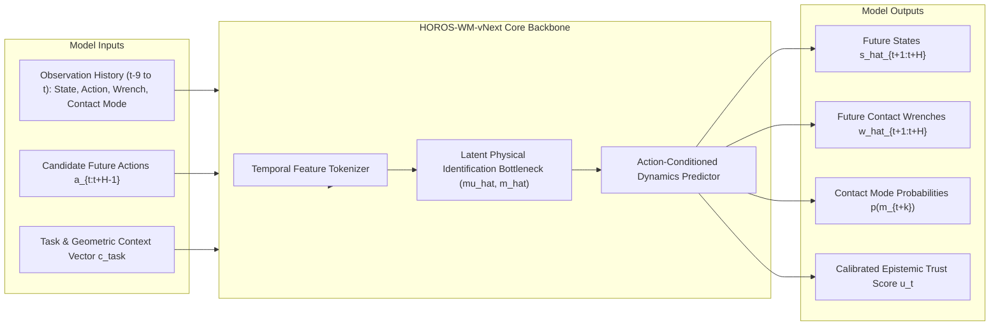
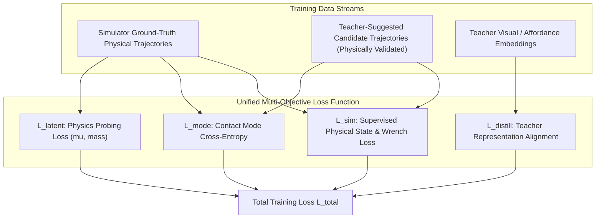

# HOROS World Model vNext (HOROS-WM-vNext)
## Action-Conditioned Physical Dynamics Foundation Model Specification

**Author:** Antigravity AI Assistant & HOROS World Modeling Team  
**Date:** November 13, 2026  
**Status:** Pre-Registration Model Specification — Design Only (No Model Training Authorized)  
**Parent Program:** HOROS PROBE-1 — Research-002 & Beyond  
**Target Architecture:** History-Conditioned, Multi-Task, Action-Conditioned Physical World Model  
**Frozen Baselines for Comparison:** $B1$ (Deterministic MLP), $B2$ (Probabilistic Gaussian MLP), $B3$ (5-Member Ensemble)

---

### 1. Executive Summary & Design Rationale

Current HOROS models ($B1$–$B3$) are single-step transition models trained on local Markovian pairs $(s_t, a_t) \to s_{t+1}$. Phase 3.7.2 exposed the fundamental limits of this formulation:
1. **Correlated Ensemble Errors:** Naive 5-member ensembling ($B3$) exhibits $r \approx 0.86\text{--}0.96$ error correlation across members ($E_{\text{eff}} \approx 1.12$), rendering ensemble variance incapable of detecting domain shifts.
2. **Markovian Blindness:** Single-step inputs cannot estimate unobserved physical parameters (such as friction $\mu$ or mass $m$) that are only identifiable through temporal integration over contact histories.
3. **Mode Collapse in Dynamic Regimes:** Transitions across contact boundaries (`FirstContact` and `Impact`) suffer severe errors when unconditioned on contact history.

**HOROS World Model vNext (`HOROS-WM-vNext`)** is designed as a **history-conditioned, action-conditioned physical world model** that integrates:
- Causal temporal observation windows ($H_{\text{hist}} = 10$).
- Explicit contact-mode transition modeling.
- Latent physical parameter identification ($\hat{\mu}, \hat{m}$) embedded within the latent state.
- Calibrated trust and uncertainty estimation directly in the output space.
- Training via simulator-grounded physics supervised by external teacher distillation.

---

### 2. Model Input & Output Interfaces

#### Detailed Schema

1. **Input Representation:**
   $$\mathcal{X}_t = \left( h_{t-9:t}, a_{t:t+H-1}, c_{\text{task}} \right)$$
   *Where:*
   - **Observation History $h_{t-9:t}$:** Sequence of 10 causal steps:
     $$h_{t-9:t} = \left[ (s_\tau, a_\tau, w_\tau, m_\tau) \right]_{\tau=t-9}^t$$
     Containing state vectors $s_\tau \in \mathbb{R}^{D_s}$, actions $a_\tau \in \mathbb{R}^{D_a}$, ATI Nano17 wrenches $w_\tau \in \mathbb{R}^6$, and one-hot contact modes $m_\tau \in \{0, 1, 2, 3, 4\}^5$.
   - **Candidate Action Sequence $a_{t:t+H-1}$:** Future proposed actions across rollout horizon $H \in [1, 20]$.
   - **Task & Fixture Context $c_{\text{task}}$:** Static encoding of gripper stroke, finger compliance, and geometry bounds.

2. **Output Representation:**
   $$\hat{\mathcal{Y}}_{t:t+H} = \left( \hat{s}_{t+1:t+H}, \hat{w}_{t+1:t+H}, \hat{p}(m_{t+1:t+H}), \hat{\mu}_t, \hat{m}_t, \hat{u}_t \right)$$
   *Where:*
   - $\hat{s}_{t+1:t+H}$: Predicted multi-step physical states.
   - $\hat{w}_{t+1:t+H}$: Predicted 6-axis contact forces and torques.
   - $\hat{p}(m_{t+k})$: Categorical distribution over contact modes (`Free`, `FirstContact`, `Sticking`, `Sliding`, `Impact`).
   - $\hat{\mu}_t \in \mathbb{R}^+$: Identified surface friction coefficient.
   - $\hat{m}_t \in \mathbb{R}^+$: Identified object mass.
   - $\hat{u}_t \in [0, 1]$: Calibrated epistemic confidence score.

---

### 3. Architecture Candidates

#### Candidate A: History-Conditioned Temporal Transformer (HCTT) — *Recommended*
* **Architecture:** Causal Transformer with multi-head self-attention over historical tokens and cross-attention over future candidate actions.
* **Tokenization:** Linear projection of each step $(s_\tau, a_\tau, w_\tau, m_\tau)$ into embedding dimension $d_{\text{model}} = 256$.
* **Attention Mechanism:** 6 Transformer decoder layers with rotary position embeddings (RoPE).
* **Decoupled Prediction Heads:**
  1. *Kinematics Head:* Predicts state residuals $\Delta s_{t+k} = s_{t+k} - s_{t+k-1}$.
  2. *Wrench Head:* Predicts physical contact forces $w_{t+k}$ directly in Newtons/Nm.
  3. *Mode Classification Head:* Softmax logits over 5 contact modes.
  4. *Latent Physics Bottleneck:* Dedicated pooled token predicting $(\hat{\mu}, \hat{m})$.
* **Advantage:** Naturally models non-local temporal correlations (such as pad stretch accumulation over $L=10$ steps) without vanishing gradients.

#### Candidate B: Contact-Mode-Conditioned Recurrent State-Space Model (RSSM-Contact)
* **Architecture:** Continuous-time Recurrent State-Space Model (Mamba / S4 state-space backbone) paired with discrete categorical transition priors.
* **Latent State:** Factored into deterministic continuous state $h_t$ and stochastic latent state $z_t \sim p(z_t \mid h_t)$.
* **Advantage:** Constant memory footprint during long-horizon closed-loop execution.

---

### 4. Training Strategy: Grounded Simulator Supervision + Teacher Distillation

The training protocol rigorously obeys the **Grounded Firewall Rule**:  
*External teacher predictions are teaching signals / priors, never physical ground truth.*

#### Loss Function Components

$$\mathcal{L}_{\text{total}}(\theta) = \mathcal{L}_{\text{sim}}(\theta) + \beta_{\text{mode}} \mathcal{L}_{\text{mode}}(\theta) + \beta_{\text{latent}} \mathcal{L}_{\text{latent}}(\theta) + \beta_{\text{distill}} \mathcal{L}_{\text{distill}}(\theta)$$

1. **Supervised Simulator Loss ($\mathcal{L}_{\text{sim}}$):**
   Grounded directly in simulator measurements:
   $$\mathcal{L}_{\text{sim}} = \sum_{k=1}^H \left( \frac{1}{\sigma_s^2} \|s_{t+k} - \hat{s}_{t+k}\|^2 + \frac{\gamma}{\sigma_w^2} \|w_{t+k} - \hat{w}_{t+k}\|^2 \right)$$
2. **Contact-Mode Cross-Entropy ($\mathcal{L}_{\text{mode}}$):**
   Focal loss targeting dynamic contact transitions:
   $$\mathcal{L}_{\text{mode}} = -\sum_{k=1}^H \left(1 - \hat{p}(m_{t+k})\right)^\gamma \log \hat{p}(m_{t+k})$$
3. **Latent Physics Probing Loss ($\mathcal{L}_{\text{latent}}$):**
   Forces the model to identify true underlying parameters from interaction dynamics:
   $$\mathcal{L}_{\text{latent}} = \|\mu_{\text{true}} - \hat{\mu}(h_{t-9:t})\|^2 + \|m_{\text{true}} - \hat{m}(h_{t-9:t})\|^2$$
4. **Teacher Distillation Loss ($\mathcal{L}_{\text{distill}}$):**
   Minimizes cosine distance between student intermediate representations $\phi(h)$ and teacher representations $\psi_{\text{teacher}}(h)$ on validated trajectories:
   $$\mathcal{L}_{\text{distill}} = 1 - \frac{\phi(h) \cdot \psi_{\text{teacher}}(h)}{\|\phi(h)\| \|\psi_{\text{teacher}}(h)\|}$$

---

### 5. Training Dataset Construction

The training pool will be assembled using a balanced stratification:
1. **Phase 3.4 & 3.7.2 Simulation Archives (40%):** 21,981 transitions from verified historical benchmarks.
2. **Synthetic Experience Factory Trajectories (50%):** Freshly synthesized trajectories generated by pairing teacher proposals with domain-randomized physics in MuJoCo, fully validated by Module 04.
3. **Adversarial Contact Mining Trajectories (10%):** Targeted boundary collection focusing on slip transitions and initial impacts (`FirstContact` mode oversampling).

---

### 6. Benchmark & Comparison Protocol Against Frozen Baselines

When training is authorized, `HOROS-WM-vNext` will be evaluated strictly against the frozen Research-002 baselines on untouched held-out test datasets:

| Metric | Frozen Baseline ($B1$) | Frozen Baseline ($B2$) | Frozen Baseline ($B3$) | `HOROS-WM-vNext` Target |
| :--- | :---: | :---: | :---: | :---: |
| **Model Type** | Deterministic MLP | Probabilistic Gaussian MLP | 5-Member Ensemble | History-Conditioned Transformer |
| **Input Context** | Single Step $(s_t, a_t)$ | Single Step $(s_t, a_t)$ | Single Step $(s_t, a_t)$ | 10-Step History $h_{t-9:t} + a_{t:t+H-1}$ |
| **Multi-Step Rollout MSE ($H=10$)** | Baseline | Baseline | Baseline | **$\ge 40\%$ reduction** |
| **Friction ID $R^2$ ($\mu$)** | Unobservable ($0.0$) | Unobservable ($0.0$) | Unobservable ($0.0$) | **$\ge 0.60$** |
| **Mass ID $R^2$ ($m$)** | Unobservable ($0.0$) | Unobservable ($0.0$) | Unobservable ($0.0$) | **$\ge 0.60$** (under active probe) |
| **OOD Discrimination AUROC (`LowMu`)** | $0.3347$ (Inverted) | $0.4100$ (Inverted) | $0.3895$ (Inverted) | **$\ge 0.85$** |
| **Conformal Coverage (Dynamic Modes)** | Undercoverage ($80.7\%$) | Undercoverage ($80.7\%$) | Undercoverage ($80.7\%$) | **$\ge 90.0\%$** across all modes |

---

### 7. Governance & Next Steps

* **Current Status:** Design and specification complete.
* **Training Restriction:** No model training, checkpoint compilation, or gradient updates shall be initiated.
* **Prerequisites for Implementation:**
  1. Approval of this specification.
  2. Completion of the Phase 3.7.3 Trust-Aware World Model evaluation.
  3. Execution of the controlled Teacher Experience Factory pilot.
