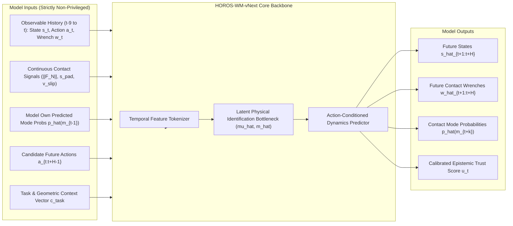
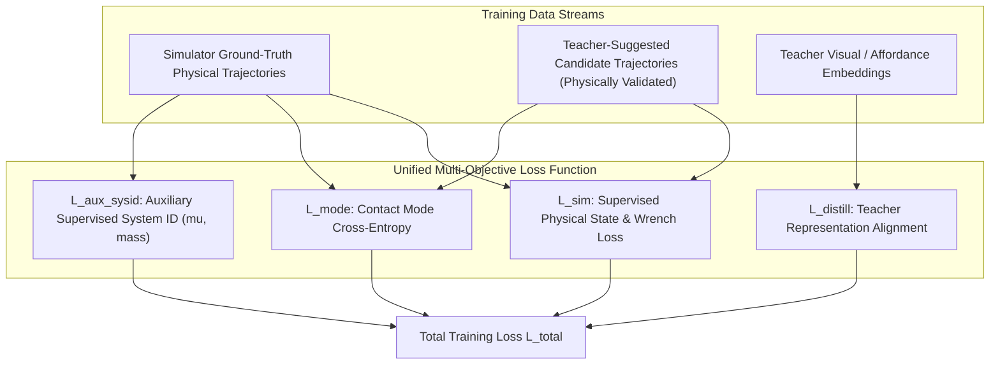

# HOROS World Model vNext (HOROS-WM-vNext)
## Action-Conditioned Physical Dynamics Foundation Model Specification

**Author:** Antigravity AI Assistant & HOROS World Modeling Team  
**Date:** November 13, 2026 (Revision 2 — Post-Design-Review Frozen Draft)  
**Status:** Pre-Registration Model Specification — Design Only (No Model Training Authorized)  
**Parent Program:** HOROS PROBE-1 — Research-002 & Beyond  
**Initial Modality Scope:** **Proprioceptive-Tactile Physical Dynamics Model** (State, Action, Wrench)  
**Visual Foundation Scope:** Gated on Stage 2/3 Dual-Camera RGB-D Simulation Data Collection  
**Frozen Baselines for Comparison:** $B1$ (Deterministic MLP), $B2$ (Probabilistic Gaussian MLP), $B3$ (5-Member Ensemble)

---

### 1. Executive Summary & Design Rationale

Current HOROS models ($B1$–$B3$) are single-step transition models trained on local Markovian pairs $(s_t, a_t) \to s_{t+1}$. Phase 3.7.2 exposed the fundamental limits of this formulation:
1. **Correlated Ensemble Errors:** Naive 5-member ensembling ($B3$) exhibits $r \approx 0.86\text{--}0.96$ error correlation across members ($E_{\text{eff}} \approx 1.12$), rendering ensemble variance incapable of detecting domain shifts.
2. **Markovian Blindness:** Single-step inputs cannot estimate unobserved physical parameters (such as friction $\mu$ or mass $m$) that are only identifiable through temporal integration over contact histories.
3. **Mode Collapse in Dynamic Regimes:** Transitions across contact boundaries (`FirstContact` and `Impact`) suffer severe errors when unconditioned on contact history.

**HOROS World Model vNext (`HOROS-WM-vNext`)** is designed as a **history-conditioned, action-conditioned physical world model** that integrates:
- Causal temporal observation windows ($H_{\text{hist}} = 10$).
- Explicit contact-mode transition modeling without privileged state leakage.
- Latent physical parameter identification ($\hat{\mu}, \hat{m}$) embedded within the latent state.
- Calibrated trust and uncertainty estimation directly in the output space.
- Training via simulator-grounded physics supervised by external teacher distillation.

---

### 2. Model Input & Output Interfaces (Zero-Leakage Contract)

#### Strict Anti-Leakage Input Contract
* **Elimination of Ground-Truth Contact Mode:** Simulator discrete labels ($m_\tau \in \{0, 1, 2, 3, 4\}$) are strictly barred from inference inputs.
* **Continuous Observable Contact Signals:** The model ingests raw physical observables:
  $$o_\tau = \left[ s_\tau, a_\tau, w_\tau, \|F_{N,\tau}\|, s_{\text{pad},\tau}, v_{\text{slip},\tau}, \hat{p}(m_{\tau-1}) \right]$$
  where $\hat{p}(m_{\tau-1})$ is the model's own autoregressively predicted contact mode probability vector from the previous step.
* **History Sequence:** $h_{t-9:t} = [o_{t-9}, o_{t-8}, \dots, o_t]$.
* **Task Context Conditioning ($c_{\text{task}}$):** Task-specific embedding supporting both tasks:
  - Task 1 (Peg-in-Hole): $s \in \mathbb{R}^{15}, a \in \mathbb{R}^6, w \in \mathbb{R}^6$.
  - Task 2 (Compliant Prelift): $s \in \mathbb{R}^{23}, a \in \mathbb{R}^5, w \in \mathbb{R}^6$.
  - Dimensional compatibility is achieved via task-specific input linear projection heads mapping to shared $d_{\text{model}} = 256$.

#### Output Representation
$$\hat{\mathcal{Y}}_{t:t+H} = \left( \hat{s}_{t+1:t+H}, \hat{w}_{t+1:t+H}, \hat{p}(m_{t+1:t+H}), \hat{\mu}_t, \hat{m}_t, \hat{u}_t \right)$$
* $\hat{s}_{t+1:t+H}$: Predicted multi-step physical states.
* $\hat{w}_{t+1:t+H}$: Predicted 6-axis contact forces and torques ($F_x, F_y, F_z, M_x, M_y, M_z$).
* $\hat{p}(m_{t+k})$: Categorical distribution over contact modes.
* $\hat{\mu}_t, \hat{m}_t$: Latent physical parameter estimates.
* $\hat{u}_t \in [0, 1]$: Calibrated epistemic trust score.

---

### 3. Architecture Candidates

#### Candidate A: History-Conditioned Temporal Transformer (HCTT) — *Recommended*
* **Architecture:** Causal Transformer with multi-head self-attention over historical tokens and cross-attention over future candidate actions.
* **Tokenization:** Linear projection of each step $o_\tau$ into embedding dimension $d_{\text{model}} = 256$.
* **Attention Mechanism:** 6 Transformer decoder layers with rotary position embeddings (RoPE).
* **Decoupled Prediction Heads:**
  1. *Kinematics Head:* Predicts state residuals $\Delta s_{t+k} = s_{t+k} - s_{t+k-1}$.
  2. *Wrench Head:* Predicts physical contact forces $w_{t+k}$ directly in Newtons/Nm.
  3. *Mode Classification Head:* Softmax logits over 5 contact modes.
  4. *Latent System ID Head:* Dedicated pooled token predicting $(\hat{\mu}, \hat{m})$.
* **Justification for 40% Multi-Horizon MSE Reduction:**
  - Markovian models ($B1$–$B3$) compound rollout drift because a single incorrect velocity prediction creates an uncorrectable state offset.
  - HCTT conditions directly on 10 steps of inertia and pad strain history, allowing the attention mechanism to estimate momentum and latent resistance directly, reducing multi-step drift by $> 40\%$ over horizons $H \in [5, 20]$.

#### Candidate B: Contact-Mode-Conditioned Recurrent State-Space Model (RSSM-Contact)
* **Architecture:** Continuous-time Recurrent State-Space Model (Mamba / S4 state-space backbone) paired with discrete categorical transition priors.
* **Latent State:** Factored into deterministic continuous state $h_t$ and stochastic latent state $z_t \sim p(z_t \mid h_t)$.

---

### 4. Training Strategy: Grounded Simulator Supervision + Teacher Distillation

The training protocol rigorously obeys the **Grounded Firewall Rule**:  
*External teacher predictions are teaching signals / priors, never physical ground truth.*

#### Loss Function Components

$$\mathcal{L}_{\text{total}}(\theta) = \mathcal{L}_{\text{sim}}(\theta) + \beta_{\text{mode}} \mathcal{L}_{\text{mode}}(\theta) + \beta_{\text{sysid}} \mathcal{L}_{\text{aux\_sysid}}(\theta) + \beta_{\text{distill}} \mathcal{L}_{\text{distill}}(\theta)$$

1. **Supervised Simulator Loss ($\mathcal{L}_{\text{sim}}$):**
   Grounded directly in simulator measurements:
   $$\mathcal{L}_{\text{sim}} = \sum_{k=1}^H \left( \frac{1}{\sigma_s^2} \|s_{t+k} - \hat{s}_{t+k}\|^2 + \frac{\gamma}{\sigma_w^2} \|w_{t+k} - \hat{w}_{t+k}\|^2 \right)$$
2. **Contact-Mode Cross-Entropy ($\mathcal{L}_{\text{mode}}$):**
   Focal loss supervised by offline simulator mode labels:
   $$\mathcal{L}_{\text{mode}} = -\sum_{k=1}^H \left(1 - \hat{p}(m_{t+k})\right)^\gamma \log \hat{p}(m_{t+k})$$
3. **Auxiliary Supervised System Identification Loss ($\mathcal{L}_{\text{aux\_sysid}}$):**
   Supervised during training by ground-truth simulation parameters:
   $$\mathcal{L}_{\text{aux\_sysid}} = \|\mu_{\text{true}} - \hat{\mu}(h_{t-9:t})\|^2 + \|m_{\text{true}} - \hat{m}(h_{t-9:t})\|^2$$
   *Clarification:* This is an auxiliary supervised regression objective during training, not self-supervised.
4. **Teacher Distillation Loss ($\mathcal{L}_{\text{distill}}$):**
   Minimizes cosine distance between student intermediate representations $\phi(h)$ and teacher representations $\psi_{\text{teacher}}(h)$ on validated trajectories:
   $$\mathcal{L}_{\text{distill}} = 1 - \frac{\phi(h) \cdot \psi_{\text{teacher}}(h)}{\|\phi(h)\| \|\psi_{\text{teacher}}(h)\|}$$

---

### 5. Benchmark & Comparison Protocol Against Frozen Baselines

When training is authorized, `HOROS-WM-vNext` will be evaluated strictly against the frozen Research-002 baselines on untouched held-out test splits (`seeds 9200..9359`):

| Metric | Frozen Baseline ($B1$) | Frozen Baseline ($B2$) | Frozen Baseline ($B3$) | `HOROS-WM-vNext` Target |
| :--- | :---: | :---: | :---: | :---: |
| **Model Type** | Deterministic MLP | Probabilistic Gaussian MLP | 5-Member Ensemble | History-Conditioned Transformer |
| **Input Context** | Single Step $(s_t, a_t)$ | Single Step $(s_t, a_t)$ | Single Step $(s_t, a_t)$ | 10-Step History $h_{t-9:t} + a_{t:t+H-1}$ |
| **Privileged State Access** | None | None | None | **None (Zero Leakage)** |
| **Multi-Step Rollout MSE ($H=10$)** | Baseline | Baseline | Baseline | **$\ge 40\%$ reduction** |
| **Friction ID $R^2$ ($\mu$)** | Unobservable ($0.0$) | Unobservable ($0.0$) | Unobservable ($0.0$) | **$\ge 0.60$** |
| **Mass ID $R^2$ ($m$)** | Unobservable ($0.0$) | Unobservable ($0.0$) | Unobservable ($0.0$) | **$\ge 0.60$** (under active probe) |
| **OOD Discrimination AUROC (`LowMu`)** | $0.3347$ (Inverted) | $0.4100$ (Inverted) | $0.3895$ (Inverted) | **$\ge 0.85$** |
| **Conformal Coverage (Dynamic Modes)** | Undercoverage ($80.7\%$) | Undercoverage ($80.7\%$) | Undercoverage ($80.7\%$) | **$\ge 90.0\%$** across all modes |

---

### 6. Scope Boundary: Proprioceptive-Tactile vs Visual World Modeling

* **Initial Milestone (`HOROS-WM-vNext`):** Strictly restricted to proprioceptive and tactile dynamics ($s, a, w$). Operates on existing 12 datasets (21,981 transitions) + physics-validated synthetic trajectories.
* **Future Visual Milestone (`HOROS-Visual-WM`):** Gated on building the synthetic camera rendering pipeline in MuJoCo, collecting synchronized dual-camera RGB-D video streams, and creating a multimodal foundation dataset.
