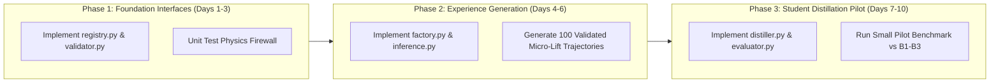

# HOROS Model Teaching Infrastructure
# Implementation Plan & Engineering Interfaces

**Date:** November 13, 2026  
**Status:** Implementation Blueprint — Design & Code Contract Specifications  
**Author:** Antigravity AI Assistant & HOROS Engineering Team  
**Scope:** Concrete Interfaces and Data Contracts for Modules 01–06  
**Core Rule:** External teacher models provide auxiliary teaching signals, not physical ground truth. Physics validation is mandatory.

---

## 1. Executive Summary

This document specifies the concrete Python software interfaces, data contracts, failure modes, provenance tracking, and verification harnesses for the **HOROS Model Teaching Infrastructure**.

The system is organized into six decoupled modules located under `src/teaching/`:
- `src/teaching/registry.py` (01 — Teacher Model Registry)
- `src/teaching/inference.py` (02 — Teacher Inference Engine)
- `src/teaching/factory.py` (03 — Synthetic Experience Factory)
- `src/teaching/validator.py` (04 — Physics Validation Engine)
- `src/teaching/distiller.py` (05 — Distillation & Training Engine)
- `src/teaching/evaluator.py` (06 — Evaluation Engine)

---

## 2. Module 01: Teacher Model Registry (`src/teaching/registry.py`)

### 2.1 Interface Contract
```python
from dataclasses import dataclass
from typing import Dict, List, Optional
from enum import Enum


class TeacherProvider(str, Enum):
    LOCAL_CHECKPOINT = "local_checkpoint"
    EXTERNAL_REST_API = "external_rest_api"
    SYNTHETIC_HEURISTIC = "synthetic_heuristic"


@dataclass(frozen=True)
class TeacherModelDescriptor:
    model_id: str
    display_name: str
    version: str
    provider: TeacherProvider
    supported_modalities: List[str]
    capabilities: List[str]
    license: str
    endpoint_url: Optional[str] = None
    local_weights_path: Optional[str] = None
    rate_limit_rpm: int = 60
    deterministic_seed_supported: bool = True


class TeacherModelRegistry:
    def register(self, descriptor: TeacherModelDescriptor) -> None: ...
    def get(self, model_id: str) -> TeacherModelDescriptor: ...
    def list_available(self, capability: Optional[str] = None) -> List[TeacherModelDescriptor]: ...
    def export_manifest(self, filepath: str) -> None: ...
```

### 2.2 Provenance & Versioning Contract
Every registered model must produce an immutable SHA-256 fingerprint of its descriptor and model checkpoint/weights. API teachers track client version, API endpoint URL, and model identifier tag.

---

## 3. Module 02: Teacher Inference Engine (`src/teaching/inference.py`)

### 3.1 Interface Contract
```python
from dataclasses import dataclass
import numpy as np
from typing import Any, Dict, List, Optional


@dataclass
class TeacherQueryPayload:
    task_id: str
    query_type: str  # "trajectory_proposal", "subgoal", "affordance"
    current_state: np.ndarray
    observation_history: np.ndarray
    text_instruction: str
    target_horizon: int
    seed: int


@dataclass
class TeacherInferenceResult:
    model_id: str
    candidate_actions: np.ndarray  # Shape: (H, action_dim)
    predicted_confidence: float
    latent_embeddings: Optional[np.ndarray]  # Shape: (d_embed,)
    provenance_hash: str
    latency_ms: float
    cached: bool


class TeacherInferenceEngine:
    def __init__(self, registry: TeacherModelRegistry, cache_dir: str): ...
    def query(self, model_id: str, payload: TeacherQueryPayload) -> TeacherInferenceResult: ...
    def query_batch(self, model_id: str, payloads: List[TeacherQueryPayload]) -> List[TeacherInferenceResult]: ...
```

### 3.2 Failure Handling & Caching Strategy
- **Failure Modes:** API timeout, rate limiting (HTTP 429), malformed tensor shapes.
- **Handling Strategy:** Exponential backoff with jitter (3 retries). If the external teacher fails, the engine falls back to an internal heuristic teacher (`PassiveNominalTeacher`) and logs a warning.
- **Deterministic Caching:** Key = `sha256(model_id + str(payload.seed) + payload.current_state.tobytes())`. Cached responses are stored as compressed `.npz` files in `cache_dir`.

---

## 4. Module 03: Synthetic Experience Factory (`src/teaching/factory.py`)

### 4.1 Interface Contract
```python
@dataclass
class EnvironmentSamplingSpec:
    friction_range: tuple[float, float] = (0.08, 1.20)
    mass_range_kg: tuple[float, float] = (0.10, 2.50)
    clearance_range_mm: tuple[float, float] = (0.10, 4.00)
    noise_force_sigma_n: float = 0.02
    enable_regime_shifts: bool = True


@dataclass
class SyntheticEpisodeRecord:
    episode_id: str
    seed: int
    task: str
    states: np.ndarray         # Shape: (T, state_dim)
    actions: np.ndarray        # Shape: (T, action_dim)
    wrenches: np.ndarray       # Shape: (T, 6)
    modes: np.ndarray          # Shape: (T,)
    env_metadata: Dict[str, Any]


class SyntheticExperienceFactory:
    def __init__(self, inference_engine: TeacherInferenceEngine, spec: EnvironmentSamplingSpec): ...
    def generate_episode(self, task: str, teacher_id: str, seed: int) -> SyntheticEpisodeRecord: ...
    def generate_batch(self, task: str, teacher_id: str, seeds: List[int]) -> List[SyntheticEpisodeRecord]: ...
```

---

## 5. Module 04: Physics Validation Engine (`src/teaching/validator.py`)

**The Grounded Firewall:** No external teacher trajectory enters the student training set without passing physics validation.

### 5.1 Validation Checks
```python
from enum import Enum


class ValidationVerdict(str, Enum):
    PHYSICALLY_VALID = "PHYSICALLY_VALID"
    REJECTED_KINEMATIC_LIMIT = "REJECTED_KINEMATIC_LIMIT"
    REJECTED_FRICTION_CONE = "REJECTED_FRICTION_CONE"
    REJECTED_PENETRATION = "REJECTED_PENETRATION"
    REJECTED_FORCE_OVERFLOW = "REJECTED_FORCE_OVERFLOW"


@dataclass
class ValidationReport:
    verdict: ValidationVerdict
    max_normal_force_n: float
    max_friction_ratio: float
    max_penetration_mm: float
    failure_step: Optional[int]
    violation_details: str


class PhysicsValidationEngine:
    def __init__(self, max_force_n: float = 20.0, max_penetration_mm: float = 0.5): ...
    def validate_trajectory(self, episode: SyntheticEpisodeRecord) -> ValidationReport: ...
    def filter_and_label_batch(self, episodes: List[SyntheticEpisodeRecord]) -> tuple[List[SyntheticEpisodeRecord], List[ValidationReport]]: ...
```

### 5.2 Physics Firewall Invariants
1. **Coulomb Friction Cone:** $\|F_{\text{tangential}, t}\| \le \mu_{\text{sim}} F_{\text{normal}, t} + 0.1\text{ N}$.
2. **Maximum Crush Force:** $\max_t \|F_t\| \le 20.0\text{ N}$.
3. **Rigid Body Penetration:** Penetration depth $\le 0.5\text{ mm}$.
4. **Kinematic Continuity:** Maximum joint step acceleration bounded by actuator limits.

---

## 6. Module 05: Distillation & Training Engine (`src/teaching/distiller.py`)

### 6.1 Interface Contract
```python
@dataclass
class TrainingHyperparameters:
    learning_rate: float = 3e-4
    batch_size: int = 32
    sequence_length: int = 30  # 10 history + 20 future rollout
    d_model: int = 256
    num_layers: int = 6
    num_heads: int = 8
    loss_weights: Dict[str, float] = None  # sim: 1.0, mode: 0.5, sysid: 0.25, distill: 0.1


class StudentDistillationEngine:
    def __init__(self, hparams: TrainingHyperparameters): ...
    def prepare_dataloader(self, validated_episodes: List[SyntheticEpisodeRecord]): ...
    def train_epoch(self, dataloader) -> Dict[str, float]: ...
    def save_checkpoint(self, path: str, metadata: Dict[str, Any]) -> str: ...
```

---

## 7. Module 06: Evaluation Engine (`src/teaching/evaluator.py`)

### 7.1 Interface Contract
```python
@dataclass
class BenchmarkResults:
    student_id: str
    multi_horizon_mse: Dict[int, float]  # horizons: [1, 3, 5, 10, 20]
    baseline_b3_mse: Dict[int, float]
    mse_reduction_pct: Dict[int, float]
    friction_id_r2: float
    mass_id_r2_active: float
    ood_lowmu_auroc: float
    conformal_coverage_per_mode: Dict[str, float]
    all_gates_passed: bool


class StudentEvaluationEngine:
    def __init__(self, frozen_baselines_dir: str): ...
    def evaluate_against_baselines(self, student_checkpoint_path: str, test_dataset_path: str) -> BenchmarkResults: ...
    def export_report_md(self, results: BenchmarkResults, output_path: str) -> None: ...
```

---

## 8. Staged Implementation Roadmap



### Immediate Next Step
Awaiting user authorization to create the `src/teaching/` module package and begin implementing the Teacher Model Registry and Physics Validation Engine.
